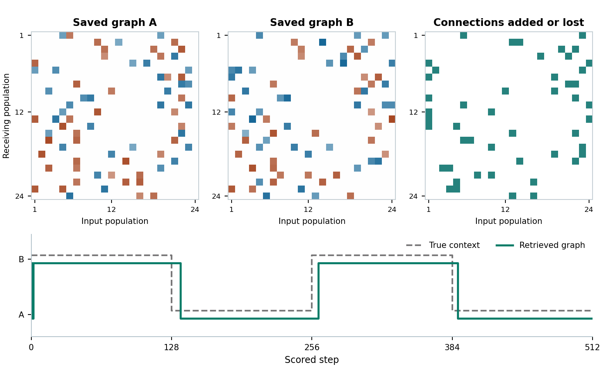

# NeuroSciFi
## A developmental AI built around an individual artificial connectome

**Model definition.** NeuroSciFi is a brain-inspired, multimodal AI architecture in which one individual artificial connectome develops over a lifetime. Its recurrent circuits link sensation, prediction, memory and action. An executive chooses what to do next. A metacognitive process uses the outcome to decide what should change: an interpretation, a skill, a sensor calibration or the wiring itself. Exact digital records let the learner revisit the experience behind a belief. Quantization and sparse execution make the cost of that development measurable on a single device.

**What persists.** Each instance has a founding graph, a private sequence of experiences and a history of changes to its circuitry. Two instances can begin with the same wiring and develop different skills. Restarting an instance restores its learned state, its pending uncertainties and the permissions attached to its memories.

| Foundation | Consequence for the model |
|---|---|
| Individual human brains | Study repeated measurements of individuals across time. Keep anatomical evidence, correlations and causal interventions distinguishable. |
| Efficient multimodal computation | Represent populations and typed connections at several resolutions. Let the runtime activate small parts of the graph and retain precision where learning requires it. |
| Continuous, recursive learning | Use actions to test predictions. Update working beliefs quickly. Promote changes to skills or connectivity only after testing delayed transfer and earlier abilities. |
| Hybrid cognitive memory | Preserve selected encounters as exact records. Derive revisable semantic and procedural representations with links back to their evidence. |

**The design question.** A person says “left” as a camera is remounted. Can the same learner discover which mapping changed, preserve the person’s intended meaning, and still operate the original setup tomorrow? This single task requires the four foundations to work together.

**Inside this 34-page brief.** Reanalyses of human brain and behavioral data, controlled learning and compression simulations, a repeated CPU benchmark, a first implementation plan for the DGX Spark, and a mobile-first runtime for private sensing, on-device prediction and linked phone/tablet recall.

**Status.** The companion kit runs a persistent learner, graph selection and packing, verified lossless archives, sensory and structural-learning experiments, device probes, and a working smartphone web interface with a paired sensory bridge. The full architecture and physical Spark transition below are specifications. The design begins with its own model state, code, process, storage and interfaces.

<!-- page -->

# The founding state and the scale budget
## Translate biological organization into a computational budget

**What “infant-like” means here.** At initialization an instance can register and align inputs, orient, wait, act, record an outcome and request a demonstration. Object identity across occlusion, the meaning of a partner’s word, and skill transfer are acquired capabilities. Track prior exposure of each encoder, every teacher intervention, repeat views and replay updates. Synchronization with a person means sharing episodes and corrections on a common timeline. Neural phase synchronization with the partner is a separate, untested hypothesis.

**Biological anchors.** Azevedo et al. estimated an average 86.1 billion neurons in their adult male human-brain sample. The proposed 100–150 trillion synapses are a scale scenario, with considerable biological uncertainty. A neuron has internal dynamics and a synapse has state, timing and plasticity. An activation and a scalar parameter capture only selected aspects of each. [16]

| Literal engineering thought experiment | Bytes before overhead |
|---|---|
| 86 billion instantaneous node values | 86 GB at INT8 or 172 GB at FP16. A recurrent learner needs additional persistent state. |
| 100–150 trillion scalar weights | 50–75 TB packed at four bits, 100–150 TB at eight bits, or 200–300 TB at FP16. Indices, activations and update history add to these figures. |
| First prototype | Start with populations, branches and bounded candidate edges. At the microbenchmark scale the model can consider 24 inputs per population, then retain three in an inference snapshot. Increase population capacity only after transfer and latency measurements. |

**Where to spend spare capacity.** Over-provision candidate connections during a learning phase. Track how each candidate changes prediction error in distinct contexts. Rank, prune, then quantize a separate inference snapshot. Validate under rare cues, reversal and loss of a sensory channel. Keep recoverable plastic state when the individual still needs to learn. A fixed parameter-to-synapse conversion would conceal these costs.

<!-- page -->

# What individual brains contribute
## Scales of evidence and their consequences

**Structure at microscopic scale.** Shapson-Coe and colleagues reconstructed an approximately cubic-millimeter human cortical fragment containing roughly 57,000 cells and 150 million synapses. They found rare, strong multisynaptic inputs amid many weaker connections. This motivates heterogeneous connection strengths and a budget for rare pathways. One tissue sample cannot supply a complete brain topology. [1]

**Function at individual scale.** Gordon and colleagues collected five hours of resting-state fMRI and six hours of task fMRI per participant across ten adults. Individual network boundaries and topologies became visible with repeated measurements. In a different longitudinal study of 104 infants with 806 scans, individual connectivity patterns could be recognized across months. Use longitudinal evaluation of one evolving model alongside comparisons across many independently raised instances. Resting-state correlation alone cannot establish direction of influence. [2, 3]

**At birth.** A 2026 analysis of 419 infants reported functional organization shared across newborns alongside individual variation. Specify an inherited scaffold for orienting, action, sensor clocks and error correction. Record the initial abilities, any externally trained encoders, and any demonstrations. Development begins with structured biases. [4]

**At the level of behavior.** Gweon and Schulz studied 16-month-olds adapting after a toy failed. In one comparison, 9 of 14 first tried changing the agent in one condition, versus 3 of 14 in the other. My two-sided Fisher check gives p = 0.054. In a second experiment, pooling two similar within-agent conditions for this reanalysis, the comparison was 13/19 versus 11/36, p = 0.010. A small study motivates a testable ability to distinguish a failure of self from a failure of the object. Its effect size is an uncertain benchmark. [5]

**Multisensory development.** Rohe and Noppeney found evidence for common-source inference in an adult audiovisual task. Gori and colleagues found that in young children, one sense could dominate a visual–haptic judgment, depending on the property judged. Preserve separate channels early. Allow selective fusion once the learner has evidence about their common cause and calibration. [6, 7]

<!-- page -->

# What the human data changed
## Reanalyses of receptor maps, connectivity and reaching behavior

**Regional chemistry.** Using Hansen et al.’s normative PET atlas, fit components on six functional networks and predict regions in the seventh. Across 100 regions and 19 receptor or transporter channels, four components explained 80.3% of in-sample variance, 69.7% when compressing all channels in the held-out region, and 51.4% when a channel there had to be predicted. Seven components reached 59.2% on the masked task. A regional sensitivity prior is worth testing. These data do not identify time-varying transmitter release or a fixed number of digital modulators. [17]

**Connectivity.** On the same group-level 100-region structural and functional matrices, putting the two hemispheres on opposite sides cut 21.4% of structural connection weight but 49.0% of positive functional weight. The median volume of software messages cannot be inferred from either number. Use anatomical topology to propose a partition, then measure actual traffic under perception, recall and replay. [17]

**Feedback timing.** We analyzed two Avraham et al. reaching experiments with 64 participants each. In 82,971 valid held-participant forecasts, adding the current cue to movement history and prior feedback reduced short-delay mean squared error by 0.115% and increased long-delay error by 0.037%. The short-minus-long acquisition contrast was +0.17 degrees, with a 95% interval from −0.37 to +0.71. The design therefore keeps several credit windows and learns which predicts well in each task. [18]

**Individual versus group evidence.** Repeated measurements within one person inform longitudinal validation. The normative atlas supplies a spatial prior, while the reaching analysis tests prediction across held-out participants. These are distinct claims. The research directory records data origins, source hashes, folds, analysis scripts and numerical outputs. The human-data analyses were rerun from hash-verified inputs for this edition.

<!-- page -->

# The executable connectome
## Three maps and one source of truth for changes

**Structural graph.** Nodes represent recurrent populations, object representations, sensor and motor maps, and memory interfaces. A directed edge specifies source and destination, branch, sign, weight, delay, precision class and version. This is the graph that the runtime actually executes. Measurement-derived human motifs guide its initial organization. Synthetic and biological nodes operate at different scales.

**Functional map.** Log when populations coactivate, in what context, and with what lag. Use this map to propose routes, detect redundancy and estimate communication cost. A common stimulus can make disconnected populations coactivate.

**Effective influence.** Perturb or silence a candidate route in a forked model, repeat the same episodes, and measure the change in a prediction or action. Store the task, context, effect estimate and uncertainty. A silencing result describes that operating point. It does not establish a universal purpose for an edge.

| Layer | State and exchange |
|---|---|
| Sensory and motor | Vision, audio, touch or control feedback retain timestamps, uncertainty and calibration identifiers. A copy of each action enters the predictor before its measured consequence. |
| Perceptual and predictive | Competing object and event representations predict short-term sensory changes under candidate actions. Recurrent message passing can integrate cues or keep two sources separate. |
| Executive | Maintains a goal and interruption budget. Chooses among act, observe, ask, test a reference and defer. Hard deadlines can reuse a validated immediate policy. |
| Metacognitive | Estimates whether the uncertainty comes from sensing, a person’s convention, the external world, or an inadequate hypothesis set. Assigns learning to the affected scope. |
| Memory and regulation | Episodic evidence can reinstate prior state. Semantic and skill memories guide predictions. Regulation tracks activity, backlog, write volume and resource pressure independently of task reward. |

**Central nervous system roles.** A fast sensorimotor loop predicts the consequence of each movement. A competitive action gate chooses a response or briefly delays it when alternatives conflict. A slower planning loop compares futures. Coupling among these loops is measurable: interrupt the planner and check whether an already learned movement can still be corrected. These are functional assignments in the proposed software.

**One event.** A person presses a control and describes the motion. The model stores actor and action, sensory values and provenance. It predicts the next observation under competing explanations. A disagreement may warrant rotating a known marker, trying the opposite button or asking what the speaker meant. Only evidence relevant to that distinction should change the corresponding circuit.

<!-- page -->

# How the model changes itself
## Inference, plasticity and growth have different clocks

**Inference.** Estimate joint beliefs over body mapping, world dynamics, sensory alignment and partner-specific conventions. A compact factor graph is tractable for small factors. For richer tasks, use a bounded set of object and context hypotheses with a reserved unknown alternative. Log discarded probability or approximation error. A low-loss forecast can still leave the cause unidentifiable.

**Functional plasticity.** For a candidate connection, keep a decaying trace of recent branch activity and apply a bounded update when an outcome supplies a relevant teaching signal. Test distinct branch rules alongside uniform updates on an identical graph. The UCSD study found compartment-dependent rules in mouse motor cortex. Human tissue work directly supports nonlinear dendritic computation. An eligibility-trace algorithm such as e-prop is a computational comparator. [8–10]

**Modulation.** Use separately observable estimates of sensory reliability, reward or task error, and inferred environmental change. Each local circuit learns a bounded sensitivity to those signals. Repeated errors with high-quality evidence can raise plasticity. Poor sensing can lower its influence. In a human pharmacology study, model-based measures linked neuromodulatory manipulations with components of uncertainty and response selection. This supports comparing several modulators while leaving their digital meanings empirical. [11]

**Structural plasticity.** Maintain a fixed active-edge budget and a rotating pool of candidate routes. Accumulate residual correlations, propose a swap, and test it in a fork. Preserve an older graph when it still solves a prior context. Candidate search, index bytes and probing consume compute even with few live edges. Compare fixed, growing and dense alternatives under stated budgets.

**Recursive improvement.** The learner can propose a new routing rule, context partition or replay policy, train it on approved experience, and compare it with its current version. Hold out independent episodes and past rare skills. Keep the incumbent when a change merely improves recall of the proposal’s training episodes. Version the scoring rules separately so a learner cannot earn promotion by changing its own exam.

**Developmental milestones.** Track learned sensory alignment, self-caused motion, object permanence, jointly grounded vocabulary, first skill transfer, and correction after reversal. Report interactions and compute per capability. Human age is an observational reference for task choice, never a score derived from a single benchmark.

<!-- page -->

# From coincidence to a durable skill
## A proposed learning cycle operating on several timescales

**Local association.** A rate-based branch can reinforce activity covariance between two populations. A spike-based branch can maintain separate pre- and postsynaptic traces and compare their timing. A pre-before-post event and a post-before-pre event may receive different signs and magnitudes according to branch type and task. Bi and Poo provide an experimental example in cultured neurons. The UCSD mouse findings motivate testing compartment specificity. Neither establishes a universal update curve. [8, 19]

**Credit and stability.** As an initial implementation, decay a branch eligibility trace over elapsed event time, accumulate its local coincidence, then multiply by feedback error and a circuit-specific learning gain. Bound the update, regulate target activity, and keep a slower reference weight. Compare ordinary gradient updates, tied Hebbian rules, branch-specific covariance and STDP under equal active compute. Tune only on development environments. Include a continuously plastic control to reveal runaway adaptation.

| Timescale | Proposed state and trigger |
|---|---|
| Sensor and action event | Update working state, efference copy and next-observation predictions. Compare actual consequences with several candidate actions and sources. |
| Outcomes over an episode | Separate expected noise, novelty, persistent change and task value. Distinct regional sensitivities adjust gain, exploration and learning rate. |
| Quiet intervals | A fast hippocampal-like index reinstates specific episodes. A slower cortex-like predictor interleaves new evidence with older skills to learn shared structure. Generated rollouts and observed evidence have distinct provenance. |
| Across developmental stages | Compare versions on delayed transfer, rare skills and ability to learn the next task. Add or prune connections, archive validated older states and revert harmful changes. |

**Complementary learning systems.** CLS provides the computational rationale for learning an episode quickly and extracting regularities more slowly. A sleep-like pass should deliver improvement on later tasks under a declared replay budget. Test real-episode replay, generative replay, mixed replay and rest without updates. Score recalled evidence separately from independent execution of a skill. [12, 13, 20]

<!-- page -->

# Does evolving connectivity help?
## A new test of the artificial connectome itself

**Experiment.** In 96 generated worlds, 24 observed populations interacted through three directed inputs per population. After 1,536 steps, one of the three inputs to every population was rewired. Each algorithm received another 1,536 steps. We compared dense regression, a fixed random sparse graph, and a sparse learner allowed to exchange links. All saw the same states, noisy targets and independent external excitations. New 512-step trajectories tested prediction. Results below are means across worlds.

| Prediction or structural measure | Before change | After change |
|---|---|---|
| Dense 24 × 24 predictor, MSE | 0.00486 | 0.00485 |
| Fixed sparse graph, MSE | 0.01645 | 0.01638 |
| Evolving sparse graph, MSE | 0.00430 | 0.00429 |
| Evolving graph, INT8 readout, MSE | 0.00430 | 0.00429 |
| Scrambled incoming sources, MSE | 0.03052 | 0.03069 |
| Active edges matching the generator | 100.0% | 100.0% |

**What changed.** After the switch, the learner replaced one third of its active edges. It recovered all 72 true ordered links in each of these deliberately identifiable worlds. The learned graph finds recurring influences that a fixed sparse graph misses. The dense control tests the value of explicitly representing sparsity. The eight-bit result rounds consolidated weights for inference. All learning and candidate scoring in this experiment used higher precision.

**Memory consequence.** Evaluate the old world after the switch, once with the latest connections and once with the epoch-one graph. The latest graph scored 0.01346 MSE on the old world. Restoring the saved first graph scored 0.00430. When the original graph still works, a context-specific checkpoint is an inexpensive way to preserve that skill in this experiment. The deployed learner would also need to recognize the context and select the right version.

**What this test grants the learner.** The state is observable, the true dynamics are linear, edges are sparse, and independent excitation makes the source directions informative. The growing learner probes every pair in this small benchmark. The 72 active weights need 72 bytes at INT8, plus indices, scales and graph state; its dense proposal matrix remains a separate cost. Efficient sparse candidate discovery, hidden-state identification, online quantized training and transfer from real perception remain open tests.

<!-- page -->

# Packing a learned connectome
## Over-provision, prune, quantize and independently test the result

**Implemented.** Starting with a learned 24 × 24 dense FP32 matrix, rank incoming weights by absolute magnitude per receiver. Compare 2, 3, 4, 6 or 12 entries per row at four or eight bits, with an exact dense fallback. On a separate 256-step validation trajectory, allow at most 2% excess mean squared error relative to dense FP32. Of the acceptable candidates choose the smallest complete file. Retest on a fresh 512-step trajectory.

| Measured across 64 new synthetic worlds | Result |
|---|---|
| Source | 2,304 raw FP32 weight bytes. Each true population had three informative inputs. |
| Selected snapshot | All 64 selected three weights per row at four bits. Complete size 247 bytes, or 9.33× smaller than the source weights. |
| Byte audit | 11-byte header, 96 bytes of row scales, 72 bytes of source indices, 36 bytes of signed packed weights and 32 bytes of checksum. |
| Held-out predictions | Dense FP32 MSE 0.004865. Selected graph MSE 0.004326. Zero of 64 held-out tests exceeded the validation tolerance. |

**What explains the gain.** Sparsity, pruning and quantization reduce footprint together. Removing weak fitted edges can improve prediction in these intentionally sparse worlds. There is no evidence here for a 9.33× improvement on dense language models or a general adult connectome. Snapshot decoding materializes a dense matrix in the reference runtime. This measurement concerns stored bytes; sparse-kernel memory and execution latency need their own test.

**A quantitative limit on online quantization.** In a separate scalar tracking test at learning rate 0.005, RMSE was 0.0025 for FP32, 0.0027 for FP16, 0.3937 for nearest-rounded INT8, and 0.0037 for INT8 with a higher-precision residual. INT8 plus FP16 residual costs three nominal bytes per weight before alignment, versus two for FP16. Compress stable connections first. Measure whether weak new associations can still form.

<!-- page -->

# Recovering the right circuit
## Hybrid memory as an executable collection of earlier skills

**From storage to behavior.** On 64 additional world pairs the learner saved a four-bit, three-input graph from each of two learned contexts. It then encountered four 128-step segments alternating between them. The selector saw observations and measured outcomes. Its prediction on every step was committed before the outcome arrived. A rolling 12-outcome window ranked candidate graphs by prior prediction error. Context labels were reserved for scoring and the oracle comparison.

| Policy on 32,768 scored steps | Mean squared error |
|---|---|
| Always use the latest saved graph | 0.008909 |
| Choose from past prediction errors | 0.004660 |
| Oracle supplied the true context | 0.004331 |

**Result.** The history-based selector chose the matching graph on 95.8% of steps, including boundaries. Holding two packed snapshots cost 494 bytes for graph files plus transient scoring state. The useful effect is the recovery of an earlier skill from recent evidence, at a cost in storage, scoring and adaptation lag.

**Remaining limitation.** Both contexts already existed in the archive. The test supplies clean population observations and exposes the outcomes needed to score alternatives. A real person can change the task, the camera can move, or the world can enter a genuinely new context. The deployed executive needs an unknown-context option, a cost-aware probe and a decision to create a new graph. Test unseen contexts, when retrieved skills are unhelpful, before allowing autonomous graph creation.

**Unified memory interface.** Retrieve candidates by exact key and time, association or embedding, or graph version and context. Return source scope, confidence, outcome history, permissions and state version with each candidate. A retrieved skill competes on what it predicts now. A belief can be superseded while its evidence remains auditable. A request to delete an episode must apply to snapshots and archives that derive from it, with rebuilding where needed.

<!-- page -->

# What a recovered skill looks like
## Two four-bit graph files and the behavior they preserve

**Reading the matrices.** Each cell links an input population to a receiver. Blue indicates a positive learned weight, rust indicates a negative weight, and white indicates no retained connection. Teal marks support changes between graphs. These are computed weights in one artificial world pair from the recall experiment, seed 840091.

**Reading the timeline.** The environment changes every 128 steps. The learner sees one outcome at a time and chooses the next graph from previous prediction errors. The lag after a switch is the price of evidence. The two lines are vertically offset for legibility. This example illustrates the mechanism; the preceding page gives the aggregate across 64 pairs.

<!-- page -->

# An accurate forecast can hide a wrong belief
## Why a developmental learner needs independent reference signals

**Construction.** The world has three hidden binary mappings: how a command moves a mechanism, how a camera encodes that movement, and how a speaker labels it. After removing the known command, the camera observes world XOR sensor and speech observes world XOR vocabulary. Simultaneously reversing all three hidden mappings leaves both reports unchanged. With a uniform prior two distinct explanations remain equally likely, however long the observer watches. A keyed mechanical reference can distinguish them.

| 8,192 balanced synthetic worlds | Accuracy identifying all three mappings |
|---|---|
| Twelve camera and speech pairs, 10% reading noise | 50.0%. New noisy camera and speech reports were predicted at 90.2% and 89.1%. |
| One independently noisy keyed reading | 90.2% |
| Three readings from a healthy reference | 97.0% |
| Five readings from a standard secretly inverted in 15% of worlds | 83.8% accuracy despite 99.1% mean confidence under a wrongly trusted standard. |

**Copies versus evidence.** In a second simulation of 16,384 worlds, three measuring instruments shared one faulty upstream calibration. Treating nine readings as independent yielded wrong answers above 95% confidence in 15.0% of all worlds. Grouping inputs by their known root reduced this to zero by withholding high confidence. Accuracy remained 84.7%. With three genuinely independent calibrations the root-aware model reached 92.2% accuracy and exceeded 95% confidence in 57.7% of worlds.

**Implementation.** An event carries a sample ID, sensor or speaker identity, upstream calibration root and epoch. Deduplicate copies. Allow multiple readings to reduce random noise. Group readings sharing a permanent fault when combining evidence. Unknown dependence calls for an explicit uncertainty range or another measurement. The simulated root-aware estimator was given the fault rate and group identities.

**When to spend an interaction.** Across 2,048 simulated lifetimes of 192 steps, checking a reference periodically achieved 89.4% state accuracy. Checking when uncertain achieved 90.8% with the same 24 checks. The paired improvement was 1.43 percentage points, with an approximate 95% interval of 1.23–1.64 points. Access to an independent reference mattered much more than elaborate timing.

<!-- page -->

# Grounding perception and detecting lost meaning
## A test with rendered pixels and sound waveforms

**Sensory entry point.** Generate 24 × 24 RGB frames and 256-sample PCM tones. The model receives those arrays. Hand-designed spatial tiles and spectral bands feed two-class prototypes learned from 16 labeled pairs. Another 192 nominal pairs calibrate them. Eight audiovisual events and three noisy reference readings precede each state estimate. These are rendered patterns and tones with keyed meanings. They do not exercise speech understanding.

**A failed design.** Rotating the camera by 90 degrees and transposing both tones made one wrong tone resemble a familiar category. In an initial run of 1,024 shifted lifetimes, accepting each channel only when it looked familiar cut exact-state accuracy from 20.2% to 1.3%. This is selective retention of misleading observations. Familiarity can be dangerous evidence for a wrong interpretation.

**Revised design.** At an announced equipment change, capture four known pairs to refit the two prototypes and 16 separate pairs to check them. To vote, a channel must decode at least 13 of 16 correctly and at least six of eight for each class. A failed channel contributes equal evidence to both alternatives. Test in 24 fresh calibration rooms per condition and 128 lifetimes per room.

| Condition | Frozen decoder | Refit only | Refit and validate |
|---|---|---|---|
| Normal equipment | 96.7% | 96.7% | 96.7% |
| Rotated picture and shifted pitches | 12.0% | 96.7% | 96.7% |
| Both audio symbols emitted as the same tone | 48.0% | 49.3% | 48.5% |

**Reading the equal scores.** Ordinary supervised refitting accounts for the recovery under rotation and pitch shift. Validation earns its place when the two sounds become indistinguishable: mean confidence fell from 82.9% for unchecked refitting to 48.5%. The multiclass Brier score improved from 0.844 to 0.526, where smaller is better. Silence about the missing meaning is a correct outcome. This test was supplied an equipment-change notification; discovering the onset during ordinary use remains a product requirement.

<!-- page -->

# Memory that an individual can live with
## A stable history must allow changing interpretations

| Store | Write and retrieval rules |
|---|---|
| Working memory | The active scene, bodily state, current goal, unconfirmed explanations and pending actions. Decay or evict by event time and task relevance. |
| Episodic record | A selected, consent-scoped sample, its acquisition and arrival times, actor and action, raw or bounded reference, and all upstream identities. Source evidence is versioned. |
| Semantic memory | Object relations, world dynamics and conventions scoped by environment and partner. Each belief carries uncertainty, supporting events, counterevidence and revision history. |
| Procedural memory | Policies with conditions of applicability, previous failures, tested interventions and a dependency on the graph and sensor versions used. |
| Digital archive | Exact values, time-indexed search, alternate graph snapshots, permission and deletion records. Retrieval can reconstruct an episode that compressed weights alone cannot recall. |

**Consolidation.** Rehearse disconfirming cases, old rare skills, new observations and a uniform control sample. Generated experience is labeled as simulated. Test the candidate immediately and after intervening tasks, including with episodic lookup disabled. Human replay studies motivate testing the mechanism. More recent motor work shows that immediate gains after brief rest can reflect transient performance changes. Use delayed tests and a replay-free baseline. [12, 13]

**Learning with a person.** A user can demonstrate, correct an instruction, refuse a recording, or change a preference. “I prefer the dial reversed” changes a personal setting. “The shaft turns clockwise” is externally testable. A different speaker can use a different convention. Record the scope of a statement before allowing it to change a shared skill. Preserve the distinction between who said something and what the learner independently verified.

**Forgetting and recovery.** Give raw capture a short default lifetime, with explicit promotion of selected episodes. When evidence is removed, revoke access, invalidate dependent indices and beliefs, and retrain dependent adapters from an eligible snapshot where necessary. Measure recall after rebuilding. Record a failed rollback and its cause if a permitted reconstruction is impossible. Hardware throttling and storage pressure can pause new writes while leaving approved prior skills usable.

<!-- page -->

# What TufaZip contributes
## A source-level decision for archival compression

**Published system.** TufaZip v2 uses a quantized offline prior, expands its learned layers into a larger Transformer, and updates the predictor as bytes are encoded and decoded. A deterministic arithmetic coder turns the same evolving probability estimates into an exact bitstream. The authors report 100,958,324 payload bytes plus a 4,430,029-byte decoder ZIP for one billion enwik9 bytes: 105,388,353 bytes total, about 9.49×. The decoder ZIP already includes weights and vocabulary. [21, 22]

**Cost and reproducibility.** Reported encoding took approximately 631,548 seconds, excluding offline training. Decoding took 645,748 seconds, about 7.5 days. The published launcher checks for x86-64, exactly two visible B200 GPUs and pinned runtime versions. Spark uses an Arm CPU and a GB10. Treating these predictions as interchangeable risks unrecoverable archives because both ends must generate identical integer probabilities. The published full-system benchmark was not reproduced in this project. [15, 21]

**Implemented subset.** NeuroSciFi includes the pinned upstream arithmetic coder and license notices. Its new CPU predictor keeps byte counts conditioned on the previous high nibble, resets at each block and updates only after a symbol is emitted or recovered. A reversible 16-bit delta and byte-plane transform is another candidate. These files use NeuroSciFi’s versioned format. They do not decode the upstream enwik9 bitstream.

**Operational decision.** Fast backups choose raw or Zstandard. In an idle period, the cold policy also tries XZ and delta plus Zstandard. An explicit experimental policy tests both arithmetic variants. All policies count persisted framing and select per block. The online learner cannot modify a historical decoder. A future neural codec would need immutable weights, vocabulary and numerical rules, cross-device restore tests, measured resource costs and enough additional savings to justify retaining its decoder for the lifetime of the archive.

<!-- page -->

# Lossless archive bake-off
## Measured complete-file ratios on six NeuroSciFi workloads

| Source | Fast policy | Cold policy | With arithmetic trials |
|---|---|---|---|
| Actual model results, JSON | 6.27× | 6.43× | 6.43× |
| Actual CPU timing observations, CSV | 5.25× | 5.85× | 5.85× |
| SQLite backup with 1,600 generated learning events | 6.84× | 9.98× | 9.98× |
| Generated sparse INT8 graphs in dense byte layout | 4.42× | 4.69× | 5.93× |
| Generated smooth 16-bit signal | 3.63× | 4.66× | 5.01× |
| Seeded uniform bytes | 0.998× | 0.998× | 0.998× |

**What was counted.** Six fixtures, 439,481 original bytes in total. Each of ten profiles was tested three times in shuffled order, for 180 exact byte-for-byte round trips. Ratios include archive headers, per-block checksums and the stream footer. Installed library and decoder code is excluded from these per-file ratios; TufaZip’s ranked number includes its decoder ZIP. File mix, sizes, synthetic signal and shared-host timings restrict generalization. The smooth signal represents low-entropy integer samples and says little about typical speech recordings.

**Decision by workload.** The experimental policy produced 120,810 bytes versus 123,023 cold, a 1.80% aggregate saving. On dense-layout INT8 graph bytes, it recovered 27,648 bytes from 4,666 and took about 116 ms to restore, versus 0.25 ms for the conventional cold archive. On the smooth signal the experimental restore took about 305 ms versus 0.63 ms. It added no savings on the SQLite checkpoint. On the uniform input, a 65,536-byte file grew to 65,647 bytes because integrity metadata still has a cost.

**Correctness.** The checkpoint command takes a consistent SQLite backup with the writer open. Each 64 KiB block is independently decoded and verified; the footer checks the complete original byte sequence. A failed restore never publishes a partial file, and output publication refuses to overwrite an existing path. Integrity hashes detect corruption. Deployment still requires access control, encryption as appropriate, and a deletion policy for retained backups.

<!-- page -->

# Operating as the primary system on the Spark
## Proposed ownership, resource budgets and reversible commissioning

**CPU.** Own ordered event intake, timestamps, partner and consent scope, small exact beliefs, action arbitration, and the append log. **GPU.** Own batches of visual and audio encoding, learned recurrent populations, world-model rollouts, and interruptible consolidation. **NVMe.** Hold the evidence journal, snapshots and versioned learning records. A single writer owns each mutable graph revision. Other workers read a pinned version and return proposals.

**Precision.** Start with FP32 references for numerical comparison. Test INT8 consolidated edges with per-block scales, FP16/BF16 transient activations and higher-precision plastic accumulators. Quantize signed delays and structural metadata separately. Report indices, scales, residuals and alignment along with weight bytes. An eight-bit weight plus a 16-bit destination already consumes at least three bytes before indexing overhead. Treat weak-signal acquisition and rare-skill retention as quantization tests. [14]

**Budget in bytes.** An uncompressed 640 × 480 RGB stream at 30 Hz generates 27.65 MB/s. Two seconds consume about 55.30 MB before audio, queue and encoder state. A minute approaches 1.66 GB. Retain short buffers near acquisition and store selected evidence asynchronously. Sixty-four 12-step rollout trajectories with 256 FP16 values per state require 384 KiB for the state values alone. Compare migration and waiting time with the work saved before moving these jobs.

**Measure.** The packaged probe checks numerical parity and records CPU or CUDA latency for the same 12-step recurrent workload. The supplied CPU results are from x86. GPU mode requires a compatible CuPy installation. On the physical Spark, test single versus batched work concurrently with capture and replay. Record p50/p95/p99 sensor-to-action latency, dropped inputs, synchronization time, memory high-water mark and wall joules per retained skill. NVIDIA documents unified memory and a 273 GB/s interface for the 128 GB configuration. Shared memory still permits bandwidth contention. [15]

**Commissioning.** Use a fresh service identity, environment, state directory and explicit device permissions. Rehearse against synthetic input before taking exclusive ownership of the camera, microphone or action interface. Preserve a restorable snapshot of the current device, stop conflicting services during switchover, and verify startup, loss of input, restart and power recovery under the new owner. Keep a reversible boot or service selection. This design assumes a functioning host OS and driver stack. Physical deployment requires access to the actual device.

<!-- page -->

# Repeated CPU measurements
## When sparse wiring should change how the device executes

**Protocol.** A single pinned x86 logical CPU updated an array of 8,388,608 records, 16 bytes per record (128 MiB). The study used five seeds and 13 timed trials per update kernel per seed. Each run includes correctness checks against the same starting records. The table shows medians across seed medians for the original run and a fresh build from the packaged source. Units are milliseconds. These are kernel timings on shared hosts.

| Workload and update strategy | Original | Repeat |
|---|---|---|
| 1% active, direct shuffled input | 0.55 | 0.69 |
| 1% active, rebuild bitmap and update | 0.89 | 0.99 |
| 25% active, direct shuffled input | 31.67 | 30.81 |
| 25% active, rebuild bitmap and update | 9.84 | 8.51 |
| 25% active, supplied preordered input | 7.60 | 7.02 |
| 100% active, dense sequential update | 7.71 | 7.36 |

**Interpretation.** At low density it was cheaper to visit the available events directly than to prepare a bitmap. At 25% density rebuilding the bitmap saved time in both runs. Fully dense activity favored the sequential kernel. Preordered events look fast when supplied, but ordering required about 130 ms at 25% in the repeated run; reuse would have to amortize that cost. Preserve order and multiplicity for spike-timing updates.

**Commission the mesh.** Profile input capture to acknowledged action on the Arm CPU, then measure GPU-resident encoders and rollout batches under load. Introduce consolidation and lossless archiving as independently interruptible jobs. Benchmark hot, battery or thermal-limited, and backlog conditions where applicable. Record p99 delay, dropped events, peak resident bytes, energy per successful task and time to restore the last usable skill. Add another device first for independent replay or evaluation jobs, with one writer for each mutable graph revision.

<!-- page -->

# What the first release must demonstrate
## Objective tests for a developing individual

| Milestone | Evidence to collect |
|---|---|
| Birth | Publish priors, supplied action semantics, encoder provenance, initial graph and memory inventory. Measure baseline abilities with zero personal episodes. |
| Grounding | Capture an actual visual feature, sound and direct action feedback. Deliberately alter one instrument. The model identifies the affected scope or asks for calibration. |
| Lifelong correction | Introduce a second partner who uses the opposite word mapping. Restore the first partner’s environment a day later. Score both meanings and the actions taken, with and without exact lookup. |
| Graph development | Fork two identical instances into different experience streams. Cross-test both, permute learned edges, lesion suspected routes, and compare held-out task loss against fixed, dense and equal-cost recurrent alternatives. |
| Growth and retention | Permit a graph revision only if its benefit transfers beyond the training episodes, previous rare skills remain within tolerance, and the resource increase fits a locked budget. Measure the capacity to learn the next skill as well. |
| Device ownership | Demonstrate a full capture-to-action loop, reversible switchover and restart with intact beliefs and evidence. Measure under simultaneous inference and consolidation. |

**Proposed decision rules.** Predeclare the task, matched teacher time, interaction allowance and memory budget. Target fewer confidently wrong updates on shifted sensors, near-parity on normal sensors and an independently measurable old-skill retention benefit. As initial engineering thresholds, use a 50% relative reduction in wrong answers above 95% confidence, at most two points of nominal task loss, and at least 80% coverage on normal inputs. Always report coverage and Brier score so silence cannot manufacture a pass. Set a device-specific latency budget from the capture and actuation deadlines.

**Runnable now.** The kit includes a local, persistent binary learner, raw-sensory calibration, graph learning, validation-selected packing, history-based graph recall, verified checkpoint archives, and CPU and optional GPU timing probes. They exercise components independently. Production neural encoders, lifelong autonomous graph revision, general language, open-world reasoning and physical Spark commissioning are pending integration milestones.

**Success in daily use.** A person changes a familiar control panel. The learner notices, tests the mechanism, and asks about a word only if the evidence still leaves two meanings plausible. On the earlier panel it recalls and executes the earlier skill. The person can inspect which experience led to the change and which uncertainty remains.

<!-- page -->

# Pocket, the mobile interface
## Carry one developing NeuroSciFi instance through an ordinary day

The Spark holds the individual connectome. The phone acts as a sensory organ, a way to ask a question, and a place to correct the learner. Keeping one individual across sessions avoids teaching a separate phone model a different personal history. A working bridge is included with this edition.

**A morning walk.** Tap Walk and mark it as a self-report. Sampling the microphone gives a second observation, perhaps “sound · moderate.” The owner can keep the walk and discard the sound. If a friend joins, Pocket can still measure a sound band without transcribing either person. Later, “What did you use to learn that?” should return the approved receipts and their origin. Two observations made together do not establish that the walk caused the sound.

| Surface | What the person can do |
|---|---|
| Home and lock screen | Proposed shortcuts open Ask, Mark an activity, or a visible capture session. Opening Ask uses text by default. Hide personal answers on a locked screen. |
| Capture | The prototype displays which sensor is active, the latest candidate and a Stop control. Native sessions add a lock-screen stop, expiry time and accessible visual, spoken or haptic cues. |
| Review and memory | Inspect the exact outgoing value. Share once, allow learning, discard, or forget. The prototype shows retained observations, their learning status and the resulting estimate. |
| Dialogue | Proposed replies can combine permissioned memories with the world model. Use a headset or text for private replies. Treat owner corrections as evidence with lineage. |

**Availability.** The native target is quick access to NeuroSciFi throughout the day. Network loss leaves capture and review on the phone. An encrypted, explicitly enabled queue of sanitized events can wait for the Spark. A future offline answer must show the age of the locally approved memory snapshot. The current web runtime can cache its program offline. Unapproved sensor drafts clear on hide. The optional encrypted field vault preserves reviewed episodes and unfinished forecasts.

<!-- page -->

# Choose how much the phone senses
## Persistent availability, with a visible and revocable capture grant

| Mode | Sensor behavior and retention |
|---|---|
| Available | Default. Sensors off. Open the interface, mark an activity or consult available memories. A shortcut can open an interaction. |
| Check once | Invoke a sound or light check. Only one coarse value awaits review. A separate choice determines whether the Spark stores it and whether it counts toward learning. |
| Listen for a while | Working web mode lasts up to five minutes in the foreground. By default only the latest level awaits review. An optional switch sends one sound band per minute for learning. The switch clears at stop. |
| Everyday companion | Proposed native opt-in. Choose a duration, a sensor, allowed outputs, local-only or paired sync, and learning on or off. A renewable session can span a work block with the screen locked. Use coarse observations by default. |
| Private moment | Prototype Stop releases tracks. Discard clears the local draft. The native target adds a single action to clear pending material, stop hardware, block queued uploads and suppress reminders until manually resumed. |

**Permission belongs to a purpose.** An owner can permit coarse sound at their desk, decline speech everywhere, and allow a deliberate photo only after preview. A changed purpose, input route or capture mode requires a fresh decision. In a meeting, classroom or shared home, use self-report or coarse mode. A person nearby can request an immediate pause. Owner permission alone cannot establish another person's agreement.

**An evening review should be short.** Show the observations that changed a forecast, anything waiting for approval, and the last time a sensor was active. Offer “forget this,” “forget this session” and “stop learning this pattern.” The prototype has per-item and per-pairing erasure. Native session and pattern controls require dependency tracking before release.

<!-- page -->

# Listen well without keeping the room
## Separate signal quality from permission to retain speech

**Available now.** The browser requests one microphone channel, asks the OS to disable automatic gain, echo cancellation and noise suppression for level sampling, and reads short PCM windows in memory. Device processing may override a request. It retains one relative level. A nearby conversation might change the level but yields no words, speaker embedding or waveform in an outgoing observation. Coarse levels can still reveal routines.

**Spoken activity, implemented with a compatibility gate.** In private, invoke on-device US English recognition and say one complete label, such as “walk.” “Walk with Jane” is discarded. A valid label still needs review. If local recognition or its installed language pack is unavailable, use tap controls. The controller does not identify the speaker. [M8]

**Proposed owner voice notes.** Start with push-to-talk and a close microphone. Request optional owner enrollment in a quiet setting. Keep its template in device-protected local storage and provide reset and erase. Without enrollment use self-report or typed input. Do not weaken attribution thresholds to salvage a difficult recording. The recognition and redaction path must work locally in the selected language.

| Native processing stage | Quality and privacy behavior |
|---|---|
| Capture and monitor | Use route-native PCM, a bounded volatile buffer, monotonic sample times and explicit route-change events. For voice recognition, resample a copy to the model's input rate. Check clipping, wind, speech audibility and dropped frames. |
| Establish attribution | Evaluate speech activity, overlap, enrolled-owner verification and replay/TV cases. Target-speaker separation may improve recognition. If another voice overlaps, the score is uncertain, or a gate is unavailable, discard the interval before transcription. |
| Sanitize the owner's speech | Local transcription runs on accepted owner-only intervals. Names spoken by the owner, quoted dialogue, addresses, phone numbers and unique descriptions can identify others. Replace identifying spans, then offer a neutral summary for review. Suppress the whole candidate when context remains identifying. |
| End the session | Drop audio buffers and temporary features. Exclude media and templates from crash reports, backups and telemetry. Require fresh approval to resume after a call, route change or interruption. Record a gap in coverage. |

VoiceFilter-Lite demonstrated target-speaker separation for streaming recognition on device. Its task measures recognition quality. Its results do not establish bystander anonymity, permission or owner verification for Pocket. Free-form speech stays outside the bridge contract. [M4]

<!-- page -->

# Images, motion and missing evidence
## Use the least identifying representation that answers the question

**Light check, implemented.** A user opens the camera once. The phone reduces a frame to one pixel, computes approximate luminance and releases the track. Only dim, midrange or bright can become a receipt. This approach preserves a useful signal when an image would expose faces, badges, messages, addresses or screens. Exposure compensation and phone placement make it a relative measurement.

**Object or scene note, proposed.** The user frames an object and crops to the area of interest. Local detectors cover people, faces, visible text, badges, plates and reflections. Replace detected regions with opaque pixels, re-encode a fresh image, remove metadata, discard the source, and show a preview. Prefer an allowlisted object category whenever it answers the question. Suppress uncertain frames or identifying backgrounds. A missed face or an unusual uniform can identify someone even after a successful text mask. Only reviewed categories are eligible to cross the bridge. [M5]

**Movement and place, proposed.** Start with a user-selected activity. Later, test on-device motion classes such as stationary or walking and a manual “at my desk” label. Coarsen time locally and leave precise location off. User-declared private periods are sufficient for the first release. Optional private zones should suppress capture locally and expose neither coordinates nor visit history to the Spark.

**Evidence lineage.** The OS timestamp, modality, calibration version and common capture root belong in the proposed local evidence record. Send only the minimum required fields under the current grant. Two recognition outputs from one clip share a root. A dropped or masked interval is missing data. Do not train from “no speech,” “owner absent” or zero brightness when the sensor was simply unavailable.

**Example.** A coffee shop receipt on a desk contains an address and a person's name. A useful personal observation could be “marked a work session” or “light · bright.” Neither requires the paper, the person's identity, or the venue.

<!-- page -->

# The phone-to-Spark bridge
## Enforce the boundary where rich sensory input first exists

| Component | First implementation and evolution |
|---|---|
| Phone | The runnable web UI samples sensors, shows the outgoing observation, and offers a learning checkbox. Program assets are self-hosted. Only explicitly reviewed categories enter the field episode. |
| Transport | Use a private LAN or VPN and a trusted HTTPS endpoint on the Spark. Enter a five-minute, one-use invitation. Each pairing has a separate revocable credential held in tab memory by default. Default binding is loopback. LAN binding requires TLS. |
| Receiver | For legacy sensor receipts, permit exactly four fields: random event ID, channel, categorical value and learning flag. Enforce channel vocabularies, a request size limit, authentication and per-pairing storage isolation. Conflict on a changed retry. Expired or forgotten stored IDs cannot be resurrected by retry. |
| Learning | The reference estimator predicts the next approved value within each channel using retained counts plus one prior count per category. Recompute after deletion. The existing binary calibration task has different semantics and receives no synthetic conversion from these events. |
| Storage | Shared records expire after 24 hours. At runtime the bridge sweeps every minute and before authenticated reads or writes. Startup also sweeps stale records. Random ID tombstones survive until unpairing. Use an encrypted volume and exclude the DB from backups. |

**Example payload.** After an approved light check, the only observation fields are a new event UUID, channel “light,” value “dim” and learn “false.” The receiver can store it for review, but it adds zero weight to its forecast. Turning learning on for a new observation changes the forecast; removing that event reverses its contribution. The service sees network metadata. An authorized receiver or compromised handset remains inside the trust boundary.

**Native evolution.** Provision a per-device key pair and bind a scoped grant to the Spark identity during QR pairing. Use system-backed key storage, encrypted bounded queues, short expiries and idempotent delivery. Before flushing an offline queue, recheck purpose, grants and deletion state. Give revocation and delete messages priority over data replay. Do not promote personally derived replay, embeddings, model updates or compressed backups until erasure and rebuild can be demonstrated for every descendant. [M6]

<!-- page -->

# Native sessions and device budgets
## An iPhone-first implementation with equivalent Android controls

**iPhone.** Use SwiftUI for the interface, AVAudioSession and AVAudioEngine for active audio, and AVFoundation for user-invoked still capture. Request microphone and camera permission separately when invoked. A user-started audio session can continue during screen lock with the appropriate audio background mode. Observe interruptions and route changes. After suspension, termination or restart, return to sensors-off. Recording needs explicit consent and a clear indication. Test background eligibility and App Review on the actual application. [M1, M2]

**Android.** Use Compose, AudioRecord and CameraX. Start a user-requested microphone foreground service from a visible activity. Declare its microphone service type and permissions, show a persistent notification with Stop, and react to permission loss. Android restricts service startup from the background. Choose explicit reactivation after reboot or interruption. Camera remains a foreground, deliberate action on both platforms. [M3]

**Hybrid compute.** Keep raw samples, any speaker template, initial attribution and redaction on the phone. Schedule speech or vision inference only after a deliberate trigger. The Spark CPU validates events, tracks evidence and handles recalls. The GPU can batch eligible representation updates or replay while the interactive queue is quiet. Decouple ingestion from training so incoming events do not contend with replies. If local redaction or inference is unavailable, fall back to coarse categories or typed interaction; a cloud fallback would alter the privacy boundary.

**Pacing and high-quality capture.** Compare built-in, wired and Bluetooth routes using consented samples. Measure dropped windows, effective sample rate, clipping, wind and end-to-preview latency. A noisy microphone can report low confidence and suggest a closer mic. Low battery or thermal pressure should reduce sampling or end the session, never bypass masking. Start with a small protected buffer, for example two seconds, then profile actual memory and power. The web version shows browser-level control, while native adapters must validate OS interruption and route behavior on handsets.

**Always available in practice.** Product release depends on access time, visible state, predictable failure and recovery as well as recording duration. A stopped sensor must remain stopped after the application returns. Personal replies and lock-screen previews should be independently configurable.

<!-- page -->

# Mobile validation and release criteria
## What is demonstrated, and what richer capture must earn

**Executed.** The project test suite passed with 20 tests, including a real hostname-verified loopback TLS exchange and one-use pairing. Synthetic sensor-controller checks exercised sound, light, late permissions, stop, timeout, a hidden page, input mute, local-only capture, opt-in automatic sharing, an unavailable voice language pack, and rejection of an utterance containing a name. Sensor and field writes use separate allowlists. A browser integration check is included; Chromium launch was blocked on the build host. These tests provide no handset latency, battery or measured bystander masking rate. [M7]

| Release decision | Proposed acceptance test |
|---|---|
| Ship native coarse capture | Run at least one current iPhone and two Android handsets across built-in and headset routes. Verify lock, interruption, network loss, permission revoke, sleep, thermal load and reboot. Inspect outgoing traffic and disk for raw media. Require zero post-stop capture restarts. |
| Enable enhanced voice or visual notes | Use consented owner, stranger, simultaneous speech, TV, reflections, badges, screens and distinctive surroundings. Count bystander content accepted per opportunity, owner false rejects, missed identifiers, and reviewer corrections. Score by setting, language and route. Retain only test fixtures that participants authorized. |
| Judge leakage | Predefine an independent challenge set. A candidate pilot target is zero identity-bearing releases in 3,000 independent opportunities per modality, roughly a 0.1% one-sided 95% upper bound. Correlated clips from one speaker or room weaken that inference. Report clustered uncertainty and worst strata. Any observed identity disclosure blocks expansion until investigated. |
| Judge usefulness and cost | Compare owner-note word error and task success against deliberate push-to-talk. Measure p50/p95 time to preview and Stop, foreground/background battery percentage points per hour above idle, thermal throttling and missing windows. Report actual hardware and thresholds before enabling all-day sessions. |

**Mobile source notes.** [M1] Apple, AVAudioSession recording and screen lock. https://developer.apple.com/documentation/avfaudio/avaudiosession/category-swift.struct/record

[M2] Apple, App Review Guidelines, 2.5.14. https://developer.apple.com/app-store/review/guidelines/

[M3] Android Developers, foreground service types and while-in-use microphone permissions. https://developer.android.com/develop/background-work/services/fgs/service-types

[M4] Wang et al., VoiceFilter-Lite, Interspeech 2020. https://research.google/pubs/voicefilter-lite-streaming-targeted-voice-separation-for-on-device-speech-recognition/

[M5] Apple Vision, recognizing text in images. https://developer.apple.com/documentation/vision/recognizing-text-in-images

[M6] Android Developers, Android Keystore system. https://developer.android.com/privacy-and-security/keystore

[M7] MDN, permission and secure contexts for browser capture. https://developer.mozilla.org/en-US/docs/Web/API/MediaDevices/getUserMedia

[M8] MDN, on-device speech recognition and language-pack capability checks. https://developer.mozilla.org/en-US/docs/Web/API/SpeechRecognition/available_static

<!-- page -->

# Pocket as the everyday computer
## A phone can close the learning loop while the Spark is asleep

**A work session in Raleigh.** Before reading a paper on a tablet, the owner chooses Reading. Pocket checks acoustic variation and accepts a reviewed metric from the phone showing several recent app changes. It asks what is likely to happen next. If three or four similar episodes disagree, it can say that it has insufficient evidence. The owner switches to the paper. When they return, they unlock Pocket and mark Continued, Switched tasks or Paused. Only the owner supplies the outcome.

**What runs where.** The mobile runtime performs perception, feature reduction, episodic recall, prediction, uncertainty gating and feedback locally. An optional encrypted vault preserves the pending forecast across an app switch. The Spark keeps approved shared evidence and handles heavier experiments. A tablet can consult the same field episodes when authorized and has space to compare evidence beside the capture controls. Each device can continue its private local history while disconnected.

| Biological design commitment | Engineering consequence in Pocket |
|---|---|
| Individual development | Two users can start with the same empty estimator. Each has a different private trajectory. A new user receives a prior and an explicit abstention. |
| Prediction before feedback | Freeze the features and estimate before asking what happened. Reopening an unfinished episode restores that estimate. |
| Complementary memory | The fast store retains episodes with their source. Selected records last seven days locally. Future consolidation on Spark must demonstrate transfer and respect erasure before it can alter a long-lived skill. |
| Metacognitive control | When few comparable records exist, show uncertainty and the available evidence. The person controls whether to spend another sensor measurement or supply a correction. |

**One device can be enough.** Bring the web shell online once over a trusted connection. After successful caching, cold reopening and local recall are designed to work without the Spark. Storage eviction can require an online reopen. The prototype does not depend on an on-device language model to produce or explain its forecast. [P1]

<!-- page -->

# What the phone can actually observe
## Keep device behavior, context and the owner's intention distinct

| Observation | What the collector measures |
|---|---|
| Listening | A short microphone sample yields a relative level. A separate eight-second survey compares the 90th and 10th percentile of sampled log power. It releases steady, variable or wide. Interruptions and sample shortages end the survey. The result cannot identify speech, intent or mood. |
| On-screen activity | A user-started timer measures continuous visibility of Pocket. Hiding the page clears the timer. An owner-selected screenshot is reduced locally to 32 × 32 pixels and then to one band of horizontal color variation. Images, text and app identity stay outside the episode schema. |
| Android app use | With Usage Access granted, a one-hour event query counts changes between consecutively resumed packages. Optionally name one app locally and total observed, closed foreground intervals for it. Its identifier stays on the handset. [P2] |
| Android screen use | Count interactive screen activations and sum complete interactive-to-noninteractive intervals. Time bands are under five, five to under twenty, or at least twenty observed minutes. Intervals crossing the query boundary can be lost. [P3] |
| iPhone and iPad use | Shortcuts can run an App Intent when an owner-selected app opens. Record a band of marks from the last hour. The user chooses the participating apps. Store the source as Shortcut. It measures selected openings, so comparison with Android transitions is disabled. [P4] |
| System conditions | Native source adapters can report power-saving mode and a thermal band. The browser can operate with both absent. A constrained device can still accept a typed or tapped correction. |

**Interpretation limits.** Multi-window use, interrupted sessions and rapidly changing apps complicate attribution. A minute of screen interaction does not establish attention. A quiet microphone does not establish solitude. A changed focus app invalidates comparisons based on its earlier use. Renew the designated app deliberately or start a fresh field history. Native JSON receipts are user-supplied and editable. Their source tags describe a measurement method and do not authenticate hardware.

<!-- page -->

# A usable interface above the signals
## Quick capture on a phone, inspection on a tablet

**Phone.** Select a goal, add only the signals relevant to this session, and inspect all outgoing categories. Start a forecast before switching away. When the task ends, give one-tap feedback. “Why this estimate?” shows the three outcome probabilities and up to three contributing episodes available in the current view. A small amount of personal evidence can be inspected directly.

**Tablet.** At wide viewport sizes the field session and memory occupy one column, with sensing and Spark controls alongside. A linked tablet can retrieve shared episodes by explicit request. This lets the owner revisit a reading session or compare similar experiences without exposing the private phone vault. Both layouts also work without pairing.

**Offline and continuity.** The service worker precaches six named program assets and excludes API traffic. Session-only field memory clears when the page hides. Open a passphrase vault before starting to preserve a pending forecast or completed episodes. It uses AES-GCM with a new IV for each write and a passphrase-derived key. Web Locks serialize updates. Expired rows are excluded on read and removed when the vault is rewritten. A locked, inactive browser may still hold ciphertext. Losing the passphrase or clearing browser storage can lose the local history. [P1]

**Cross-device policy.** An existing pairing can issue a five-minute, one-use handoff code. The second device receives its own credential. Linked devices can view and forget shared field episodes. Legacy single-sensor receipts remain private to their originating pairing. Local vaults and Spark copies have separate deletion controls. The user may explicitly protect their pairing credential in the vault for up to 24 hours of resumability.

**Shared devices.** Default to sensors off and session-only memory. Lock on hide and make the owner unlock before showing personal history again. A borrowed tablet should use an isolated browser profile and should remain unlinked unless the owner intends it to have the ability to read and erase shared episodes. The selected screenshot and exported metric file still exist wherever the owner saved their originals.

<!-- page -->

# How a field episode becomes evidence
## Experience, prediction, observation and selective replay

**Acquisition.** Each feature has a value and source. The owner can choose a goal, include a recently reviewed sensor reading and import selected device metrics. Missing features remain absent. Episodes contain categorical values, an outcome, a learning choice and a random identifier. A goal is a self-report. App openings are behavioral evidence that may have several explanations.

**Associative retrieval.** The field predictor compares only features with the same method of collection. It requires at least one matching feature and agreement on at least two thirds of comparable features. Rank matches by agreement and coverage, then take at most twelve. One episode contributes at most one vote. Uniform prior counts protect against a confident answer from a single example. Multiple features from one device may still be correlated.

**Executive decision.** Report a proposed outcome only when total similarity support reaches three and its posterior estimate reaches 55%. Otherwise abstain, let the owner inspect the alternatives and invite feedback. The interface never launches or blocks another app as a consequence of its guess. Unlabelled episodes and memory-only records cannot become training examples.

**Repeated experiences.** The controls handle forgetting a local contribution and declining model use while keeping a memory. A Spark submission sends one reviewed episode with the original ID. Retries are idempotent. Forgetting the shared copy blocks replay of that ID within its linked group. A completed local field episode lasts 24 hours by default. The owner can grant seven days locally. The shared copy still expires 24 hours after receipt.

**Next consolidation experiment.** Cluster repeated goal–context–outcome relationships offline on the Spark. Compare an episodic-only baseline against the proposed distilled association on held-out days, different device routes and earlier skills. Promote a change only if its forecasters remain calibrated and deleting its support can rebuild or invalidate it. Sensitive personal routines should never become opaque, irreversible weight updates by default.

<!-- page -->

# What the field learner demonstrated
## A controlled test with missing sensors and different individual histories

Forty-eight simulated individuals experienced eighty episodes each. The generator linked sound and app activity to a latent context, with a person-specific mapping from context to outcome. Feedback sometimes contradicted that mapping. Eighteen percent of sound features and twenty-five percent of switch features were independently dropped in expectation. The simulator supplied the outcomes. It used no phone recordings or human behavioral measurements.

| Prequential measure | Result |
|---|---|
| Scored forecasts | 3,072, following sixteen warm-up episodes per individual. Every forecast preceded its own outcome. |
| Coverage at the abstention threshold | 2,727 answers, 88.8% of scored forecasts. |
| Accuracy on answered cases | 88.3% for the context learner. The rolling most-frequent outcome reached 34.6% on those same cases. |
| Mean log loss over all cases | 0.575 for the context learner and 1.126 for a smoothed context-free baseline. Lower is better. |

**Why the difference appeared.** The generator deliberately made the context predictive while the unconditional outcome could be nearly uniform. Two sensors often described the same latent state. This experiment checks chronology, use of available context and abstention on each person's stream. It gives no estimate of real-world focus prediction, energy savings or sensor accuracy.

**Verification.** The Python suite exercised TLS pairing, single-use handoffs, independent credentials, cross-device erasure, expiry, replay rejection and isolation. JavaScript checks covered sensor states, local speech rejection, a hidden page, vault encryption, the wrong passphrase, restoring an unfinished prediction and accepting later feedback. The eight earlier deterministic analyses also reproduced. Physical OS adapters, battery behavior, browser offline cold starts and accessibility on real devices require commissioning. The build host prevented a full Chromium launch.

<!-- page -->

# Commissioning the mobile-first system
## Advance the capabilities in the order the owner would use them

**First, an individual baseline.** Use one phone and one tablet for matched reading and work sessions. Test an offline day, switching apps before feedback, app restarts, quota eviction, microphone interruption, a dropped connection and companion-device revocation. Check that raw screen content, speech, app names and exact timestamps never appear in exported episodes. Compare time-to-capture, time-to-stop, energy overhead and the rate of missing outcomes against a tap-only diary.

**Then richer listening and screen assistance.** Start with an intentional question about one owner-selected screen or one push-to-talk remark. Run local text recognition, sensitive-content checks and owner attribution before proposing a sanitized answer. Keep screens with credentials, private messages, names, notifications or ambiguous ownership out of memory. Use a private headset or text reply. Android MediaProjection requires explicit user consent for each capture session; use OS stop controls and release the projection on callback. Treat iOS broadcast or share-extension capability as a separate user-initiated design. Neither continuous screen capture nor free-form bystander transcription is part of the current prototype. [P5]

**Platform-specific promotion.** For a US iPhone owner, ship selected-app Shortcuts and deliberate sharing first. Apple requires authorization and distribution entitlements for Screen Time capabilities. Its separate FamilyActivityData interface for identified app and website information has EU device and Apple Account requirements. Avoid a US product dependency on that interface. Where eligible, evaluate category reports on-device before considering any allowed export. [P6, P7]

**A field trial worth running.** Pre-register per-person metrics, permit silent weeks without prompts, and compare next-outcome log loss against each person's base rate. Randomly withhold the proposed extra signal in eligible sessions. Measure whether asking for an observation improves future forecasts enough to justify its battery cost and the interruption. Only later test optional suggestions, tracking acceptance, dismissals and corrections.

[P1] web.dev, storage and offline data. https://web.dev/learn/pwa/offline-data

[P2] Android Developers, UsageStatsManager. https://developer.android.com/reference/android/app/usage/UsageStatsManager

[P3] Android Developers, UsageEvents.Event. https://developer.android.com/reference/android/app/usage/UsageEvents.Event

[P4] Apple, Shortcuts app triggers on iPhone and iPad. https://support.apple.com/guide/shortcuts/setting-triggers-apde31e9638b/ios

[P5] Android Developers, media projection consent and lifecycle. https://developer.android.com/media/grow/media-projection

[P6] Apple, Family Controls distribution entitlement. https://developer.apple.com/documentation/familycontrols/requesting-the-family-controls-entitlement

[P7] Apple, FamilyActivityData region and authorization. https://developer.apple.com/documentation/familycontrols/familyactivitydata

<!-- page -->

# Source notes and reproducibility
## Direct studies, technical references and original measurements

[1] Shapson-Coe et al. (2024). A petavoxel fragment of human cerebral cortex reconstructed at nanoscale resolution. Science. https://doi.org/10.1126/science.adk4858

[2] Gordon et al. (2017). Precision functional mapping of individual human brains. Neuron. https://doi.org/10.1016/j.neuron.2017.07.011

[3] Existence of Functional Connectome Fingerprint during Infancy and Its Stability over Months. Journal of Neuroscience. https://pubmed.ncbi.nlm.nih.gov/34789554/

[4] Precision probabilistic mapping reveals personalized functional topography in the early postnatal human brain (2026). Nature Communications. https://doi.org/10.1038/s41467-026-79265-3

[5] Gweon and Schulz (2011). 16-month-olds rationally infer causes of failed actions. Science. https://doi.org/10.1126/science.1204493

[6] Rohe and Noppeney (2015). Cortical hierarchies perform Bayesian causal inference in multisensory perception. PLOS Biology. https://doi.org/10.1371/journal.pbio.1002073

[7] Gori et al. (2008). Young children do not integrate visual and haptic form information. Current Biology. https://pubmed.ncbi.nlm.nih.gov/18450446/

[8] Wright, Hedrick and Komiyama (2025). Distinct synaptic plasticity rules operate across dendritic compartments in vivo during learning. Science. https://doi.org/10.1126/science.ads4706

[9] Gidon et al. (2020). Dendritic action potentials and computation in human layer 2/3 cortical neurons. Science. https://pubmed.ncbi.nlm.nih.gov/31896716/

[10] Bellec et al. (2020). A solution to the learning dilemma for recurrent networks of spiking neurons. Nature Communications. https://doi.org/10.1038/s41467-020-17236-y

[11] Marshall et al. (2016). Pharmacological fingerprints of contextual uncertainty. PLOS Biology. https://doi.org/10.1371/journal.pbio.1002575

[12] Buch et al. (2021). Consolidation of human skill linked to waking hippocampo-neocortical replay. Cell Reports. https://pubmed.ncbi.nlm.nih.gov/34107255/

[13] Das et al. (2025). Micro-offline gains do not reflect offline learning during early motor skill acquisition in humans. PNAS. https://pubmed.ncbi.nlm.nih.gov/41150724/

[14] Gupta et al. (2015). Deep learning with limited numerical precision. ICML. https://proceedings.mlr.press/v37/gupta15.html

[15] NVIDIA. DGX Spark User Guide, Hardware Overview. https://docs.nvidia.com/dgx/dgx-spark/hardware.html

**Reproducing the numbers.** The kit contains the scripts, exact seeds and JSON summaries. The two infant comparisons use published aggregate counts. All other accuracy results are original simulations, with no private human data or pretrained models. The core uses NumPy. The archive requires Zstandard, and the optional human-data reproduction scripts also use SciPy. GPU profiling additionally requires compatible hardware and CuPy.

<!-- page -->

# Evidence and implementation references
## Biological scaling, learning, data and codec provenance

[16] Azevedo et al. (2009). Equal numbers of neuronal and nonneuronal cells make the human brain an isometrically scaled-up primate brain. Journal of Comparative Neurology. https://doi.org/10.1002/cne.21974

[17] Hansen et al. (2022). Mapping neurotransmitter systems to the structural and functional organization of the human neocortex. Nature Neuroscience. https://doi.org/10.1038/s41593-022-01186-3

[18] Avraham et al. (2022). Contextual effects in sensorimotor adaptation adhere to associative learning rules. eLife. https://doi.org/10.7554/eLife.75801

[19] Bi and Poo (1998). Synaptic modifications in cultured hippocampal neurons. Journal of Neuroscience. https://pubmed.ncbi.nlm.nih.gov/9852584/

[20] McClelland, McNaughton and O’Reilly (1995). Why there are complementary learning systems in the hippocampus and neocortex. Psychological Review. https://pubmed.ncbi.nlm.nih.gov/7624455/

[21] Tufa Labs. TufaZip v2 source and decoder requirements, pinned commit b9d678db3a0f726e117c8cab51927975830395ac. https://github.com/Tufalabs/tufazip/tree/b9d678db3a0f726e117c8cab51927975830395ac

[22] Tommy He (2026). Learning to Compress a Billion Bytes of Wikipedia. Author’s technical account of the offline prior, online updates and accounting. https://tufalabs.ai/research/tufazip/

**Reproduction map.** The prototype includes detailed methods and source manifests for the human studies, both CPU runs, compression inputs or generation recipes, model tests and file formats. The source used for upstream arithmetic coding is pinned by Git blob ID. The included source notices travel with the decoder. Measurements of byte counts, errors and latency are reported at the component and device levels actually tested.

**First physical acceptance test.** Teach one action and one word, switch one sensor mapping, and return to the earlier setup after a restart. Measure autonomous source attribution, intervention count, confidence, older-skill retention and retrieval with archive lookup disabled. Compare against fixed wiring, a conventional recurrent learner with replay, and direct episodic lookup. Log teacher and compute costs throughout.
