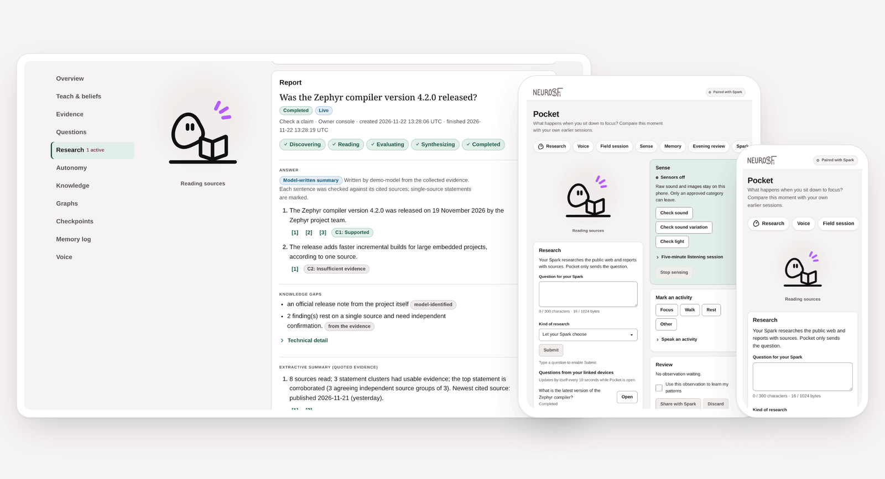
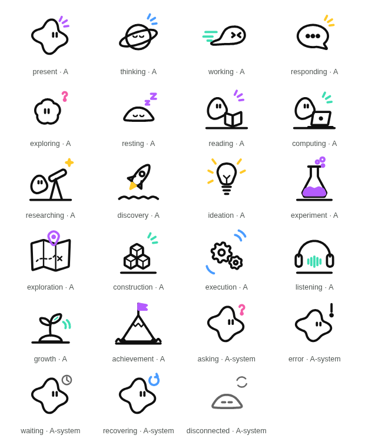
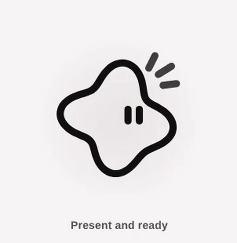
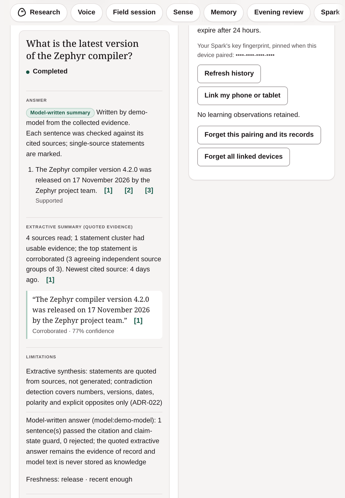
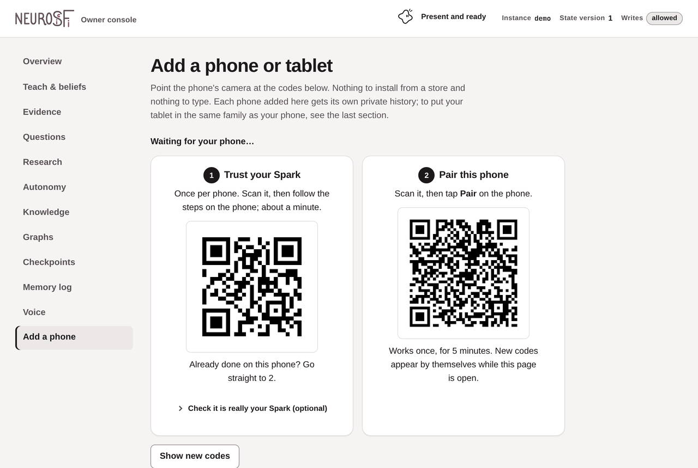
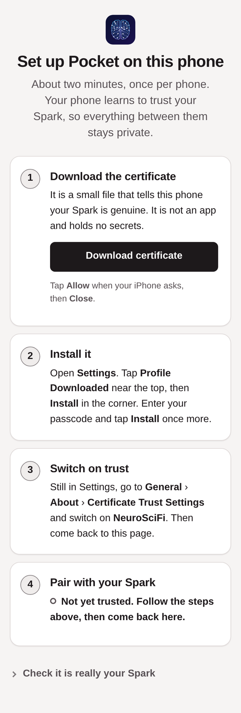
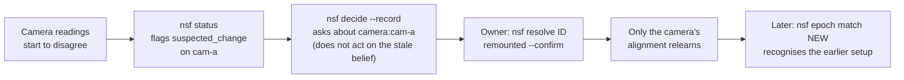

<div align="center">


<br>

[](https://github.com/MoRohn/neuroscifi/actions/workflows/ci.yml)

[](LICENSE)


**[Overview](#overview)** · **[See it](#see-it-in-action)** · **[Architecture](#architecture)** · **[Requirements](#requirements)** · **[Quick start](#quick-start)** · **[Optional services](#optional-services)** · **[Privacy & trust](#privacy-security-and-trust)** · **[Testing](#testing-and-verification)** · **[Docs](#documentation)** · **[Limitations](#known-limitations)**

</div>

<div align="center">
<picture>
  <source media="(prefers-color-scheme: dark)" srcset="docs/assets/screenshots/hero-dark.png">
  
</picture>
<br><sub>One individual, every device: the Presence entity shows what NeuroSciFi is really doing while it researches, answers and listens.</sub>
</div>

---

## Overview

NeuroSciFi is a local-first, evidence-grounded cognitive architecture built around **one developing artificial connectome**. One individual lives in one SQLite file, and it is the single cognitive authority across text, voice and paired devices: a typed question, a spoken question and a question from a phone take the same path. Predictions guide action, and feedback can change a belief, a skill or the wiring itself.

Web research enters memory only as dated, cited evidence that passes verification and the owner's review. A local language model may write the answer from that evidence, and a deterministic **guard** checks every sentence's citations, numbers and claim states before it is shown. The core needs no pretrained model, no GPU service and no cloud service; the optional search, model, memory and voice services run in Docker on the same host and listen on loopback only.

| Capability | What it does |
|---|---|
| 🧠 **One individual, one file** | Beliefs, evidence, epochs, graphs, knowledge, transcripts and checkpoints in one SQLite file. It decides whether to *act, observe, ask, test a reference or defer*, and says why. Expired learning events stay as compact readings, so beliefs outlive their raw events. |
| 🔁 **Scoped relearning** | Detects a silent sensor change, asks about that scope, and relearns only what changed. Questions to the owner follow a rolling weekly budget. |
| 🕸️ **Executable connectome** | Graphs are learned, evaluated and promoted through an immutable-rule gate, recalled per context and rolled back. A graph no better than no graph is never promoted. |
| 🌐 **Governed web research** | Off by default. Discovery through a self-hosted, digest-pinned SearXNG with an honest User-Agent, structured APIs (arXiv, OpenAlex, Crossref, PubMed, PyPI, npm, OSV, GitHub, Wikipedia) and, with a key, the Brave Search API. Pages are read four at a time, and a cancel, web-off or deny is honoured before every request. Web text never edits a belief, graph or weight. |
| ✅ **Claim verification** | 8 claim categories and 6 states (`supported`, `disputed`, `conflicting`, `insufficient`, `temporally_unresolved`, `not_evaluated`). Syndicated copies count once; a subject with two senses is read and listed, never mixed. |
| 🧩 **Evidence-bound answers** | A local model behind an OpenAI-compatible gateway writes from verified evidence only. The guard checks citations, claim states, numbers and units, coverage, exceptions and conditions, who did what, and hidden characters; it refuses what it cannot confirm. Without a model, a labelled extractive answer is shown. |
| 📈 **Knowledge evolution** | Versioned knowledge, hypotheses with testable predictions and calibration. A contradiction stated in other words is found and put to the owner, never decided. The owner accepts every knowledge item; model weights never change. |
| 🤖 **Controlled autonomy** | Opt-in with a recorded owner enable and its own daily budget. Research is chosen from stored records by expected information gain; how past forecasts fared only orders it. |
| 🎙️ **Voice Cortex** | Whisper and Kokoro behind a bridge in which NeuroSciFi stays authoritative. Three modes, barge-in, one capturing device at a time, and a **Voice check** for your own hardware. |
| ✳️ **Presence Cortex** | A minimal, abstract, physics-driven entity at the centre of every view. Its light, geometry and motion follow what the individual is really doing and its surroundings, never invented activity. |
| 📱 **Pocket** | A mobile-first web app over HTTPS with a private CA. Devices pair with one-use codes into families that share research; a question written while the Spark is out of reach waits on the device and is sent once when it is back; opt-in **push** sends an empty notification when research finishes. |
| 🔏 **Signed research nodes** | The owner enrols a paired device after comparing key fingerprints. Nodes sign their requests and can hand off research sessions; Pocket checks the Spark's signature on every reply. |
| ⚖️ **Resource scheduling** | One pressure level from memory and GPU data, audio first. Opt-in idle unloading of the model, speech, search and memory services; a reload is refused if it would not fit, and never holds a call past its timeout. |
| 🧾 **Governed forgetting** | `nsf forget` cascades through every derived record, in-memory indexes included, and a checkpoint restore replays every forget, so forgotten records do not come back. |
| 🔬 **Measured cognitive mechanisms** | Project Cognitive Genesis, Wave 1: an internal-state record, a self-description (`nsf self`) with each field's source and age, exact what-if and forecast commands on a private copy (`nsf imagine`), a monitoring record per research answer, knowledge premises and re-check marks. On by default only where they record or display; whatever would change research, answers or beliefs is off until the owner turns it on ([Wave 1](docs/genesis/WAVE1.md)). Waves 2 to 4 measured further mechanisms (Waves 3 and 4 also once on withheld worlds at the end); most mechanisms they built ship off, and telling independent sources from copies, or from the individual's own earlier answers, is still unsolved at the shipped defaults ([Genesis overview](docs/genesis/README.md), [Wave 4](docs/genesis/WAVE4.md)). |
| 🩺 **Health checks** | `nsf doctor` checks dependencies, file modes, WAL mode, schema, integrity, free space, disk encryption and swap. |

The **[34-page architecture brief](NeuroSciFi_Architecture.pdf)** (editable as [`Architecture.md`](Architecture.md)) covers reanalyses of human brain and behavioural data, controlled simulations, CPU benchmarks, the TufaZip evaluation, the DGX Spark plan and the mobile field runtime.

<div align="center">
<picture>
  <source media="(prefers-color-scheme: dark)" srcset="docs/presence/snapshots/gallery-tierA-dark.png">
  
</picture>
<br><sub>Presence Cortex compositions, captured from the production renderer by the end-to-end tests.</sub>
</div>

## See it in action

All screenshots come from the real console and Pocket on seeded scratch instances ([how they are made](docs/assets/screenshots/README.md)) and follow your light or dark setting.

<p align="center">
<picture>
  <source media="(prefers-color-scheme: dark)" srcset="docs/assets/screenshots/entity-alive-dark.webp">
  
</picture>
<br><sub><b>The entity, alive.</b> It follows your pointer, answers each keystroke, then morphs through the real stages of the question you asked.</sub>
</p>

<table>
<tr>
<td width="62%" valign="top">
<picture>
  <source media="(prefers-color-scheme: dark)" srcset="docs/assets/screenshots/console-research-dark.png">
  
</picture>
<br><b>Owner console · Research.</b> The model-written answer with citations, each claim's verification state, knowledge gaps and the quoted evidence.
</td>
<td width="38%" valign="top">
<picture>
  <source media="(prefers-color-scheme: dark)" srcset="docs/assets/screenshots/pocket-phone-dark.png">
  
</picture>
<br><b>Pocket on a phone.</b> The entity sits above the question, in thumb reach, while the Spark reads.
</td>
</tr>
<tr>
<td valign="top">
<picture>
  <source media="(prefers-color-scheme: dark)" srcset="docs/assets/screenshots/voice-dark.png">
  
</picture>
<br><b>Voice.</b> Speak or type; the same research path answers.
</td>
<td valign="top">
<picture>
  <source media="(prefers-color-scheme: dark)" srcset="docs/assets/screenshots/pocket-tablet-dark.png">
  
</picture>
<br><b>Pocket on a tablet.</b> A linked tablet continues the phone's research.
</td>
</tr>
</table>

The shared design system, the cross-device audit and a before/after gallery are in [docs/ui](docs/ui/DESIGN_SYSTEM.md).

## Architecture

<picture>
  <source media="(prefers-color-scheme: dark)" srcset="docs/assets/architecture/neuroscifi-architecture-dark.svg">
  
</picture>

One host, the DGX Spark, holds the individual and every service. The numbers follow the diagram's legend:

1. **A question from any client.** The console, the CLI, MCP, Pocket, voice and the autonomy loop reach one orchestrator, with one privacy screen, web switch and set of budgets.
2. **Screened queries leave the host.** Only privacy-screened queries and page fetches go out. No private data leaves.
3. **Verified evidence only.** Web Cortex runs intent, discovery, safe fetch, extraction, claims, verification, word sense and synthesis; only verified evidence reaches the inference gateway.
4. **The local model writes, the guard checks.** Model, speech, memory and search services listen on 127.0.0.1 only. The model runs after verification and cannot change a claim's state.
5. **A cited reply** goes to the console, voice or Pocket. A closed Pocket gets an empty push, then fetches the Spark-signed reply.
6. **Owner review, then knowledge.** Knowledge candidates and autonomous findings arrive as owner questions; nothing is promoted on its own.

Full design: [System architecture](docs/architecture/SYSTEM_ARCHITECTURE.md) and [Architectural decisions](docs/architecture/ARCHITECTURAL_DECISIONS.md).

## Requirements

The reference host is an **NVIDIA DGX Spark GB10** (aarch64, Blackwell sm_121, 121.9 GiB unified memory). The core and text research run on any Linux host with Python 3.12 and need no GPU.

| For | You need |
|---|---|
| The individual, console, Pocket and text research | Python 3.12, [`uv`](https://docs.astral.sh/uv/), extras `web` and `crypto` |
| Quality gate and the open-webSearch fallback | Node 22 and npm |
| News rendering and the browser tests | Chromium: `playwright install chromium`, or `NSF_CHROMIUM=/usr/bin/chromium` |
| SearXNG discovery | Rootful Docker and the digest-pinned SearXNG image |
| Local reasoning model | Docker with **NVIDIA CDI** (`--device nvidia.com/gpu=all`), the pinned vLLM image and the weights (31.2 GB on disk; about 44 GiB loaded on GB10) |
| Memory models | Docker with NVIDIA CDI and two 0.6B models (about 4.3 GiB loaded as one server) |
| Voice | Docker with NVIDIA CDI, images built from the pinned vLLM base, Whisper large-v3-turbo and Kokoro-82M (about 5 GiB); Pocket voice needs HTTPS |

<details>
<summary><b>Python extras</b></summary>

| Extra | Installs | For |
|---|---|---|
| `web` | Scrapling 0.5.1, markdownify 1.2.4, pypdf 7.1.1 | Web Cortex: HTML parsing, Markdown and PDF extraction |
| `web-extract` | trafilatura 2.3.1 | A second article-extraction engine |
| `web-render` | Playwright 1.64.1 | JavaScript rendering (needs a Chromium) |
| `crypto` | cryptography 50.0.2 | Pocket: the private CA, signed research replies, node keys, push |
| `research` | SciPy 1.17.0 | The human-data and statistical analyses |
| `dev` | pytest, ruff, Playwright | The test suite and browser end-to-end tests |
| `gpu` | CuPy 14.2.0 for CUDA 13 | `profile_device --device cuda` |

</details>

## Quick start

**At the end:** NeuroSciFi running on your Spark, your phone and tablet paired with it, and a question asked on one continuing on the other. About ten minutes. You need a Linux host with Python 3.12 and `uv`, and a phone on the same Wi-Fi or LAN.

### Step 1: Install

```sh
git clone https://github.com/MoRohn/neuroscifi.git && cd neuroscifi
uv venv .venv -p 3.12 && uv pip install -e '.[web,crypto]'   # add dev for the test suite
. .venv/bin/activate
```

### Step 2: Set up once (`nsf setup`)

```sh
nsf setup --db /secure/nsf/individual.sqlite
```

`--db` names the file that holds the individual; for real use, put it on an encrypted volume (`nsf doctor --db PATH` checks). Run it while the Spark is on the network your phone will use. Each step says `done`, `already done` or `skipped`, and the command is safe to run again:

```text
nsf setup: /secure/nsf/individual.sqlite
  1. individual  done          created /secure/nsf/individual.sqlite
  2. web         done          web access and Pocket research are on
  3. model       skipped       no model answered at http://127.0.0.1:8811/v1 (unavailable); answers stay extractive until `nsf llm config --url URL`
  4. pocket_tls  done          created the CA and issued a certificate for spark, spark.local, localhost, 192.168.1.20, 127.0.0.1 (valid until 2027-12-24)
  5. ca_export   done          CA for phones: ~/.config/neuroscifi/pocket/neuroscifi-ca.crt (Android) and …-ca.pem; SHA-256 3B:F4:D4:…:03:B2
  6. brave       skipped       key missing (optional: nsf setup --brave-key-stdin, or nsf web provider set-key brave --stdin)
  7. push        skipped       optional: nsf setup --push
  8. memory      skipped       memory is ranked by its words: the memory models are not installed here (optional: bash deploy/memory/run.sh start, then nsf setup again)

NeuroSciFi is set up. Next:
  1. Start it:     nsf start
  2. Add a phone:  in the console choose "Add a phone" (or run: nsf add-phone) and scan its two codes
```

<details>
<summary><b>What setup does, its options, and where files go</b></summary>

In order: creates the individual (never overwrites one); turns on web access and Pocket research; configures a local model or memory models that answer on this host; creates a private certificate authority (CA) and a server certificate for this host's name, `NAME.local`, `localhost`, `127.0.0.1` and every LAN address; exports the CA for phones; stores a [Brave key](#brave-search-api-key) and creates the push key only when you ask. It never changes a setting you made by hand, records its choices in `~/.config/neuroscifi/setup.json` (0600), and prints each service's exact command for running them separately.

| Option | Use it to |
|---|---|
| `--brave-key-stdin`, `--brave-key-file PATH`, `--brave-daily-cap N` | store a Brave key; set its daily cap (default 30; 0 turns Brave off) |
| `--push` | create the push (VAPID) key |
| `--no-model`, `--model-url URL` | skip the model step, or probe another loopback endpoint |
| `--name HOST`, `--ip ADDR` | put these names or addresses on the certificate (repeatable) |
| `--bind ADDR`, `--port N`, `--setup-port N` | the bridge's address (default: the first LAN address), port (8765) and phone setup page port (8764; 0 turns it off) |
| `--dry-run`, `--json` | show what would change; print the report as JSON |

| File | Where |
|---|---|
| The individual | `--db` |
| Pocket pairings, console URL (0600, removed when the console stops) | next to it: `NAME.pocket.sqlite`, `NAME.console.url` |
| CA key (0600, never read by a service) | `~/.config/neuroscifi/pocket-ca` |
| Server certificate, exported CA, push key | `~/.config/neuroscifi/pocket` |
| Brave key (0600) | `~/.config/neuroscifi/search/brave.key` |

The CA vouches only for the names and addresses it was created for. If the Spark gets a new LAN address, `nsf setup` keeps the CA and warns, with the command for a new one.

</details>

### Step 3: Start (`nsf start`)

```sh
nsf start
```

One terminal runs the research worker, the owner console and Pocket, and opens the console in your browser. Ctrl-C stops all of it; paired devices stay paired. The console listens on this computer only: from another machine, use `ssh -L 8766:127.0.0.1:8766 HOST` and open the link in `NAME.console.url`. To run as system services, see [Run as system services](#run-as-system-services).

### Step 4: Add your phone (scan two codes)

In the console, choose **Add a phone** (or run `nsf add-phone`). Then, on the phone:

<table>
<tr>
<td width="64%" valign="top">
<picture>
  <source media="(prefers-color-scheme: dark)" srcset="docs/assets/screenshots/setup-console-dark.png">
  
</picture>
<br><sub><b>Console · Add a phone.</b> Two codes; the page says by itself when the phone has paired.</sub>
</td>
<td width="36%" valign="top">
<picture>
  <source media="(prefers-color-scheme: dark)" srcset="docs/assets/screenshots/setup-phone-dark.png">
  
</picture>
<br><sub><b>Code 1 on an iPhone.</b> The steps for this phone; it notices by itself when trust is on.</sub>
</td>
</tr>
</table>

1. **Scan code 1** with the camera. A page opens with the steps for your phone (once per phone, about a minute):
   - **iPhone or iPad:** **Download certificate** → **Allow**. **Settings** → **Profile Downloaded** → **Install**. Then **Settings → General → About → Certificate Trust Settings** → switch on **NeuroSciFi**.
   - **Android:** **Download certificate**. **Settings**, search **CA certificate** → **Install a certificate → CA certificate → Install anyway** → pick `neuroscifi-ca.crt`.

   The page says **This phone trusts your Spark** when it works.
2. **Scan code 2.** Pocket opens with the pairing filled in. Tap **Pair**: the phone shows **Paired with Spark**, the console **Your phone is paired**.

Optional: add Pocket to the home screen to open it like an app (on an iPhone that will use push, pair from that icon), and keep the pairing across tab closes with **Keep episodes on this device** → a passphrase of at least 12 characters → **Keep pairing in this vault for 24 hours**.

<details>
<summary><b>Why the certificate, what the codes contain, and if you can't scan</b></summary>

- **Why:** Pocket talks to your Spark over HTTPS with your own certificate authority, so no outside service is involved. A phone must be told once to trust it; code 1 does that. The certificate is public data and vouches only for your Spark's names and addresses.
- **Code 1** opens a plain-HTTP page that offers only that certificate, for 15 minutes. **Code 2** is Pocket's HTTPS address with a one-use pairing code (5 minutes) in the part of the link a browser never sends; Pocket removes it at once.
- **Use a home network you trust.** Plain HTTP cannot prove where the certificate came from. To check, compare the fingerprint under **Check it is really your Spark** with the installed certificate on the phone. On a shared network, copy `neuroscifi-ca.crt` over a channel you trust and scan only code 2 ([TLS for Pocket](docs/operations/TLS.md)).
- **Can't scan:** "Can't scan the codes?" in the console lists both addresses and the code to type.
- **Remove the certificate:** Android, Settings → Trusted credentials → User; iPhone, Settings → General → VPN & Device Management. Design: ADR-043 in [Architectural decisions](docs/architecture/ARCHITECTURAL_DECISIONS.md).

</details>

### Step 5: Add a tablet or another person

Every new device does code 1 once. Then:

| To add | How |
|---|---|
| **Your own tablet** (same family: it sees, follows and cancels the same questions) | On the paired phone: Your Spark → **Link my phone or tablet**. Enter the code on the tablet under Your Spark → **Pair** (5 minutes) |
| **Another person** (their own family: they see none of your questions) | Console → **Add a phone** again; they scan both codes |

A family holds at most 6 devices. `nsf pocket list-pairings` shows them and `nsf pocket erase-pairing LABEL [--family]` removes one or a whole family.

### Step 6: Ask across devices

1. **Phone:** **Research** → type a question → **Submit**. It goes from Queued through Discovering, Reading, Evaluating and Synthesizing to Completed.
2. **Tablet:** the question appears within 10 seconds. **Open** follows it.
3. **The report:** the model-written answer first (with a model configured), each sentence with its [n] citations and claim states; then the extractive summary with quoted evidence and dated sources.

Any device of the family can cancel, continue or review a question. If the phone loses its connection, the question waits under **Waiting to send** and goes out by itself, once, when the Spark can be reached again (or tap **Send now**). A family may submit 10 questions an hour. Pocket refuses questions that contain e-mail addresses, phone numbers, network addresses, file paths, secrets or names the owner marked private.

### Just exploring? (no phone)

```sh
export NSF_DB=$PWD/individual.sqlite
nsf init && nsf web config --enable
nsf web ask "When was Python first released?"    # a cited report; "template" until a model is configured
nsf console                                      # prints a URL with a one-time session token
```

<details>
<summary><b>Manual setup (what <code>nsf setup</code> does, one command at a time)</b></summary>

Replace `spark` and `192.168.1.20` with your host's name and LAN address (`ip -o addr show scope global`).

```sh
export NSF_DB=/secure/nsf/individual.sqlite
nsf init                                      # refuses to overwrite an existing file
nsf web config --enable --pocket-research     # both switches
nsf llm config --url http://127.0.0.1:8811/v1 --model qwen3-30b-a3b-instruct-2507-fp8   # only with a running model

P=~/.config/neuroscifi/pocket
nsf pocket tls init --out $P/tls --name spark --name spark.local --name localhost \
  --name 192.168.1.20 --name 127.0.0.1
nsf pocket tls export-ca --file $P/neuroscifi-ca.crt --der   # Android
nsf pocket tls export-ca --file $P/neuroscifi-ca.pem         # iPhone and iPad accept either
nsf pocket tls status --out $P/tls
```

Then start `nsf web work`, `nsf console` and `nsf pocket serve` with `--db "$NSF_DB"` and the certificate paths (`nsf setup --json` lists the exact commands). For push, add `--push-key ~/.config/neuroscifi/pocket/vapid.pem` to `nsf pocket serve`. The server certificate lasts 397 days; run `nsf setup` again to renew it.

</details>

<details>
<summary><b>Troubleshooting</b></summary>

| Symptom | Fix |
|---|---|
| `nsf setup: name the individual's database` | Pass `--db PATH` or export `NSF_DB` |
| A question stays **Queued** ("no research worker running") | Start `nsf web work`; `nsf web status` shows `worker.running` |
| No Research panel on the device | Run `nsf setup` again and start the bridge with the printed command (it needs `--instance-db`) |
| Certificate warning or `ERR_CERT_AUTHORITY_INVALID` | Step 4; on iOS, Certificate Trust Settings is the required second step |
| `ERR_CERT_COMMON_NAME_INVALID`, or setup warns "… not on the certificate" | Use a URL the bridge printed, or run the `--new-ca` command in the warning and reinstall the CA on every device |
| "That code was not accepted…" | The code expired, was used or was replaced: `nsf pocket invite --db …` |
| After a reload, Pocket shows "Not paired" | The pairing lived in tab memory: pair again and keep it in the vault |
| The console tab shows no session after a reload | Open the URL in the URL file again |
| `Address already in use` | Stop the other process, or `nsf setup --port N` |
| No test push; the bridge prints `answered 410` | The push service had not finished registering (up to about 20 s); the Spark retries. On iOS, use the Home Screen app |
| A node's session action answers `reenrol` | Enrol the node again from its Research panel |
| Brave: `"key": "missing"`, `"insecure"`, `off` or `rate_limited` | Store the key as the worker's user; `chmod 600` it; raise `daily_provider_queries.brave` from 0; or wait for the next UTC day |

</details>

## Optional services

Each service is optional. When one is missing or down, NeuroSciFi says so and degrades with a label: discovery falls back to open-webSearch and the structured APIs, answers to the extractive summary, memory to its word ranking, and voice to text.

### SearXNG discovery

```sh
docker pull searxng/searxng@sha256:fc1d81d7e9d04d3c8b3e23c7162feddf5c3d6aecd32e67a56eaabcb8d8747f79
nsf web config --enable
nsf web searxng start            # config, container, honest-header probe; sets searxng_url
nsf web searxng health --probe   # one real query per category
```

Every engine request carries an honest User-Agent, and a header probe stops the container if any request looks like a browser. Only robots-compliant or public-API engines are enabled (10 across general, news, it and science). Details: [SearXNG integration](docs/web-cortex/SEARXNG_INTEGRATION.md).

### Brave Search API key

Without a key, general queries rely on SearXNG's two key-free general engines, which often find little. With a [Brave Search API](https://brave.com/search/api/) key, general and news queries go to Brave first and the others become fallbacks. Brave's Search plan includes $5 of monthly credit at $5 per 1,000 requests; the default cap of 30 queries a day stays inside it and counts every use, autonomous research included.

The key is never taken from the command line:

```sh
nsf web provider set-key brave --stdin --db /secure/nsf/individual.sqlite         # paste at the prompt (or: nsf setup --brave-key-stdin)
nsf web provider status --db /secure/nsf/individual.sqlite                        # "key": "configured", remaining_today
nsf web config --set 'daily_provider_queries={"brave": 30}' --db /secure/nsf/individual.sqlite   # 0 turns Brave off
nsf web provider remove-key brave --db /secure/nsf/individual.sqlite
```

It is stored in `~/.config/neuroscifi/search/brave.key` (0600) for this user and is never printed or logged. `--from-file PATH` also works; a file others can read, a symlink or another user's file is refused. Queries pass the same private-data screen as every provider, and Brave results are dropped when a task finishes ([search provider strategy §6](docs/web-cortex/SEARCH_PROVIDER_STRATEGY.md#6-keyed-provider-brave-search-api-adr-034-amendment-1)).

### Local reasoning model (vLLM)

Place the weights in `~/.local/share/neuroscifi/models/qwen3-30b-a3b-instruct-2507-fp8`.

```sh
deploy/vllm/run.sh start && deploy/vllm/run.sh wait          # first start about 3 min
nsf setup --db /secure/nsf/individual.sqlite                 # step "model": done
nsf llm status --probe                                       # ready + a one-word generation
nsf web ask "When was Python first released?"                # generated_by: model:qwen3-...
```

The run script refuses a non-loopback bind and an image without a digest; its key lives in `~/.config/neuroscifi/inference/api_key` (0600). The server schedules by priority, so the owner's question is served before background research (first token 1.13 s instead of 1.72 s beside four background requests; [evidence](docs/quality/evidence/accel_vllm_flags.json)). The self-check pass reads only sentences in which the model wrote something of its own: on the benchmark, 10 critique calls instead of 45 and a mean task of 2.7 s instead of 4.2 s ([evidence](docs/quality/evidence/accel_decisions_pipeline_final.json); `nsf llm config --critique-restatements` restores the full pass). Endpoints off this host are refused unless you pass `--remote-allowed`. Details and every switch: [Cognitive inference](docs/architecture/COGNITIVE_INFERENCE.md); why vLLM: [NVIDIA assessment](docs/acceleration/NVIDIA_ASSESSMENT.md).

### Memory models (embedding and reranker)

Without them, stored knowledge is found by its words. With them, a fact asked in other words is found first for 98 % of the benchmark's paraphrased questions instead of 27 %, and a contradiction stated in other words can be found. Place the weights in `~/.local/share/neuroscifi/models/qwen3-embedding-0.6b` and `qwen3-reranker-0.6b`.

```sh
deploy/memory/run.sh start && deploy/memory/run.sh wait      # one server for both models, loopback 18441 and 18442
nsf setup --db /secure/nsf/individual.sqlite                 # step "memory": done
nsf web memory                                               # the switch, health and the effect in words
nsf web memory config --disable                              # back to the word ranking
```

By default one process serves both models (about 4.3 GiB, ready in about 10 s, a lookup in about 0.1 s); `NSF_MEMORY_SERVER=vllm` in `deploy/memory/memory.env` restores two vLLM servers ([evidence](docs/quality/evidence/open_items_memory_server.json)). The process that holds the models and their key has no network at all; a small forwarder publishes its two ports on this computer (`NSF_MEMORY_EGRESS=bridge` goes back to one networked container; [evidence](docs/quality/evidence/remaining_memory_server.json)). No vector is written to disk, memory text never leaves the host without the owner's authorisation, and any failure falls back to the word ranking with the reason. Details: [Memory integration](docs/web-cortex/MEMORY_INTEGRATION.md).

### Voice (Whisper ASR and Kokoro TTS)

Place the weights in `~/.local/share/neuroscifi/models/whisper-large-v3-turbo` and `kokoro-82m`.

```sh
deploy/voice/run.sh build && deploy/voice/run.sh start all
deploy/voice/run.sh wait all 600          # ASR about 110 s cold, TTS 15-25 s
nsf voice health                          # engine states + a real round trip
```

Use the **Voice** view in the console or Pocket and run the [Voice check](docs/voice/VOICE_VALIDATION.md#6-owner-device-self-test-voice-check) once on your own hardware. Modes: **A** voice and text, **B** voice in and text out, **C** text only. `nsf voice settings|transcripts|forget|sweep` manage settings and data. The voice units in `deploy/systemd/` are installed by hand, as their headers describe.

### Autonomy, nodes and resources

```sh
nsf web autonomy enable          # recorded owner enable; off by default
nsf web autonomy status          # budgets, refusals, recent decisions
nsf web node list                # research nodes and devices waiting with their key fingerprint
nsf web node enrol NAME --fingerprint FP
nsf resources                    # pressure, GPU temperature and power, the model server's queue
nsf resources idle --set vllm=30m --set asr=15m --set tts=15m --set embed=15m --set rerank=15m   # opt-in idle unloading
```

Idle unloading never stops a service during a voice session in use, a running task or an in-flight request; a voice session left open but unused for 30 minutes no longer holds it off (`--set voice=off` keeps any open session counting). A service it unloaded reloads on its next use; a memory lookup never waits for it and is answered from the word ranking meanwhile. Details: [Resource scheduling](docs/architecture/RESOURCE_SCHEDULING.md) and [Research policy](docs/autonomy/RESEARCH_POLICY.md).

### Run as system services

`sudo bash deploy/install.sh` installs the systemd units, disabled; `--dry-run` shows the plan and writes nothing. Add `--searxng`, `--llm --llm-user USER`, `--memory --memory-user USER` (it installs the unit of the configured memory server) and `--idle` (the idle timer and the wake units). With `--idle`, the services' account and the account that runs the models share only what they must: every step inside the services' folder runs as that account, and a polkit rule lets the idle account start and stop exactly the model units. With `--idle --searxng`, SearXNG runs as the idle account and only reads the individual's file; its first start prints the one command to run as the services' account. Re-running the installer keeps the arrangement. Plain steps: [Runbook](docs/operations/RUNBOOK.md); checked with two real accounts in a user namespace by `scripts/two_account_check.py`.

### Upgrading an individual you already have

The file format is now schema 19 (17 adds an empty store for imagined content, never evidence: [ADR-049](docs/architecture/ARCHITECTURAL_DECISIONS.md); 18 adds empty tables for knowledge premises, re-check marks, reflections and the improvement ledger, ADR-055; 19 adds one index. At the shipped defaults nothing changes in what the individual researches, answers or believes). The first command that opens an individual made by older software upgrades it, so read [Migrations](docs/operations/MIGRATIONS.md) section 2 first and take a checkpoint. At that first open, once and recorded:

- an individual still on the original graph rule (`gate-v1`) moves to `best-learner-v1`, and an active graph that predicts worse than no graph at all is archived (nothing is deleted);
- datasets you forgot under an earlier version lose the graph weights learned from them, as a forget now does.

```sh
nsf graph migration status --db FILE                   # what it would do, without doing it
nsf config --db FILE --no-graph-rule-migration         # opt out before that first open
nsf graph migration undo --db FILE --owner-approved    # put the old rule and graphs back afterwards
```

### Comparing TensorRT-LLM (optional, owner-run)

`scripts/trtllm_compare.py` measures TensorRT-LLM against the vLLM answer model on this machine. It needs the answer model stopped for 15 to 35 minutes (estimated), so it runs only when you start it: `python scripts/trtllm_compare.py --dry-run` shows the plan and stops nothing; `--yes` runs the window and always puts vLLM back as it was ([how it works](docs/acceleration/NVIDIA_ASSESSMENT.md)).

## Run a persistent instance

One file is one individual. Every command prints JSON.

```sh
nsf birth                                            # priors, action semantics, encoders, memory inventory
nsf epoch start bench
nsf observe bench e01 camera 0 0 cam-a               # event id, channel, commanded bit, observed bit, root
nsf observe bench e02 word 0 0 alice                 # for a word, the root is the partner who spoke
nsf observe bench e03 reference 0 0 standard-1       # an independent mechanical reference
nsf status bench                                     # beliefs: mechanism, each camera root, each partner
nsf decide bench --record                            # act | observe | ask | test_reference | defer, with a reason
nsf explain bench                                    # supporting and counter evidence, revisions
```

### The design question

> *A camera is silently remounted while a person keeps saying "left". What should the individual do?*



The executive asks about scope `camera:cam-a` instead of acting on the stale belief. After the owner confirms, only the camera's alignment relearns; the partner's meaning and the mechanism carry over. Later, `nsf epoch match NEW` recognises the original setup and the executive asks whether to continue there.

An event expires after 7 days unless promoted (`nsf promote`), and what a learning event taught stays as a consolidated reading, so a belief outlives its events: up to a limit (one million by default) with plain warnings from 80 %. `nsf config` shows and changes this, the ask budget's weekly window and the other owner settings; `nsf config --no-consolidation` keeps 0.7.0's expiry.

<details>
<summary><b>Command reference</b></summary>

| Command | Purpose |
|---|---|
| `nsf pending` / `nsf resolve` | List and answer open questions |
| `nsf memory evidence\|consolidated\|belief\|graph\|…` | Retrieve records with scope, permissions and state version |
| `nsf forget evidence\|consolidated\|epoch\|partner\|camera\|dataset\|research\|knowledge\|source\|voice` | Delete with a full cascade; checkpoints are rewritten or marked stale |
| `nsf promote` | Keep an episode past its 7-day lifetime |
| `nsf config` | Owner settings: `--ask-budget`, `--ask-window-days`, `--consolidation`, `--max-consolidated-rows` |
| `nsf regulation` | Write budget, warnings and the largest epoch's belief cost |
| `nsf checkpoint create\|list\|verify\|restore\|rebuild\|prune\|rewrite` | Verified lossless archives; a restore never resurrects forgotten ids |
| `nsf graph simulate\|learn\|evaluate\|promote\|recall\|lesion\|rollback` | Graphs through the immutable-rule gate |
| `nsf console` | Owner web console on loopback |
| `nsf pocket serve\|invite\|list-pairings\|erase-pairing\|tls` | Pocket bridge, pairing and the private CA |
| `nsf web …` | Web Cortex: `config`, `ask`, `tasks`, `status`, `searxng`, `provider`, `autonomy`, `node`, `work`, `memory`, `deps`, `mcp` and more |
| `nsf knowledge …` | `evolution`, `changes`, `hypotheses`, `calibration`, `graph`, `learning`, `assert`, `rechecks`, `reflect`, `reflections`, `strategy`, `ledger`, `compete` |
| `nsf self` / `nsf internal-state` | The self-description record; the internal-state record and its history |
| `nsf imagine what-if\|questions\|retrospect\|forecast\|scm\|scenarios` | Answers computed on a private copy, labelled imagined, never evidence |
| `nsf llm config\|status\|models\|ask\|usage` | Inference gateway (off until configured) |
| `nsf voice health\|settings\|transcripts\|forget\|sweep\|selftest` | Voice Cortex |
| `nsf resources [status\|idle\|tick\|unload\|load\|wake]` | Pressure, scheduling and idle unloading |
| `nsf acceptance --all` | The first-release milestones as labelled simulations |
| `nsf doctor --db FILE [--path PATH]` | Dependencies, permissions, WAL, integrity, free space, encryption |
| `nsf import-legacy OLD.sqlite` | Import a prototype `live.py` database |

The prototype's learner is kept unchanged as `python -m neuroscifi.legacy_live`, the parity oracle for the new inference.

</details>

## Pocket, the phone interface

Run `nsf pocket serve`, open `http://localhost:8765` on that computer, and try a sound or light check. Sensors start off, and nothing leaves the device before pairing. The field workspace works offline, and its optional vault combines sound or device metrics with a goal, a prediction and later feedback. For phones and tablets, follow the [Quick start](#quick-start); the **[Pocket guide](mobile/README.md)** covers the native collectors, offline use and privacy controls.

## Web Cortex: governed web research

Off by default: nothing touches the network until `nsf web config --enable`. Findings enter memory only as candidates the owner accepts or rejects.

```sh
nsf web ask "What is the capital of Australia?"  # cited report: sources, dates, verification state, contradictions
nsf web deps                                     # installed versions vs newer releases and advisories; installs nothing
nsf web mcp                                      # read-mostly MCP tool server over stdio
```

Pages are read four at a time, with identical outcomes to one at a time; a cancel, web-off or deny is honoured before every request of every kind, and unused read-ahead traffic has a small allowance of its own (`nsf web config --set read_ahead=1` reads one page at a time). Read the [architecture](docs/web-cortex/ARCHITECTURE.md), [claim verification](docs/knowledge/CLAIM_VERIFICATION.md), the [security model](docs/web-cortex/SECURITY_MODEL.md) and the [measured results](docs/web-cortex/TEST_RESULTS.md).

## Privacy, security and trust

| Principle | How it holds |
|---|---|
| **Loopback by default** | The console listens on 127.0.0.1 with a one-time session token and Host and Origin checks. SearXNG (8888), vLLM (8811), ASR (18431), TTS (18432) and the memory server (18441, 18442) are published on 127.0.0.1 only; the run scripts refuse any other bind. Containers run read-only, without capabilities, from digest-pinned images; keys are generated outside git (0600). The run scripts send a key only to their own container's port; the services do not yet check who holds the answer model's port while it is stopped ([open item](docs/acceleration/ENGINEERING_PLAN.md)). |
| **Off until the owner says so** | Web access, autonomy, Pocket research, push, JavaScript rendering, remote inference, idle unloading and audio retention default to off. News rendering for a person's news question is on with web access (`--no-news-render`). |
| **Paired devices are checked both ways** | HTTPS from a private CA limited to its names; each device pins the Spark's key and refuses any reply without a valid signature; a node signs its requests with a key the owner enrolled. |
| **Consent before capture** | The microphone needs recorded consent per device, a visible indicator and the single capture lease; the server refuses audio otherwise. |
| **No raw audio by default** | Audio stays in memory per utterance (at most 30 s); retention is an owner setting with a 1–168 h TTL. |
| **Evidence over generation** | Model text never changes a claim's state or becomes knowledge; web text never edits a belief, graph or weight. Sensitive voice commands need a same-session confirmation within 60 s. |
| **Forgetting with tombstones** | `nsf forget`, `nsf web forget` and `nsf voice forget` cascade and leave payload-free tombstones; a restore replays them, so forgotten records do not come back. |

### What leaves the host

| What | To whom | When |
|---|---|---|
| Search queries, after the privacy screen and local-context stripping | SearXNG's upstream engines, Brave with a key, the structured APIs | Web access on |
| Page fetches with an honest User-Agent, robots.txt respected | The sites read | Web access on |
| A news page's own sub-requests, rendered in the Chromium sandbox | That news site and the hosts it loads | A person's news question, one page per task |
| An **empty** push (the service learns the device's push address, the Spark's public IP and VAPID key, and the time) | The device browser's push service only, over pinned HTTPS | Push turned on |
| Model prompts, privacy-screened; private memory needs a second authorisation | A model endpoint off this host | Only with `nsf llm config --remote-allowed` (https) |

Pocket traffic stays between the Spark and your devices. The individual, audio, transcripts, keys and model weights stay on the Spark.

## Packed graphs, restored skills and verified archives

<div align="center">

</div>

```sh
python -m neuroscifi.lab.graph_compression_bench
python -m neuroscifi.lab.context_recall
nsf archive checkpoint example.sqlite example.nsfa --policy cold
nsf archive unpack example.nsfa restored.sqlite
```

- **Graph snapshots (NSG1):** `nsf graphfile pack weights.npy weights.nsg --degree 3 --bits 4` and `nsf graphfile unpack`. FP32 mode preserves float32 weights; a quantized graph cannot recover weights discarded in pruning. Select degree and precision on separate validation data before promoting a lossy snapshot.
- **Archives (NSFA v1):** independently decodable blocks, each with its codec and checksum, and a footer over the whole file. Policies: `fast` (raw, Zstandard), `cold` (+ XZ, 16-bit delta + Zstandard), `experimental` (+ the vendored TufaZip arithmetic coder). Any archive restores under any policy.

<details>
<summary><b>TufaZip provenance</b></summary>

The upstream decoder targets enwik9 on two B200 GPUs; its neural bitstream and trained weights are separate from this implementation. The vendored bytes in `src/neuroscifi/vendor_tufazip` are pinned to Tufalabs/tufazip commit `b9d678db3a0f726e117c8cab51927975830395ac`; the arithmetic-coder blob is `bcd7e0f704d5cf8333e6c8fea700b0cfc9f18c11`. The upstream `LICENSE` and `NOTICE` are included unchanged.

</details>

## Reproduce the research

```sh
python scripts/reproduce.py
OPENBLAS_NUM_THREADS=1 python -m neuroscifi.lab.profile_device --device cpu
```

`reproduce.py` runs all eight deterministic analyses into temporary files and checks them against [`evidence/`](evidence) to numerical tolerance. The earlier human-data analyses and CPU comparisons are in [`research/`](research) ([workflow](research/README.md)); GB10 results are in [`docs/quality/evidence/`](docs/quality/evidence). No program here changes device services, boot settings or drivers.

<details>
<summary><b>The eight analyses</b></summary>

| Module | What it tests |
|---|---|
| `neuroscifi.lab.core` | Identifiability, common reference faults, confidence on duplicate evidence, equal-budget reference scheduling |
| `neuroscifi.lab.sensory` | Raw 24 × 24 RGB images, 8 kHz PCM waveforms, class prototypes, and a familiarity-only rule that fails |
| `neuroscifi.lab.recalibrate` | Announced domain changes, supervised refitting, reliability gating under audio aliasing |
| `neuroscifi.lab.source_groups` | Independent readout noise versus persistent calibration faults |
| `neuroscifi.lab.graph_bench` | Weight updates and edge exchanges under a fixed edge budget in perturbed linear worlds |
| `neuroscifi.lab.human_counts` | Two choice contrasts recalculated from published counts of infant behaviour |
| `neuroscifi.legacy_live` | Persistent binary model with event IDs, calibration epochs and instrument roots |
| `neuroscifi.lab.profile_device` | FP32 recurrent rollout probe against NumPy; CUDA mode can use CuPy |

</details>

## Testing and verification

```sh
bash scripts/check.sh                       # ruff, unit and integration tests, JavaScript checks, reproduction
bash scripts/e2e.sh                         # browser end-to-end: console, Pocket, Presence, voice, accessibility
nsf acceptance --all                        # simulated first-release milestones
python scripts/guard_differential.py compare   # the answer guard against its attack-tested reference
```

| Gate | Result |
|---|---|
| Quality gate (`bash scripts/check.sh`) | **6397 passed**, 22 skipped (live-service and platform tests, opt-in benchmark runs), 0 failed |
| Browser end-to-end (`tests/e2e`) | **216 passed**, 1 skipped (opt-in degraded-voice test) |
| Acceptance scenarios | 7 of 7 pass ([pre-registered](docs/quality/PREREGISTRATION_D1.md) D-1 redesign) |
| Reproduction | 8 of 8 analyses within tolerance |
| Answer guard differential | 1,937 inputs against the attack-tested reference: 0 unexplained differences, every change stricter or a proven exact restatement |
| Two-account install (`scripts/two_account_check.py`) | 55 of 55 checks with two real accounts, planted-link attacks included |

CI runs the quality gate, the simulated milestones and the browser tests with an accessibility check on every push and pull request. Verified on the reference host without root: the units' sandbox enforced by the kernel ([hardening](docs/operations/HARDENING_VERIFICATION.md)), Pocket's TLS chain with negative controls ([TLS](docs/operations/TLS.md#3-verified-on-the-reference-host-2026-11-22)), LUKS2 storage and zram swap, a 7-day accelerated autonomy soak ([soak](docs/autonomy/RESEARCH_POLICY.md#9-soak-results)), a live remote-inference contract ([remote inference](docs/architecture/COGNITIVE_INFERENCE.md#8-remote-providers-live-contract-2026-11-22)) and push through Google's FCM.

<details>
<summary><b>Repository layout</b></summary>

```text
neuroscifi/
├── src/neuroscifi/
│   ├── instance/        persistent individual: beliefs, executive, governance, memory, graphs, checkpoints
│   ├── webcortex/       governed web research, claim verification, knowledge evolution, autonomy, nodes
│   ├── inference/       model-independent OpenAI-compatible inference gateway
│   ├── voice/           Voice Cortex: engines, bridge, capture hub, transcripts, Voice check
│   ├── presence/        Presence Cortex: state aggregator and renderer
│   ├── resources/       memory and GPU monitoring, scheduling policy, idle unloading
│   ├── console/         loopback owner console
│   ├── pocket/          phone bridge, private CA, push and web client
│   ├── lab/             deterministic research analyses and benchmarks
│   ├── acceptance/      simulated first-release scenarios
│   ├── vendor_tufazip/  pinned upstream arithmetic coder
│   └── cli.py           the `nsf` command
├── deploy/              installer, systemd units, searxng/, vllm/, memory/, voice/, open-websearch/
├── tests/               unit, integration, JavaScript and browser end-to-end suites
├── scripts/             gate, benchmarks, reproduction, guard differential, two-account check
├── evidence/            reference outputs for bit-exact reproduction
├── research/            human-data workflow, timing runs and inputs
├── mobile/              Pocket guide and native Android and iOS collectors
├── docs/                architecture, knowledge, autonomy, voice, presence, operations, review and QA records
└── Architecture.md      the architecture brief (PDF alongside)
```

</details>

## Documentation

| Area | Documents |
|---|---|
| **Architecture** | [System architecture](docs/architecture/SYSTEM_ARCHITECTURE.md) · [Decisions (ADRs)](docs/architecture/ARCHITECTURAL_DECISIONS.md) · [Cognitive inference](docs/architecture/COGNITIVE_INFERENCE.md) · [Resource scheduling](docs/architecture/RESOURCE_SCHEDULING.md) · [API contracts](docs/architecture/API_CONTRACTS.md) · [Requirements matrix](docs/architecture/REQUIREMENTS_MATRIX.md) |
| **Web Cortex** | [Architecture](docs/web-cortex/ARCHITECTURE.md) · [Memory integration](docs/web-cortex/MEMORY_INTEGRATION.md) · [Search and acquisition](docs/web-cortex/SEARCH_AND_ACQUISITION.md) · [SearXNG](docs/web-cortex/SEARXNG_INTEGRATION.md) · [Search providers](docs/web-cortex/SEARCH_PROVIDER_STRATEGY.md) · [Security model](docs/web-cortex/SECURITY_MODEL.md) · [Measured results](docs/web-cortex/TEST_RESULTS.md) |
| **Knowledge** | [Claim verification](docs/knowledge/CLAIM_VERIFICATION.md) · [Knowledge evolution](docs/knowledge/KNOWLEDGE_EVOLUTION.md) · [Continual learning](docs/knowledge/CONTINUAL_LEARNING.md) |
| **Autonomy** | [Research policy](docs/autonomy/RESEARCH_POLICY.md) |
| **Voice** | [Cognitive voice bridge](docs/voice/COGNITIVE_VOICE_BRIDGE.md) · [Streaming and transcripts](docs/voice/STREAMING_AND_TRANSCRIPTS.md) · [Voice validation](docs/voice/VOICE_VALIDATION.md) · [Voice UAT](docs/voice/VOICE_UAT_RESULTS.md) |
| **Presence** | [Architecture](docs/presence/PRESENCE_CORTEX_ARCHITECTURE.md) · [Visual design](docs/presence/VISUAL_DESIGN_SYSTEM.md) · [State mapping](docs/presence/COGNITIVE_STATE_MAPPING.md) · [Accessibility](docs/presence/ACCESSIBILITY.md) |
| **Operations** | [Runbook](docs/operations/RUNBOOK.md) · [Pocket guide](mobile/README.md) · [TLS for Pocket](docs/operations/TLS.md) · [Environment](docs/operations/ENVIRONMENT.md) · [Migrations](docs/operations/MIGRATIONS.md) · [Hardening verification](docs/operations/HARDENING_VERIFICATION.md) · [Testing](docs/operations/TESTING.md) |
| **Engineering review** | [Overview](docs/acceleration/README.md) · [Engineering plan](docs/acceleration/ENGINEERING_PLAN.md) · [Performance](docs/acceleration/PERFORMANCE.md) · [Regression report](docs/acceleration/REGRESSION_REPORT.md) · [Verification report](docs/acceleration/VERIFICATION_REPORT.md) · [NVIDIA assessment](docs/acceleration/NVIDIA_ASSESSMENT.md) |
| **Cognitive Genesis** | [Overview](docs/genesis/README.md) · [Architecture audit](docs/genesis/COGNITIVE_ARCHITECTURE_AUDIT.md) · [Research assessment](docs/genesis/RESEARCH_ASSESSMENT.md) · [Gap matrix](docs/genesis/COGNITIVE_GAP_MATRIX.md) · [Roadmap](docs/genesis/IMPLEMENTATION_ROADMAP.md) · [Wave 0](docs/genesis/WAVE0.md) · [Cognitive benchmark](docs/quality/COGNITIVE_BENCHMARK.md) |
| **Project OMNIMIND** (branch `omnimind`, not merged) | [Overview](docs/omnimind/README.md) · [Capability audit](docs/omnimind/CAPABILITY_AUDIT.md) · [Architecture](docs/omnimind/ARTIFACT_ARCHITECTURE.md) · [Benchmarks](docs/omnimind/BENCHMARKS.md) · [Runbook](docs/omnimind/RUNBOOK.md) · [Final report](docs/omnimind/FINAL_REPORT.md) |
| **QA and research** | [0.7.0 release acceptance](docs/qa/V0.7.0_RELEASE_ACCEPTANCE.md) · [Release decisions](docs/qa/RELEASE_DECISIONS.md) · [Acceptance criteria](docs/quality/ACCEPTANCE_CRITERIA.md) · [Research workflow](research/README.md) |

## Project OMNIMIND (on a branch, not merged)

**Status: branch `omnimind` (schema 21 there), not merged into `main` (pushed as far as `06a6b30`, carried by the draft
pull request #9, which stays unmerged until the owner decides after the third look); nothing below is part of
0.7.0.** On that branch the owner can hand NeuroSciFi a file (`nsf inspect`, `nsf artifact add`): it is
identified by its content, decoded within limits in a guarded child process, and kept beside the individual where
forget and restore reach it. `nsf artifact make` decides the form of a result (a chart, a diagram, a document, a table,
a sound, a solid, an explorable model or words), makes it, checks it with an independent reader of its bytes and keeps
it marked "made by the system, not evidence"; `nsf artifact relate` compares what one file measures with what another
states. Measured on synthetic files: 510 of 528 held-out tasks right with 0 wrong, but on the withheld split, which no
lane tuned against, it gave 6 wrong answers in 652 (3 disguised or unknown files answered falsely, 3 hostile files
answered instead of refused) and the relater 6 wrong in 78: those three looks are not supported. The form planner's
and the learner's withheld looks are void by the rule (two controls were not run). Nothing decodes JPEG, MP3 or video frames;
no model sees or hears; answers in conversation are still sentences. A fix wave was then examined once on a second withheld split and none of the three fixed
mechanisms earned "supported" (5 wrong of 171 unknown files; 11 of 62 hostile files answered instead of refused; the
relater right on 47 of 80 decidable cases): the condition for merging is not met. Then, by the owner's decision, the two used withheld sets were opened for
those three families and fixed by class (Wave O-3); the relater's three new comparisons were built three times and
each version was broken by a fresh reviewer (24 of 27, 30 of 56, 31 of 63 new pairs answered wrongly), so they are
withdrawn, every relater verdict is shown and never stored, and the relater is not supported. One look at a third
unseen set, for unknown and hostile files only, is ruled and not yet taken. Details:
[docs/omnimind/README.md](docs/omnimind/README.md).

## Known limitations

- **The guard is lexical, not semantic.** It compares words, not meaning: a faithful paraphrase is refused, and some changes of meaning still pass (a bound of time, one name swapped for another in a fused sentence). A hostile page can have its own weak claim shown word for word with the code's hedge, or a faithful sentence refused. In right-to-left text, a line with direction marks is read but never cited. Open items: [Engineering plan](docs/acceleration/ENGINEERING_PLAN.md).
- **Contradictions in other words** were found for 45 of 50 on a fresh held-out set, values in other units and stated aliases included, with 1 false pair of 28. Found pairs are asked, never decided. Four bare digits ("5000 residents") are read as a year, and numbers written as words are not read.
- **News and sources.** A news page that needs more than 100 sub-requests renders incomplete, and answers about current events are usually single-source. DOI records all resolve through doi.org, so distinct papers fetched that way count as one source group.
- **Voice on real hardware rests on the owner's Voice check.** Public corpora gave a Whisper WER of 2.1 % on clean speech and 18.6 % on accented conversational English; echo, rooms and phones were simulated. Barge-in favours a reliable spoken "stop" over false stops from loud music; without browser echo cancellation NeuroSciFi's own voice interrupts it; commands are English only ([voice validation](docs/voice/VOICE_VALIDATION.md)).
- **General discovery is thin without a Brave key**, and Brave has offline tests only. Browser impersonation will not be enabled.
- **PersonaPlex is not real-time** on GB10 (99–152 ms per 80 ms frame) and stays an opt-in experiment that never answers a question.
- **Owner-side checks not run here:** root-only hardening and systemd/polkit acting on the installed units; the CA, Pocket and push on physical phones; a real remote provider; days of wall-clock autonomy; a person using a screen reader. Calibration's evidence is simulated: no individual has settled predictions yet.
- **Wave 1's cognitive mechanisms are measured on synthetic, offline worlds only.** No answer confidence is shown (not enough development data); predictive regulation is a simulated-plant result; nothing was measured on the open web, a live model or real hardware ([Wave 1](docs/genesis/WAVE1.md), "What stays open").
- **No worker federation.** Nodes submit, own and hand off research, but the Spark that runs `nsf web work` is the only executing node.

Release status: [0.7.0 release acceptance](docs/qa/V0.7.0_RELEASE_ACCEPTANCE.md). All simulated results specify their hidden variables, source graphs and assumptions in code; the reference model, the sensory front end and the graph benchmark are separate components, and their results do not amount to an integrated human-level system.

## License

Copyright © 2026 Rohn Springfield.

NeuroSciFi is free software: you can redistribute it and/or modify it under the terms of the **[GNU Affero General Public License v3.0 or later](LICENSE)** (`AGPL-3.0-or-later`), as published by the Free Software Foundation. It is distributed WITHOUT ANY WARRANTY; see the license for details.

The AGPL extends the GPL to network use. If you run a modified version that users interact with over a network, such as the Pocket bridge or the owner console, you must offer those users the corresponding source code (section 13).

**SearXNG** is also AGPL-3.0-or-later. NeuroSciFi does not import, link or vendor its code. It runs the upstream image as a separate process and talks HTTP to it. The deployed instance is *modified*: the honest-User-Agent patch is generated at start from the pinned upstream file, and no patched SearXNG file is committed. The instance is loopback-only, so its only user is the owner. If you expose it to anyone else, add a source offer first. See [SEARXNG_INTEGRATION §9](docs/web-cortex/SEARXNG_INTEGRATION.md#9-agpl-30-review).

The vendored TufaZip code in `src/neuroscifi/vendor_tufazip` keeps its upstream MIT `LICENSE` and `NOTICE`. Model weights are not part of this repository and carry their own licences. The wordmark is set in Adwaita Sans (SIL Open Font License 1.1).

<div align="center">
<br>

<br>
<sub>Predict · Calibrate · Remember · Grow</sub>
</div>
