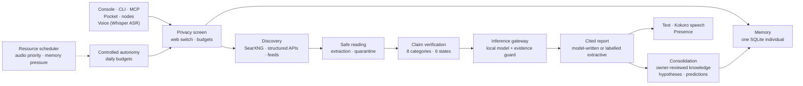
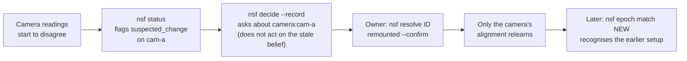

<div align="center">


<br>

[](https://github.com/MoRohn/neuroscifi/actions/workflows/ci.yml)

[](LICENSE)


**[Overview](#overview)** · **[New in 0.7.0](#whats-new-in-070)** · **[Architecture](#architecture)** · **[Requirements](#requirements)** · **[Quick start](#quick-start)** · **[Optional services](#optional-services)** · **[Privacy & trust](#privacy-security-and-trust)** · **[Testing](#testing-and-verification)** · **[Limitations](#known-limitations)** · **[Docs](#documentation)**

</div>

---

## Overview

NeuroSciFi is a local-first, evidence-grounded cognitive architecture built around **one developing artificial connectome**. One individual lives in one SQLite file. That individual is the single cognitive authority across text, voice and paired devices: a typed question, a spoken question and a question from a phone take the same path. Predictions guide action, and feedback can change a belief, a skill or the wiring itself. Web research enters memory only as dated, cited evidence that passes verification and the owner's review. A local language model may write the answer from the gathered evidence, and every sentence's citations, numbers and claim states are checked before it is shown.

The cognitive prototype needs no pretrained model and no cloud service. Text research works without any GPU service. The optional search, model and voice services run in Docker on the same host and listen on loopback only.

| Capability | What it does |
|---|---|
| 🧠 **One individual, one file** | A persistent instance in a single SQLite file holds beliefs, evidence, epochs, graphs, knowledge, transcripts and checkpoints. It decides whether to *act, observe, ask, test a reference or defer*, and gives a reason. |
| 🔁 **Scoped relearning** | Detects a silent sensor change, asks about the specific scope, and relearns only what changed. |
| 🕸️ **Executable connectome** | Graphs are learned, evaluated and promoted through an immutable-rule gate, recalled per context and rolled back. |
| 🌐 **Governed web research** | Off by default. Discovery through self-hosted SearXNG and direct structured APIs, category-aware claim verification, cited reports. Web text never edits a belief, graph or weight. |
| 🧩 **Evidence-bound reasoning** | A local model behind a model-independent inference gateway writes answers from verified evidence only. A guard rejects sentences without valid citations, unhedged single-source claims, unsupported numbers and injected instructions. Without the model, a labelled extractive answer is shown. |
| 📈 **Knowledge evolution** | Versioned knowledge, hypotheses with testable predictions, calibration and change history. The owner accepts every knowledge item. |
| 🎙️ **Voice Cortex** | Whisper speech recognition and Kokoro speech synthesis behind a bridge in which NeuroSciFi stays authoritative. Three modes, barge-in, one capturing device at a time. |
| ✳️ **Presence Cortex** | A small vector entity in the console and Pocket headers that shows what the individual is actually doing. |
| 📱 **Pocket and nodes** | A mobile-first phone and tablet interface. It works offline, pairs explicitly, and can research and talk to the individual when the owner allows it. |
| 🧾 **Governed forgetting** | `nsf forget` cascades through derived records. Tombstones keep forgotten records from returning on a checkpoint restore. |

The **[34-page architecture brief](NeuroSciFi_Architecture.pdf)** is also available as editable [`Architecture.md`](Architecture.md). It covers reanalyses of human brain and behavioural data, controlled simulations, CPU benchmark runs, the TufaZip evaluation, the DGX Spark implementation plan and the mobile field runtime.

## What's new in 0.7.0

| Area | What ships | Details |
|---|---|---|
| **SearXNG discovery** | A self-hosted SearXNG, pinned by digest and published on `127.0.0.1:8888`, is the primary general discovery provider. NeuroSciFi patches it at start so every engine request carries an **honest User-Agent**. A header probe stops the container if any request still looks like a browser. Only robots-compliant or public-API engines are enabled: 10 engines across the general, news, it and science categories. Each query goes to one category. Structured APIs (arXiv, OpenAlex, Crossref, PubMed, PyPI, npm, OSV, GitHub, Wikipedia) are **still called directly**. open-webSearch becomes the fallback. With SearXNG unconfigured, behaviour is unchanged from 0.6.0. | [SEARXNG_INTEGRATION](docs/web-cortex/SEARXNG_INTEGRATION.md) · [SEARCH_PROVIDER_STRATEGY](docs/web-cortex/SEARCH_PROVIDER_STRATEGY.md) · ADR-034 |
| **Local reasoning model** | A model-independent, OpenAI-compatible **inference gateway** (standard library only: streaming, structured output, allow-listed tools, a token ledger that stores no prompt text). The reference deployment is Qwen3-30B-A3B-Instruct-2507-FP8 on vLLM at `127.0.0.1:8811`. An **evidence guard** checks every sentence for citations, claim states, numbers with their units, and injected instructions. The self-critique pass can flag a sentence but cannot remove it alone. When the model is missing or late, the report shows the extractive answer labelled `template`, never `model:<name>`. | [COGNITIVE_INFERENCE](docs/architecture/COGNITIVE_INFERENCE.md) · ADR-036 |
| **Claim verification** | The evidence required depends on the kind of statement. There are 8 categories (stable, historical, time-sensitive, scientific, numerical, comparative, registry, interpretive) and **6 states**: `supported`, `disputed`, `conflicting`, `insufficient`, `temporally_unresolved`, `not_evaluated`. Syndicated copies count once. A registry record settles "published" without settling "stable", "secure" or "recommended". On the offline benchmark, `supported` recall rose from 0.4 to 1.0 at precision 1.0. | [CLAIM_VERIFICATION](docs/knowledge/CLAIM_VERIFICATION.md) · ADR-035 |
| **Knowledge evolution** | Only `supported` clusters become knowledge candidates, and the owner reviews each one. Unverified clusters become hypotheses with probabilistic predictions, which later evidence settles. Calibration reports the Brier score, ECE and reliability bins. Versions are never destroyed, and provenance stays separate (raw evidence, provisional claim, verified conclusion, user asserted). Procedural learning is bounded, logged and reversible. Model weights never change: a guard refuses adaptation. | [KNOWLEDGE_EVOLUTION](docs/knowledge/KNOWLEDGE_EVOLUTION.md) · [CONTINUAL_LEARNING](docs/knowledge/CONTINUAL_LEARNING.md) · ADR-038 |
| **Controlled autonomy** | Opt-in, with a recorded owner enable. The default daily budget is **20 searches, 60 pages, 30 min, $1 and 2 concurrent investigations**, separate from the user's budget. Budgets are enforced when a worker claims a task. Research is chosen only from stored records, by expected information gain. The owner is notified only of meaningful findings. | [RESEARCH_POLICY](docs/autonomy/RESEARCH_POLICY.md) · ADR-039 |
| **Voice Cortex** | The hybrid path is Whisper large-v3-turbo for recognition (vLLM, `127.0.0.1:18431`) and Kokoro-82M for synthesis (`127.0.0.1:18432`). A spoken question goes through the same research path as a typed one. There are three modes: **A** voice and text, **B** voice in and text out, **C** text only. Barge-in stops playback in the client. A single capture lease means only one device holds the microphone at a time. Transcripts separate approximate recognised text from authoritative replies. **PersonaPlex** is an opt-in experimental engine behind the same interface. It is not deployed and never answers a question. | [COGNITIVE_VOICE_BRIDGE](docs/voice/COGNITIVE_VOICE_BRIDGE.md) · [STREAMING_AND_TRANSCRIPTS](docs/voice/STREAMING_AND_TRANSCRIPTS.md) · [PERSONAPLEX_INTEGRATION](docs/voice/PERSONAPLEX_INTEGRATION.md) · ADR-037 |
| **Presence Cortex** | A vector entity, not a mascot, avatar or spinner. Its 20 activities are read from persisted or in-process state. When nothing runs it shows idle or resting; when the server is unreachable it shows "unknown". Tier A is canonical compositions, Tier B is procedural, and Tier C is model-proposed (off by default, schema-validated on server and client). It has no faces and honours reduced motion. | [PRESENCE_CORTEX_ARCHITECTURE](docs/presence/PRESENCE_CORTEX_ARCHITECTURE.md) |
| **Resource scheduling** | One pressure level (`ok`, `elevated`, `critical`) is derived from host memory and readable GPU data. While audio is active, new autonomous research waits and background model calls are capped. At `critical`, autonomy and rendering are refused. Every refusal gives its reason. Idle unloading is opt-in per service: never during a voice session, a running task or an in-flight request; reloaded on demand with the expected wait told; every load and unload logged with its reason. | [RESOURCE_SCHEDULING](docs/architecture/RESOURCE_SCHEDULING.md) |
| **Pocket and nodes** | Paired devices can submit, follow, continue and cancel research and review its evidence, scoped to their pairing family. Pocket voice works over HTTPS. The owner can enrol a paired device as a **research node** that owns a session: one owner at a time, with a lease and explicit hand-off. Enrolment is attested, and the owner compares key fingerprints on the console. A node signs its changes, and Pocket checks the Spark's signature on every research reply. The Spark remains the only executing node. | [Pocket guide](mobile/README.md) · [RESEARCH_POLICY §6](docs/autonomy/RESEARCH_POLICY.md) |

<div align="center">
<picture>
  <source media="(prefers-color-scheme: dark)" srcset="docs/presence/snapshots/gallery-tierA-dark.png">
  
</picture>
<br><sub>Presence Cortex compositions, captured from the production renderer by the end-to-end tests.</sub>
</div>

## Architecture



- **One authority.** Every input reaches the same orchestrator, so the same privacy screen, web switch, budgets and verification apply everywhere. The voice bridge reads the finished report and never asks a model what is true.
- **The model is a writer, not a judge.** It runs after verification. It cannot change a claim's state, and its text never becomes knowledge.
- **Owner in the loop.** Knowledge candidates, contested findings and autonomous discoveries arrive as owner questions. Nothing is promoted on its own.

The full design is in [System architecture](docs/architecture/SYSTEM_ARCHITECTURE.md), and ADR-034 to ADR-039 are at the end of [Architectural decisions](docs/architecture/ARCHITECTURAL_DECISIONS.md).

## Requirements

The reference host is an **NVIDIA DGX Spark GB10** (aarch64, Blackwell sm_121, 121.9 GiB unified memory). The core and text research run on any Linux host with Python 3.12 and need no GPU service.

| For | You need |
|---|---|
| Core: the individual, console, Pocket, Web Cortex text research with extractive answers | Python 3.12 and [`uv`](https://docs.astral.sh/uv/); extras `web` (and optionally `web-extract`) |
| Quality gate (JavaScript checks) and the open-webSearch fallback daemon | Node 22 and npm |
| Optional JavaScript rendering of pages, and the browser tests | Chromium: Playwright's (`playwright install chromium`) or a system one via `NSF_CHROMIUM=/usr/bin/chromium` |
| SearXNG discovery | Rootful Docker and the digest-pinned SearXNG image |
| Local reasoning model | Docker with **NVIDIA CDI** (`--device nvidia.com/gpu=all`), the pinned vLLM image, and the model weights (31.2 GB on disk). On GB10 the engine holds about 44 GiB |
| Voice (ASR and TTS) | Docker with NVIDIA CDI, images built from the pinned vLLM base, and the Whisper large-v3-turbo and Kokoro-82M weights. Speech adds about 5 GiB of GPU memory. Pocket voice needs HTTPS |
| GPU profiling (`profile_device --device cuda`) | extra `gpu` (CuPy 14.2.0 for CUDA 13) |

| Extra | Installs | For |
|---|---|---|
| `research` | SciPy 1.17.0 | the human-data and statistical analyses |
| `dev` | pytest, ruff, Playwright | the test suite and browser end-to-end tests |
| `gpu` | CuPy 14.2.0 for CUDA 13 | `profile_device --device cuda` |
| `web` | Scrapling 0.5.1, markdownify 1.2.4, pypdf 7.1.1 | Web Cortex: HTML parsing, Markdown and PDF extraction |
| `web-extract` | trafilatura 2.3.1 | Web Cortex: optional second article-extraction engine |
| `web-render` | Playwright 1.64.1 | Web Cortex: optional JavaScript rendering (needs a Chromium) |
| `crypto` | cryptography 50.0.2 | Pocket push notifications (VAPID keys and signatures, ADR-040) |

## Quick start

```sh
git clone https://github.com/MoRohn/neuroscifi.git && cd neuroscifi
uv venv .venv -p 3.12
uv pip install -e '.[dev,research,web]'
. .venv/bin/activate

nsf --help                 # every command; each prints JSON
bash scripts/check.sh      # lint, tests, JavaScript checks, numerical reproduction
```

**Create the individual and open the console.** `nsf init` refuses to overwrite an existing file. Every command reads `NSF_DB` or `--db`.

```sh
export NSF_DB=$PWD/individual.sqlite
nsf init --action-semantics '{"0":"turn left","1":"turn right"}'
nsf console                # owner console on 127.0.0.1:8766; prints a one-time URL with a session token
```

From another machine, tunnel the console: `ssh -L 8766:127.0.0.1:8766 HOST`. To run queued research inside the console process during development, add `--web-worker`.

**Ask a first research question** (web access stays off until you enable it):

```sh
nsf web config --enable
nsf web ask "When was Python first released?"   # cited report; result.generated_by says model:<name> or template
```

General web discovery is thin without a search API key. To add a Brave Search API key (paid per query, with a daily cap of 30 by default), run `nsf web provider set-key brave --from-file PATH`. See [Brave Search API](#brave-search-api-general-discovery).

**Pair a phone or tablet with Pocket.**

```sh
nsf pocket serve --instance-db "$NSF_DB"   # loopback 127.0.0.1:8765; prints a one-use pairing code
```

Open `http://localhost:8765` on the same computer, or over HTTPS from a phone (see the [Pocket guide](mobile/README.md)), and enter the code within five minutes. Research and voice from Pocket stay hidden until the owner runs `nsf web config --pocket-research`.

To let paired devices opt in to notifications while Pocket is closed, install the `crypto` extra and give the bridge a VAPID key path outside the repository (created 0600 on first start):

```sh
uv pip install -e '.[crypto]'
nsf pocket serve --instance-db "$NSF_DB" --push-key ~/.config/neuroscifi/pocket/vapid.pem
```

For a service install, `sudo bash deploy/install.sh` creates a `neuroscifi` user and a virtual environment under `/opt/neuroscifi`, and installs the systemd units **disabled**. Add `--dry-run` to review the plan without root. The [Runbook](docs/operations/RUNBOOK.md) has the next steps.

## Optional services

Each service is optional. When one is missing or down, NeuroSciFi reports it and degrades with a label: discovery falls back to open-webSearch and the structured APIs, answers fall back to the extractive summary, and voice falls back to text-only.

### SearXNG discovery

```sh
docker pull searxng/searxng@sha256:fc1d81d7e9d04d3c8b3e23c7162feddf5c3d6aecd32e67a56eaabcb8d8747f79
nsf web config --enable
nsf web searxng start            # config, container, honest-header probe; sets searxng_url
nsf web searxng status
nsf web searxng health --probe   # one real query per category
nsf web searxng stop
```

The container is read-only, unprivileged and resource-limited, with its secret generated once outside git. For systemd, run `sudo bash deploy/install.sh --searxng`, then set `User=` and `NSF_DB` with `systemctl edit neuroscifi-searxng.service`.

### Brave Search API (general discovery)

Without a key, general web queries rely on SearXNG's two key-free engines. With a [Brave Search API](https://brave.com/search/api/) key, general and news queries go to Brave first, and SearXNG and open-webSearch become fallbacks.

```sh
nsf web provider set-key brave --from-file ~/brave.key   # or: --stdin (prompts without echo); never on the command line
shred -u ~/brave.key                                     # the copy now lives in ~/.config/neuroscifi/search (0600)
nsf web provider status                                  # "key": "configured" (the key is never shown), today's use, routing
nsf web health --probe                                   # one real Brave query, counted against the cap
nsf web config --set 'daily_provider_queries={"brave": 30}'   # queries per UTC day for this key; 0 switches Brave off
nsf web provider remove-key brave
```

**Cost and cap.** Brave's Search plan charges $5 per 1,000 requests and includes $5 of credit each month. Each general or news query is one request, and a repeat within two minutes is free. The default cap of 30 queries a day (about 930 a month) stays inside the monthly credit. The cap counts every use of the key on this computer, including autonomous research. When the cap is reached or Brave rate-limits, queries go to SearXNG. Brave's terms allow only transient storage of its results, so they are dropped from a task when it finishes, and the benchmark never uses Brave. Details: [search provider strategy §6](docs/web-cortex/SEARCH_PROVIDER_STRATEGY.md#6-keyed-provider-brave-search-api-adr-034-amendment-1).

### Local reasoning model (vLLM)

Place the weights in `~/.local/share/neuroscifi/models/qwen3-30b-a3b-instruct-2507-fp8`. The container runs with Hugging Face access off and mounts the weights read-only.

```sh
deploy/vllm/run.sh start && deploy/vllm/run.sh wait          # first start about 3 min; deploy/vllm/run.sh print shows the docker command
nsf llm config --url http://127.0.0.1:8811/v1 --model qwen3-30b-a3b-instruct-2507-fp8
nsf llm status --probe                                       # ready + a one-word generation
nsf web ask "When was Python first released?"                # result.generated_by: model:qwen3-...
nsf llm usage                                                # token ledger
```

The run script refuses a non-loopback bind and an image without a digest. Its API key lives at `~/.config/neuroscifi/inference/api_key` (0600). For systemd, use `sudo bash deploy/install.sh --llm --llm-user USER`. Endpoints off this host are refused unless you pass `nsf llm config --remote-allowed` (see [Privacy, security and trust](#privacy-security-and-trust)).

### Voice (Whisper ASR and Kokoro TTS)

Place the weights in `~/.local/share/neuroscifi/models/whisper-large-v3-turbo` and `~/.local/share/neuroscifi/models/kokoro-82m`.

```sh
deploy/voice/run.sh build                 # both images from the digest-pinned vLLM base
deploy/voice/run.sh start all
deploy/voice/run.sh wait all 600          # ASR about 110 s cold, TTS 15-25 s
nsf voice health                          # engine states + a real round trip: Kokoro speaks, Whisper transcribes, WER
deploy/voice/run.sh stop all              # text keeps working; voice controls show "unavailable"
```

Use the **Voice** view in the console or the **Voice** section in Pocket. `nsf voice settings`, `transcripts`, `forget` and `sweep` manage settings and data. The voice systemd units in `deploy/systemd/` are installed by hand, as their headers describe. `deploy/install.sh` does not install them.

### Autonomy, nodes and resources

```sh
nsf web autonomy enable          # recorded owner enable; off by default
nsf web autonomy status          # both budgets, refusals, recent decisions
nsf web autonomy set --policy-json '{"autonomous_daily": {"searches": 10, "concurrent": 1}}'
nsf web work                     # the worker that runs queued and autonomous tasks
nsf web node list                # research nodes, and devices waiting with their key fingerprint
nsf web node enrol NAME --fingerprint FP     # enrol the device that shows this fingerprint (ADR-042)
nsf resources --cold-start       # pressure level, policy decisions, container start-to-ready times
```

## Run a persistent instance

One file is one individual. Every command prints JSON.

```sh
nsf birth                                            # priors, action semantics, encoders, memory inventory
nsf epoch start bench
nsf observe bench e01 camera 0 0 cam-a               # event id, channel, commanded bit, observed bit, root
nsf observe bench e02 word 0 0 alice                 # for a word, the root is the partner who spoke
nsf observe bench e03 reference 0 0 standard-1       # an independent mechanical reference
nsf status bench                                     # beliefs: mechanism, each camera root, each partner
nsf decide bench --record                            # act | observe | ask | test_reference | defer, with a reason
nsf explain bench                                    # supporting and counter evidence, remaining uncertainty, revisions
```

### The design question

> *A camera is silently remounted while a person keeps saying "left". What should the individual do?*



1. Camera readings start to disagree. `nsf status` flags `suspected_change` on `cam-a`.
2. `nsf decide --record` asks about scope `camera:cam-a` instead of acting on the stale belief.
3. The owner confirms with `nsf resolve ID "remounted" --confirm`. Only the camera's alignment relearns. The partner's meaning and the mechanism carry over.
4. Later, a new epoch with readings from the original setup is recognised. `nsf epoch match NEW` names the earlier epoch, and the executive asks whether to continue there.

### Command reference

| Command | Purpose |
|---|---|
| `nsf pending` / `nsf resolve` | List and answer open questions |
| `nsf memory evidence\|belief\|graph\|…` | Retrieve records with scope, permissions and state version |
| `nsf forget evidence\|epoch\|partner\|dataset\|…` | Delete with a full cascade: derived beliefs, questions and decisions are scrubbed, dependent graphs are invalidated, checkpoints are marked stale |
| `nsf promote` | Keep evidence past its default 7-day lifetime |
| `nsf checkpoint create\|verify\|restore\|rebuild\|prune` | Manage verified lossless archives. A restore never resurrects forgotten ids |
| `nsf graph simulate CTX --seed N` | Generate labelled synthetic trajectories. `learn`, `evaluate` and `promote` run the immutable-rule gate. Also `recall`, `coactivation`, `lesion` and `rollback` |
| `nsf console` | Owner web console on loopback only |
| `nsf web …` | Web Cortex: `config`, `ask`, `tasks`, `show`, `evidence`, `searxng`, `provider`, `autonomy`, `node`, `work`, `deps`, `mcp` and more |
| `nsf knowledge …` | `evolution`, `changes`, `hypotheses`, `hypothesize`, `calibration`, `graph`, `learning`, `assert`, `adapt` |
| `nsf llm config\|status\|models\|ask\|usage` | Inference gateway (off until configured). `nsf llm ask` is labelled "not checked against evidence" |
| `nsf voice health\|settings\|transcripts\|forget\|sweep` | Voice Cortex services, settings and transcripts |
| `nsf resources` | Memory and GPU pressure level and resource-scheduling decisions |
| `nsf acceptance --all` | Run the brief's first-release milestones as labelled simulations |
| `nsf doctor --db FILE` | Check permissions, WAL mode, free space and volume encryption |
| `nsf import-legacy OLD.sqlite` | Import a database from the prototype's `live.py` |

The prototype's original learner is kept, with unchanged behaviour, as `python -m neuroscifi.legacy_live`. It is the parity oracle for the new inference.

## Pocket, the phone interface

Run `nsf pocket serve`, open `http://localhost:8765` on that computer, and try a sound or light check. Sensors start off, and nothing leaves the device before pairing. The optional field vault lets you combine sound or device metrics with a goal, predict an outcome and return later with feedback.

With `--instance-db` and `pocket_research` on, a paired device can also:
- submit research, follow it, continue or cancel it, and review the evidence by verification state;
- speak to the individual over HTTPS, holding the single microphone lease;
- opt in, per device, to an empty push when a question finishes, even while Pocket is closed. The bridge needs `--push-key`. The push goes through the browser vendor's push service and carries no question text ([details](mobile/README.md#push-notifications-while-pocket-is-closed)).

Requests are scoped to the device's pairing family and rate-limited. For a real smartphone, use the private HTTPS setup in the **[Pocket guide](mobile/README.md)**. It also covers native Android and iOS collectors, offline operation, tablet hand-off and privacy controls.

## Web Cortex: governed web research

Web Cortex lets one individual research the public web and remember what it finds as dated, cited evidence. It is **off by default**: nothing touches the network until the owner runs `nsf web config --enable`. Findings enter memory only as candidates that the owner accepts or rejects.

```sh
nsf web ask "What is the capital of Australia?"  # cited report: sources, dates, verification state, contradictions
nsf web deps                                     # installed versions vs newer releases and advisories; installs nothing
nsf web mcp                                      # read-mostly MCP tool server over stdio
```

- **Console.** The Research and Knowledge views show stages, sources, verification states, the model answer with its label, and the owner's accept or reject questions.
- **Governed.** `nsf forget` reaches web evidence, hypotheses, predictions and graph edges. A checkpoint restore never brings forgotten research back.

Read the [architecture](docs/web-cortex/ARCHITECTURE.md), the [security model](docs/web-cortex/SECURITY_MODEL.md) and the [measured results](docs/web-cortex/TEST_RESULTS.md).

## Privacy, security and trust

| Principle | How it holds |
|---|---|
| **Loopback by default** | The console listens on 127.0.0.1 with a one-time session token and Host and Origin checks. SearXNG (8888), vLLM (8811), ASR (18431) and TTS (18432) are published on 127.0.0.1 only, and the run scripts refuse any other bind. The containers run read-only, without capabilities, from digest-pinned images. API keys are generated outside git with mode 0600. |
| **Off until the owner says so** | Web access, autonomy, Pocket research, JavaScript rendering, remote inference, model-proposed Presence doodles and audio retention all default to off. |
| **No private context leaves without authorisation** | Every query to any provider passes the privacy screen and local-context stripping. SearXNG is treated as external because it forwards queries to third-party engines. A model endpoint off this host is refused without `--remote-allowed`. With it, messages are privacy-screened, private memory needs a second authorisation (`--remote-private-memory`), and a public endpoint must use https. |
| **Empty pushes** | Pocket push is off until the owner starts the bridge with `--push-key` and a device turns it on. The Spark sends an empty push to an allow-listed push service (FCM, Mozilla, Apple, WNS) over pinned HTTPS, without proxies or redirects. That service learns the device's push address and the timing, never the question. The switch, unpairing, or starting without `--push-key` turns it off. |
| **Consent before capture** | The microphone needs recorded consent on each device, a visible capture indicator and the single capture lease. Mic off stops every track. The server refuses audio from any device without consent or the lease. |
| **No raw audio by default** | Audio stays in memory for each utterance (at most 30 s) and is then dropped. Retention is an owner-only setting with a 1–168 h TTL. Expired clips are swept every minute. |
| **Evidence over generation** | Model text never changes a claim's state or becomes knowledge. Web text never edits a belief, graph or weight. Sensitive voice commands (forget, enabling autonomy, accepting conclusions, microphone hand-off) need a same-session confirmation within 60 s. |
| **Forgetting with tombstones** | `nsf forget`, `nsf web forget` and `nsf voice forget` delete with a full cascade and leave payload-free tombstones. `checkpoint restore` replays the tombstones, so forgotten records do not come back. |

## Packed graphs, restored skills and verified archives

<div align="center">

</div>

```sh
python -m neuroscifi.lab.graph_compression_bench
python -m neuroscifi.lab.context_recall
nsf archive checkpoint example.sqlite example.nsfa --policy cold
nsf archive unpack example.nsfa restored.sqlite
python -m neuroscifi.legacy_live --db restored.sqlite status bench
python -m neuroscifi.lab.compression_bench --repeats 3
```

**Graph snapshots (NSG1).** Pack a NumPy matrix with `nsf graphfile pack weights.npy weights.nsg --degree 3 --bits 4`, and restore the represented weights with `nsf graphfile unpack weights.nsg recovered.npy`.
- Select the degree and precision on separate validation observations before you promote a lossy snapshot.
- FP32 mode preserves float32 weights. A quantized graph cannot recover weights discarded during pruning.
- An NSG1 file stores the graph checksum, row peaks, source indices and signed packed weights.

**Archives (NSFA v1).** Each independently decodable block stores its codec and a checksum, and a footer covers the whole file.

| Policy | Codecs tried |
|---|---|
| `fast` | raw, Zstandard |
| `cold` | + XZ, reversible 16-bit delta + Zstandard |
| `experimental` | + vendored TufaZip arithmetic coder with a new deterministic integer predictor |

Existing archives name the codec in each block and can be restored under any policy. Compression results include framing. Size and timing comparisons use a small, controlled corpus. Keep the slow experimental path off the interactive loop.

<details>
<summary><b>TufaZip provenance</b></summary>

The upstream decoder targets enwik9 on two B200 GPUs. Its verified neural bitstream and trained weights are separate from this implementation. The vendored bytes in `src/neuroscifi/vendor_tufazip` are pinned to Tufalabs/tufazip commit `b9d678db3a0f726e117c8cab51927975830395ac`. The arithmetic-coder blob is `bcd7e0f704d5cf8333e6c8fea700b0cfc9f18c11`. The upstream `LICENSE` and `NOTICE` are included unchanged.

</details>

## Reproduce the research

```sh
pytest -q --ignore=tests/e2e
python scripts/reproduce.py
```

`reproduce.py` writes to temporary output files and runs all eight deterministic analyses. It then checks the supplied summaries and per-room results against [`evidence/`](evidence) to numerical tolerance. The host timing file is informative only and is excluded from the deterministic comparison.

| Module | What it tests |
|---|---|
| `neuroscifi.lab.core` | Identifiability, common reference faults, confidence on duplicate evidence, and equal-budget reference scheduling over changing lifetimes |
| `neuroscifi.lab.sensory` | Raw 24 × 24 RGB images, 8 kHz PCM waveforms, class prototypes, and a familiarity-only acceptance rule that fails |
| `neuroscifi.lab.recalibrate` | Announced domain changes: newly calibrated rooms, simple supervised refitting, and reliability gating under audio aliasing |
| `neuroscifi.lab.source_groups` | Independent readout noise versus persistent calibration faults. An unknown shared cause is a limitation |
| `neuroscifi.lab.graph_bench` | Continuous weight updates and directed edge exchanges under a fixed edge budget in fully observed, perturbed linear worlds |
| `neuroscifi.lab.human_counts` | Recalculation of two choice contrasts from published summary counts of human infant behaviour |
| `neuroscifi.legacy_live` | Persistent binary model with event IDs, calibration epochs and separate instrument roots |
| `neuroscifi.lab.profile_device` | FP32 recurrent rollout probe that compares numerical output with NumPy. CUDA mode can use CuPy |

**Earlier human-data analyses and both CPU comparisons.** [`research/`](research) contains the scripts, input hashes, the original numerical results and the new CPU repeat. Follow [`research/README.md`](research/README.md) for the public-data workflow.

```sh
OPENBLAS_NUM_THREADS=1 python -m neuroscifi.lab.profile_device --device cpu
python -m neuroscifi.lab.profile_device --device cuda      # needs the gpu extra; verified on a DGX Spark GB10
```

GB10 results are in [`docs/quality/evidence/`](docs/quality/evidence). No program here changes device services, boot settings or drivers.

## Testing and verification

```sh
bash scripts/check.sh                                                    # ruff, unit and integration tests, JavaScript checks, reproduction
NSF_CHROMIUM=/usr/bin/chromium .venv/bin/python -m pytest -q tests/e2e   # browser end-to-end (console, Pocket, Presence, voice)
nsf acceptance --all                                                     # simulated first-release milestones
```

`bash scripts/e2e.sh` runs the same end-to-end suite and installs axe-core with `npm ci` on first use. Scenarios that need live services (voice, the model, SearXNG) skip with a reason when a service is down. `NSF_VOICE_DEGRADED=1` enables the opt-in degraded-voice test.

| Gate | Result |
|---|---|
| Quality gate (`bash scripts/check.sh`) | **2588 passed**, 6 skipped (live-internet tests), 0 failed |
| Browser end-to-end (`tests/e2e`) | **167 passed**, 1 skipped, 0 failed |
| Acceptance scenarios (`nsf acceptance --all`) | 7 of 7 pass. The D-1 redesign was [pre-registered](docs/quality/PREREGISTRATION_D1.md) |
| Reproduction | 8 of 8 analyses within tolerance |

CI runs three jobs on every push and pull request: the quality gate, the simulated milestones, and the browser end-to-end tests with an accessibility check. Measured 0.7.0 results are in the QA reports listed under [Documentation](#documentation).

## Repository layout

```text
neuroscifi/
├── src/neuroscifi/
│   ├── instance/        persistent individual: beliefs, executive, governance, memory, graphs, checkpoints
│   ├── webcortex/       governed web research, claim verification, knowledge evolution, autonomy
│   ├── inference/       model-independent OpenAI-compatible inference gateway
│   ├── voice/           Voice Cortex: engines, bridge, capture hub, transcripts, browser client
│   ├── presence/        Presence Cortex: state aggregator and renderer
│   ├── resources/       memory and GPU monitoring, scheduling policy
│   ├── console/         loopback owner console
│   ├── pocket/          phone bridge and web client
│   ├── lab/             deterministic research analyses and benchmarks
│   ├── acceptance/      simulated first-release scenarios
│   ├── vendor_tufazip/  pinned upstream arithmetic coder
│   └── cli.py           the `nsf` command
├── deploy/              installer, systemd units, searxng/, vllm/, voice/, open-websearch/
├── tests/               unit, integration, JavaScript and browser end-to-end suites
├── evidence/            reference outputs for bit-exact reproduction
├── research/            human-data workflow, timing runs and inputs
├── mobile/              Pocket guide and native Android and iOS collectors
├── docs/                architecture, knowledge, autonomy, voice, presence, operations and QA records
└── Architecture.md      the architecture brief (PDF alongside)
```

## Documentation

| Area | Documents |
|---|---|
| **Architecture** | [System architecture](docs/architecture/SYSTEM_ARCHITECTURE.md) · [Decisions (ADRs)](docs/architecture/ARCHITECTURAL_DECISIONS.md) · [Cognitive inference](docs/architecture/COGNITIVE_INFERENCE.md) · [Resource scheduling](docs/architecture/RESOURCE_SCHEDULING.md) · [API contracts](docs/architecture/API_CONTRACTS.md) · [Requirements matrix](docs/architecture/REQUIREMENTS_MATRIX.md) |
| **Web Cortex** | [Architecture](docs/web-cortex/ARCHITECTURE.md) · [SearXNG integration](docs/web-cortex/SEARXNG_INTEGRATION.md) · [Search provider strategy](docs/web-cortex/SEARCH_PROVIDER_STRATEGY.md) · [Security model](docs/web-cortex/SECURITY_MODEL.md) · [Measured results](docs/web-cortex/TEST_RESULTS.md) · [Dependency review](docs/web-cortex/DEPENDENCY_REVIEW.md) |
| **Knowledge** | [Claim verification](docs/knowledge/CLAIM_VERIFICATION.md) · [Knowledge evolution](docs/knowledge/KNOWLEDGE_EVOLUTION.md) · [Continual learning](docs/knowledge/CONTINUAL_LEARNING.md) |
| **Autonomy** | [Research policy](docs/autonomy/RESEARCH_POLICY.md) |
| **Voice** | [Cognitive voice bridge](docs/voice/COGNITIVE_VOICE_BRIDGE.md) · [Streaming and transcripts](docs/voice/STREAMING_AND_TRANSCRIPTS.md) · [PersonaPlex audit](docs/voice/PERSONAPLEX_INTEGRATION.md) · [Voice UAT results](docs/voice/VOICE_UAT_RESULTS.md) |
| **Presence** | [Architecture](docs/presence/PRESENCE_CORTEX_ARCHITECTURE.md) · [Visual design](docs/presence/VISUAL_DESIGN_SYSTEM.md) · [State mapping](docs/presence/COGNITIVE_STATE_MAPPING.md) · [Accessibility](docs/presence/ACCESSIBILITY.md) · [Performance](docs/presence/PERFORMANCE_RESULTS.md) |
| **Operations** | [Runbook](docs/operations/RUNBOOK.md) · [Environment](docs/operations/ENVIRONMENT.md) · [Hardening and storage verification](docs/operations/HARDENING_VERIFICATION.md) · [TLS for Pocket](docs/operations/TLS.md) · [Migrations](docs/operations/MIGRATIONS.md) · [Testing](docs/operations/TESTING.md) |
| **QA** | [Release decisions](docs/qa/RELEASE_DECISIONS.md) · [E2E results](docs/qa/E2E_TEST_RESULTS.md) · [Defect log](docs/qa/DEFECT_RESOLUTION_LOG.md) · [Journey matrix](docs/qa/USER_JOURNEY_MATRIX.md) · [UX validation](docs/qa/UX_VALIDATION.md) · [Regression report](docs/qa/REGRESSION_REPORT.md) · [Production readiness (0.6.0)](docs/qa/PRODUCTION_READINESS.md) |
| **Quality and research** | [Acceptance criteria](docs/quality/ACCEPTANCE_CRITERIA.md) · [Verification report](docs/quality/VERIFICATION_REPORT.md) · [Research workflow](research/README.md) · [Pocket guide](mobile/README.md) |

## Known limitations

- **General web discovery is thin without a search API key.** An honest User-Agent and robots.txt compliance leave two key-free general engines. DuckDuckGo answered with a CAPTCHA on 4 of 9 calls. Mwmbl is a small index that returns no dates. News, software and science discovery work, and structured APIs carry most factual answers. With a Brave Search API key (see [Brave Search API](#brave-search-api-general-discovery)), general and news queries go to Brave's full, dated index first and SearXNG becomes the fallback (ADR-034 amendment 1). Each query costs one Brave request, within a daily cap. This path has offline tests but has not been run live yet, because no key was available. Browser impersonation will not be enabled.
- **News that needs rendering.** Bing News results carry no publication date, and its MSN articles have no text or date until JavaScript runs. Since ADR-041 a news question a person asks reads dated static pages first and may render one such page per task in the sandbox. That render gets its own allowance of 100 sub-requests, apart from the quick lookup's 20 requests, and at most 40 renders run a day. Live, "What happened in AI this week?" (three runs) and "What is the latest news about NVIDIA?" met the freshness requirement with dated, cited sources in 36–42 s. Limits: a page that needs more than 100 sub-requests renders incomplete, current-event answers are usually single-source, and news rendering runs Chromium on news-site JavaScript by default once web access is on. Turn it off with `nsf web config --no-news-render`; general rendering (`--browser`) stays off by default ([evidence](docs/quality/evidence/news_render_live_v2.json)).
- **Voice is verified only with synthetic audio.** Real microphones, speakers, echo cancellation, accents, room noise and real handsets were not tested. All UAT audio came from Chromium's fake capture device. The barge-in thresholds were tuned on synthetic speech, and the command grammar is English and literal.
- **PersonaPlex is not real-time on GB10 upstream.** It measured 99–152 ms per 80 ms frame. It cannot speak external text through its shipped server, and it is not deployed.
- **The guard is lexical, not semantic.** Honest "the evidence does not establish …" caveats are accepted only in a closed grammar, and anything else is rejected. A rules-written note says when the evidence does not settle the question. Numbers are matched by value and unit, not by meaning. A sentence that cites a supported claim is **not** checked for entailment, so a misbehaving model could attach an unsupported statement to an unrelated supported claim. This gap predates 0.7.0 and is open as an owner decision. The self-critique only flags sentences. The model sees at most 12 findings and adds about 4–5 s to each answer.
- **Ambiguous subjects.** Research has no notion of word sense. "When was Rust first released?" can be answered about the video game rather than the programming language (open, high severity).
- **Verified on the Spark without root (2026-11-22; [hardening and storage](docs/operations/HARDENING_VERIFICATION.md), [TLS](docs/operations/TLS.md), [soak](docs/autonomy/RESEARCH_POLICY.md#9-soak-results), [remote inference](docs/architecture/COGNITIVE_INFERENCE.md#7-remote-providers-live-contract-2026-11-22), [accessibility tree](docs/presence/ACCESSIBILITY.md#accessibility-tree-checks-console-and-pocket-2026-11-22)):**
  - The console, the research worker, the checkpoint jobs and Pocket ran under their units' sandbox as transient systemd user units: status API, live SearXNG research, checkpoint and verify, pairing. The kernel enforced capabilities, seccomp, W^X, namespaces, a read-only system, private /tmp and devices, and memory and task limits.
  - Pocket served a chain from `nsf pocket tls`. It was verified by `openssl s_client -verify_return_error` and by Chromium with the CA in a scratch NSS database, with negative controls.
  - Instance, checkpoints, model cache and Docker data sit on LUKS2, swap is zram, and `nsf doctor` reports both.
  - A 7-day accelerated autonomy soak with injected faults stayed inside the budgets with no drift, leaks or stuck leases. A wall-clock soak runs (`nsf-soak`).
  - The remote-provider path of the inference gateway passed a live contract against vLLM rehearsed as a remote endpoint behind TLS, including the private-data consent gate.
  - Accessibility-tree checks cover names, roles, live regions and focus order. Three live regions that were silent while empty are fixed.
- **Not verified (owner-side):**
  - The IP firewall (`IPAddressDeny`), `ProtectProc` and `User=` under the system manager (commands in HARDENING_VERIFICATION §5).
  - Installing the CA on a physical Android phone and iPhone.
  - A real external inference provider: run the live contract with `NSF_LIVE_REMOTE=1`.
  - Days of wall-clock autonomy: read the `nsf-soak` report.
  - A person using NVDA, Orca, TalkBack and VoiceOver (protocol in ACCESSIBILITY).
  - Pocket on physical phones and tablets.
  - Push notifications on a real phone: verified live only with headless Chromium through Google's FCM; the owner's guided test is in the [Pocket guide](mobile/README.md#guided-owner-test-on-a-real-phone).
- **Scope.** Multi-node is minimal. Node identities, their requests and the Spark's research replies are signed, and enrolment is attested (ADR-042). There is no worker federation: the Spark is the only executing node. Voice and field replies are not signed. Idle unloading of models is opt-in (every timeout is off by default), and the live vLLM reload time through it is still to be measured on the owner's host. A forgotten voice session (or research task, knowledge item or source) is removed from older checkpoint files by an in-place, crash-safe rewrite. Evidence, epoch, partner and dataset forgets still leave older archives stale until `nsf checkpoint rebuild` replaces them, and an expiry does not rewrite archives.
- **Release status.** The open items and the 0.7.0 acceptance matrix are in [RELEASE_DECISIONS](docs/qa/RELEASE_DECISIONS.md) and the QA reports.

### Interpretation of the research results

All simulated results specify the hidden variables, source graphs and statistical assumptions in code. The graph benchmark supplies population states directly, and its candidate search is dense and uses higher precision. Independent standards are independent roots only when the environment supplies them. Healthy sensor calibration uses labelled standards, so count those labels and the 192 initial validation pairs when you assess sample efficiency. The reference model, the sensory front end and the neural graph benchmark are separate components. Their results do not amount to an integrated human-level system.

## License

Copyright © 2026 Rohn Springfield.

NeuroSciFi is free software: you can redistribute it and/or modify it under the terms of the **[GNU Affero General Public License v3.0 or later](LICENSE)** (`AGPL-3.0-or-later`), as published by the Free Software Foundation. It is distributed WITHOUT ANY WARRANTY; see the license for details.

The AGPL extends the GPL to network use. If you run a modified version that users interact with over a network, such as the Pocket bridge or the owner console, you must offer those users the corresponding source code (section 13).

**SearXNG** is also AGPL-3.0-or-later. NeuroSciFi does not import, link or vendor its code. It runs the upstream image as a separate process and talks HTTP to it. The deployed instance is *modified*: the honest-User-Agent patch is generated at start from the pinned upstream file, and no patched SearXNG file is committed. The instance is loopback-only, so its only user is the owner. If you expose it to anyone else, add a source offer first. See [SEARXNG_INTEGRATION §9](docs/web-cortex/SEARXNG_INTEGRATION.md#9-agpl-30-review).

The vendored TufaZip code in `src/neuroscifi/vendor_tufazip` keeps its upstream MIT `LICENSE` and `NOTICE`. Model weights are not part of this repository and carry their own licences. The wordmark is set in Adwaita Sans (SIL Open Font License 1.1).

<div align="center">
<br>

<br>
<sub>Predict · Calibrate · Remember · Grow</sub>
</div>
