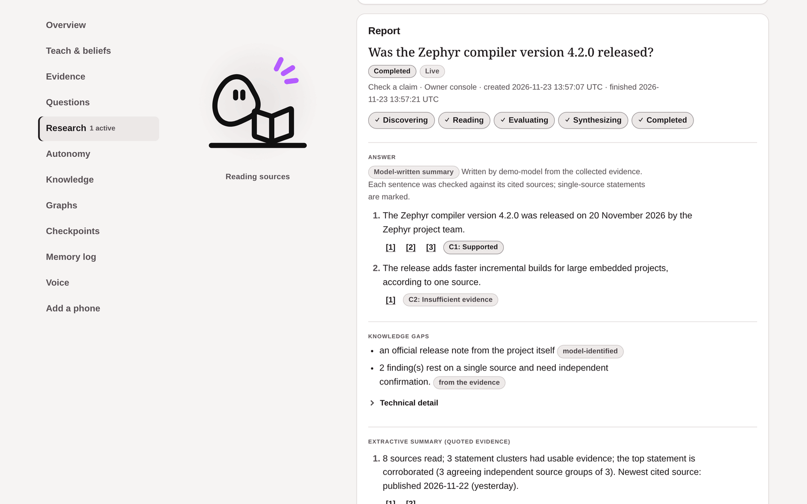
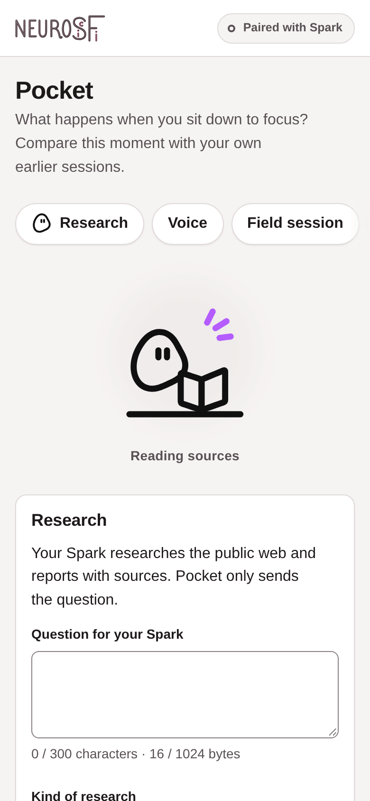
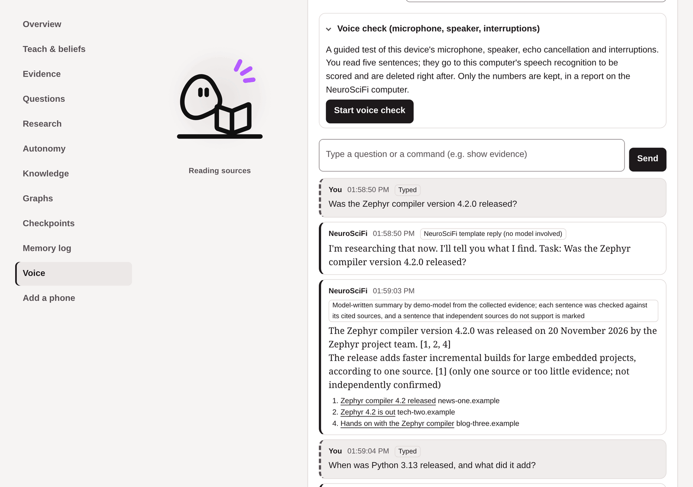
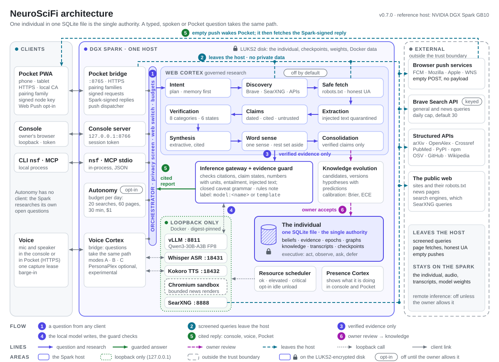
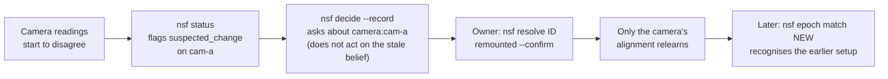
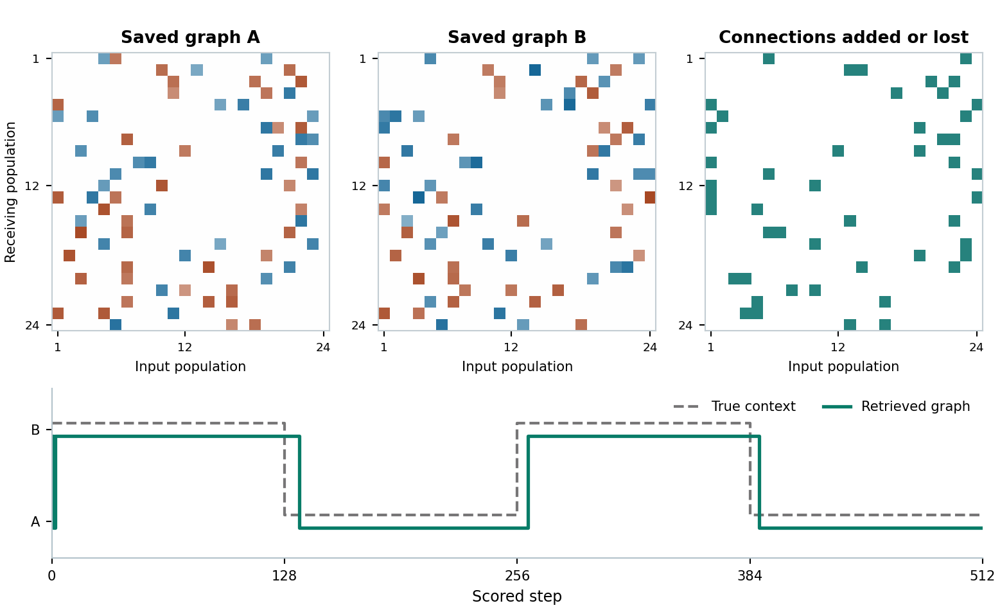

<div align="center">



<br>

[](https://github.com/MoRohn/neuroscifi/actions/workflows/ci.yml)

[](LICENSE)


**[Overview](#overview)** · **[See it in action](#see-it-in-action)** · **[Architecture](#architecture)** · **[Requirements](#requirements)** · **[Quick start](#quick-start)** · **[Optional services](#optional-services)** · **[Privacy & trust](#privacy-security-and-trust)** · **[Testing](#testing-and-verification)** · **[Limitations](#known-limitations)** · **[Docs](#documentation)**

</div>

<div align="center">
<picture>
  <source media="(prefers-color-scheme: dark)" srcset="docs/assets/screenshots/hero-dark.png">
  
</picture>
<br><sub>One individual, every device: the Presence entity shows what NeuroSciFi is really doing while it researches, answers and listens.</sub>
</div>

---

## Overview

NeuroSciFi is a local-first, evidence-grounded cognitive architecture built around **one developing artificial connectome**. One individual lives in one SQLite file. That individual is the single cognitive authority across text, voice and paired devices: a typed question, a spoken question and a question from a phone take the same path. Predictions guide action, and feedback can change a belief, a skill or the wiring itself. Web research enters memory only as dated, cited evidence that passes verification and the owner's review. A local language model may write the answer from the gathered evidence, and every sentence's citations, numbers and claim states are checked before it is shown.

The cognitive prototype needs no pretrained model and no cloud service. Text research works without any GPU service. The optional search, model and voice services run in Docker on the same host and listen on loopback only.

| Capability | What it does |
|---|---|
| 🧠 **One individual, one file** | A persistent instance in a single SQLite file holds beliefs, evidence, epochs, graphs, knowledge, transcripts and checkpoints. It decides whether to *act, observe, ask, test a reference or defer*, and gives a reason. |
| 🔁 **Scoped relearning** | Detects a silent sensor change, asks about the specific scope, and relearns only what changed. |
| 🕸️ **Executable connectome** | Graphs are learned, evaluated and promoted through an immutable-rule gate, recalled per context and rolled back. |
| 🌐 **Governed web research** | Off by default. Discovery goes through a self-hosted, digest-pinned SearXNG with an honest User-Agent, and through structured APIs called directly (arXiv, OpenAlex, Crossref, PubMed, PyPI, npm, OSV, GitHub, Wikipedia). An optional **Brave Search API** key serves general and news queries first, within a daily cap. A news question a person asks may render one scripted news page per task in a sandbox (ADR-041). Web text never edits a belief, graph or weight. |
| ✅ **Claim verification** | 8 claim categories and 6 states (`supported`, `disputed`, `conflicting`, `insufficient`, `temporally_unresolved`, `not_evaluated`). Syndicated copies count once. **Word sense:** when the sources hold two senses of the subject ("Rust" the language and the video game), the other sense's pages are read and listed, never cited. |
| 🧩 **Evidence-bound reasoning** | A local model behind a model-independent, OpenAI-compatible gateway writes answers from verified evidence only. The **guard** checks every sentence: citations, claim states, numbers with their units, coverage of the sentence by the claims it cites (entailment), and structural declarative checks that reject injected instructions. Honest caveats pass only in a closed grammar, and a rules-written note says what the evidence does not settle. Without the model, a labelled extractive answer is shown. |
| 📈 **Knowledge evolution** | Versioned knowledge, hypotheses with testable predictions, calibration and change history. The owner accepts every knowledge item. Model weights never change. |
| 🤖 **Controlled autonomy** | Opt-in with a recorded owner enable. Its own daily budget (20 searches, 60 pages, 30 min, $1, 2 concurrent investigations). Research is chosen from stored records by expected information gain. |
| 🎙️ **Voice Cortex** | Whisper speech recognition and Kokoro speech synthesis behind a bridge in which NeuroSciFi stays authoritative. Three modes, barge-in, one capturing device at a time. The **Voice check** measures microphone, speaker, barge-in and echo on your own hardware. PersonaPlex is an opt-in experiment. |
| ✳️ **Presence Cortex** | A minimal, abstract, physics-driven entity at the centre of every interaction view, alive in real time: its light, geometry and motion follow what the individual is really doing (reading, reasoning, listening, speaking) and its surroundings (your pointer, typing, scrolling, the voice level), never invented activity. |
| 📱 **Pocket** | A mobile-first web app for phones and tablets, served over HTTPS with a private CA. Devices pair with one-use codes into families, and linked devices share research. Opt-in **push** sends an empty notification through the browser vendor's push service when research finishes (ADR-040). |
| 🔏 **Signed research nodes** | The owner enrols a paired device after comparing key fingerprints. A node signs its requests and can take and hand off research sessions. Pocket checks the Spark's signature on every research reply (ADR-042). The Spark stays the only executing node. |
| ⚖️ **Resource scheduling** | One pressure level from memory and GPU data, with audio first. Opt-in **idle unloading** per service (vLLM, ASR, TTS, SearXNG) reloads on demand and logs every load and unload. A reload that would not fit in free memory is refused with the reason, and a call never waits for one past its own timeout. |
| 🧾 **Governed forgetting** | `nsf forget` cascades through derived records, and a checkpoint restore replays every forget (tombstones, forgotten epochs and datasets), so forgotten records do not come back. A voice or web forget rewrites older checkpoint archives in place, crash-safe. Other forgets mark them stale until `nsf checkpoint rebuild`. |
| 🩺 **Health checks** | `nsf doctor` checks Python and pinned dependencies, file modes, WAL mode, schema version, integrity and free space. It also reports whether the database (and any `--path`, such as the model cache) sits on an encrypted device, and what the swap is. |

The **[34-page architecture brief](NeuroSciFi_Architecture.pdf)** is also available as editable [`Architecture.md`](Architecture.md). It covers reanalyses of human brain and behavioural data, controlled simulations, CPU benchmark runs, the TufaZip evaluation, the DGX Spark implementation plan and the mobile field runtime.

<div align="center">
<picture>
  <source media="(prefers-color-scheme: dark)" srcset="docs/presence/snapshots/gallery-tierA-dark.png">
  
</picture>
<br><sub>Presence Cortex compositions, captured from the production renderer by the end-to-end tests.</sub>
</div>

## See it in action

All screenshots come from the real console and Pocket on seeded scratch instances ([how they are made](docs/assets/screenshots/README.md)); they follow your light or dark setting.

<p align="center">
<picture>
  <source media="(prefers-color-scheme: dark)" srcset="docs/assets/screenshots/entity-alive-dark.webp">
  
</picture>
<br><sub><b>The entity, alive.</b> Recorded from the real console: it follows your pointer, answers each keystroke, then morphs through the real stages of the question you asked.</sub>
</p>

<table>
<tr>
<td width="62%" valign="top">
<picture>
  <source media="(prefers-color-scheme: dark)" srcset="docs/assets/screenshots/console-research-dark.png">
  
</picture>
<br><b>Owner console · Research.</b> The entity has its own stage while a question is researched. The report shows the model-written answer, citations, each claim's verification state, knowledge gaps and the quoted evidence.
</td>
<td width="38%" valign="top">
<picture>
  <source media="(prefers-color-scheme: dark)" srcset="docs/assets/screenshots/pocket-phone-dark.png">
  
</picture>
<br><b>Pocket on a phone.</b> The entity sits above the question, in thumb reach, while the Spark reads.
</td>
</tr>
<tr>
<td valign="top">
<picture>
  <source media="(prefers-color-scheme: dark)" srcset="docs/assets/screenshots/voice-dark.png">
  
</picture>
<br><b>Voice.</b> Speak or type; the same research path answers, and the Voice check tests your own microphone and speakers.
</td>
<td valign="top">
<picture>
  <source media="(prefers-color-scheme: dark)" srcset="docs/assets/screenshots/pocket-tablet-dark.png">
  
</picture>
<br><b>Pocket on a tablet.</b> A linked tablet continues the phone's research.
</td>
</tr>
</table>

The design system shared by both apps, the cross-device audit and a before/after gallery are in [docs/ui](docs/ui/DESIGN_SYSTEM.md).

## Architecture

<picture>
  <source media="(prefers-color-scheme: dark)" srcset="docs/assets/architecture/neuroscifi-architecture-dark.svg">
  
</picture>

One host, the DGX Spark, holds the individual and every service. The numbers follow the diagram's legend:

- **① A question from any client.** The console, the CLI, MCP, Pocket, voice and the autonomy loop all reach one orchestrator. It applies the same privacy screen, web switch and budgets to each.
- **② Screened queries leave the host.** Only privacy-screened queries and page fetches go out, to SearXNG's engines, Brave (with a key), the structured APIs and the sites read. No private data leaves.
- **③ Verified evidence only.** Web Cortex runs intent, discovery, safe fetch, extraction, claims, verification, word sense and synthesis. Only verified evidence reaches the inference gateway.
- **④ The local model writes, the guard checks.** vLLM, Whisper, Kokoro and SearXNG listen on 127.0.0.1 only, and news pages render in a sandboxed Chromium on the same host. The model runs after verification and cannot change a claim's state.
- **⑤ A cited reply.** The answer goes to the console, voice or Pocket. For a closed Pocket, an empty push wakes it, and Pocket then fetches the Spark-signed reply.
- **⑥ Owner review, then knowledge.** Knowledge candidates and autonomous findings arrive as owner questions. Nothing is promoted on its own.

The full design is in [System architecture](docs/architecture/SYSTEM_ARCHITECTURE.md). ADR-034 to ADR-042 are at the end of [Architectural decisions](docs/architecture/ARCHITECTURAL_DECISIONS.md).

## Requirements

The reference host is an **NVIDIA DGX Spark GB10** (aarch64, Blackwell sm_121, 121.9 GiB unified memory). The core and text research run on any Linux host with Python 3.12 and need no GPU service.

| For | You need |
|---|---|
| Core: the individual, console, Pocket, Web Cortex text research with extractive answers | Python 3.12 and [`uv`](https://docs.astral.sh/uv/); extras `web` (and optionally `web-extract`) |
| Pocket on phones and tablets (HTTPS, signed replies, nodes, push) | extra `crypto` |
| Quality gate (JavaScript checks) and the open-webSearch fallback daemon | Node 22 and npm |
| News rendering, optional JavaScript rendering of pages, and the browser tests | Chromium: Playwright's (`playwright install chromium`) or a system one via `NSF_CHROMIUM=/usr/bin/chromium` |
| SearXNG discovery | Rootful Docker and the digest-pinned SearXNG image |
| Local reasoning model | Docker with **NVIDIA CDI** (`--device nvidia.com/gpu=all`), the pinned vLLM image, and the model weights (31.2 GB on disk). On GB10 the engine holds about 44 GiB |
| Voice (ASR and TTS) | Docker with NVIDIA CDI, images built from the pinned vLLM base, and the Whisper large-v3-turbo and Kokoro-82M weights. Speech adds about 5 GiB of GPU memory. Pocket voice needs HTTPS |
| GPU profiling (`profile_device --device cuda`) | extra `gpu` (CuPy 14.2.0 for CUDA 13) |

| Extra | Installs | For |
|---|---|---|
| `research` | SciPy 1.17.0 | the human-data and statistical analyses |
| `dev` | pytest, ruff, Playwright | the test suite and browser end-to-end tests |
| `gpu` | CuPy 14.2.0 for CUDA 13 | `profile_device --device cuda` |
| `web` | Scrapling 0.5.1, markdownify 1.2.4, pypdf 7.1.1 | Web Cortex: HTML parsing, Markdown and PDF extraction |
| `web-extract` | trafilatura 2.3.1 | Web Cortex: optional second article-extraction engine |
| `web-render` | Playwright 1.64.1 | Web Cortex: JavaScript rendering (needs a Chromium) |
| `crypto` | cryptography 50.0.2 | Pocket: the private CA (`nsf pocket tls`), the Spark's signed research replies and node keys (ADR-042), push (ADR-040) |

## Quick start

**What you'll have at the end:** NeuroSciFi running on your Spark (the host), your phone and tablet paired with it, and a question asked on one continuing on the other. Four steps, about ten minutes.

**What you need:** a Linux host with Python 3.12 and [`uv`](https://docs.astral.sh/uv/), and a phone (and a tablet) on the same Wi-Fi or LAN as the host. Optional: the Docker services for SearXNG, the local model and voice ([Optional services](#optional-services)).

| Step | What you do |
|---|---|
| [1](#step-1-install) | Install (three commands) |
| [2](#step-2-set-up-once-nsf-setup) | `nsf setup`, once |
| [3](#step-3-start-nsf-start) | `nsf start` |
| [4](#step-4-add-your-phone-scan-two-codes) | Add your phone: scan two codes with its camera |
| [5](#step-5-add-a-tablet-or-another-person) | Add a tablet, or another person |
| [6](#step-6-ask-across-devices) | Ask on the phone, continue on the tablet |

### Step 1: Install

```sh
git clone https://github.com/MoRohn/neuroscifi.git && cd neuroscifi
uv venv .venv -p 3.12 && uv pip install -e '.[web,crypto]'   # add dev for the test suite; other extras: Requirements
. .venv/bin/activate
```

`crypto` is needed for Pocket: the private certificate, the Spark's signed research replies and push.

### Step 2: Set up once (`nsf setup`)

```sh
nsf setup --db /secure/nsf/individual.sqlite
```

`--db` names the file that holds the individual; for real use, put it on an encrypted volume (`nsf doctor --db PATH` checks that). Run `nsf setup` while the Spark is on the network your phone will use. It does every one-time step, says `done`, `already done` or `skipped` for each, and is safe to run again:

```text
nsf setup: /secure/nsf/individual.sqlite
  1. individual  done          created /secure/nsf/individual.sqlite
  2. web         done          web access and Pocket research are on
  3. model       skipped       no model answered at http://127.0.0.1:8811/v1 (unavailable); answers stay extractive until `nsf llm config --url URL`
  4. pocket_tls  done          created the CA and issued a certificate for spark, spark.local, localhost, 192.168.1.20, 127.0.0.1 (valid until 2027-12-24)
  5. ca_export   done          CA for phones: ~/.config/neuroscifi/pocket/neuroscifi-ca.crt (Android) and …-ca.pem; SHA-256 3B:F4:D4:…:03:B2
  6. brave       skipped       key missing (optional: nsf setup --brave-key-stdin, or nsf web provider set-key brave --stdin)
  7. push        skipped       optional: nsf setup --push

NeuroSciFi is set up. Next:
  1. Start it:     nsf start
                   (runs the research worker, the owner console and Pocket, and opens the console)
  2. Add a phone:  in the console choose "Add a phone" (or run: nsf add-phone) and scan its two codes
                   with the phone's camera. Code 1 makes the phone trust your Spark, once per phone;
                   code 2 pairs it. No typing, no files to copy.
```

<details>
<summary><b>What it does, its options, and where files go</b></summary>

In order: creates the individual (never overwrites one); turns on web access and Pocket research; configures the local model if one answers at `http://127.0.0.1:8811/v1`; creates a private certificate authority (CA) and a server certificate for this host's name, `NAME.local`, `localhost`, `127.0.0.1` and every LAN address; exports the CA for phones; stores a [Brave Search API key](#brave-search-api-key) and creates the push key, only when you ask. It records its choices in `~/.config/neuroscifi/setup.json` (0600) for `nsf start` and `nsf add-phone`, and ends with the exact command of each service, for running them separately (for example as system services).

| Option | Use it to |
|---|---|
| `--brave-key-stdin` or `--brave-key-file PATH` | store a Brave Search API key: [Brave Search API key](#brave-search-api-key) |
| `--brave-daily-cap N` | set Brave queries per UTC day (default 30; 0 turns Brave off) |
| `--push` | create the push (VAPID) key for notifications while Pocket is closed |
| `--no-model`, `--model-url URL` | skip the model step, or probe another loopback endpoint |
| `--name HOST`, `--ip ADDR` | put these names or addresses on the certificate instead of the detected ones (repeatable) |
| `--bind ADDR`, `--port N`, `--setup-port N` | the bridge's address (default: the first LAN address), port (8765) and phone setup page port (8764; 0 turns it off) |
| `--dry-run`, `--json` | show what would change without changing anything; print the report as JSON |

| File | Where `nsf setup` puts it |
|---|---|
| The individual | `--db` |
| Pocket pairings, console URL (0600, removed when the console stops) | next to it: `NAME.pocket.sqlite`, `NAME.console.url` |
| CA key (0600, never read by a service) | `~/.config/neuroscifi/pocket-ca` (`--ca-dir`) |
| Server certificate, exported CA, push key | `~/.config/neuroscifi/pocket` (`--pocket-dir`) |
| Setup record (0600) | `~/.config/neuroscifi/setup.json` |
| Brave key (0600) | `~/.config/neuroscifi/search/brave.key` |

The CA can only vouch for the names and addresses it was created for. If the Spark gets a new LAN address later, `nsf setup` keeps the CA and warns; covering the new address needs a new CA that every device installs again (the warning prints the command).

</details>

### Step 3: Start (`nsf start`)

```sh
nsf start
```

One terminal runs everything and opens the owner console in your browser:

```text
[pocket] Listening on https://192.168.1.20:8765
[pocket] Phone setup page (plain HTTP, the CA certificate only): http://192.168.1.20:8764/
[console] Console URL (with its one-time session token) written to /secure/nsf/individual.console.url

NeuroSciFi is running.
  Owner console:  opened in your browser. Its link (with the session token) is in /secure/nsf/individual.console.url
  Add a phone:    in the console choose "Add a phone", or run: nsf add-phone
  Stop:           press Ctrl-C here
```

Ctrl-C stops all of it; paired devices stay paired. The console listens on this computer only: from another machine, use `ssh -L 8766:127.0.0.1:8766 HOST` and open the link from the URL file. To run the services separately, use the commands `nsf setup` printed; for a service install, `sudo bash deploy/install.sh` installs systemd units, disabled (`--dry-run` shows the plan); see the [Runbook](docs/operations/RUNBOOK.md).

### Step 4: Add your phone (scan two codes)

In the console, choose **Add a phone** (or run `nsf add-phone` in a terminal: it prints the same two codes and waits). Then, on the phone:

<table>
<tr>
<td width="64%" valign="top">
<picture>
  <source media="(prefers-color-scheme: dark)" srcset="docs/assets/screenshots/setup-console-dark.png">
  
</picture>
<br><sub><b>Console · Add a phone.</b> Two codes; the page says by itself when the phone has paired.</sub>
</td>
<td width="36%" valign="top">
<picture>
  <source media="(prefers-color-scheme: dark)" srcset="docs/assets/screenshots/setup-phone-dark.png">
  
</picture>
<br><sub><b>Code 1 on an iPhone.</b> The steps for this phone; it notices by itself when trust is on.</sub>
</td>
</tr>
</table>

1. **Scan code 1** with the camera. A setup page opens with the steps for your phone. This is once per phone and takes about a minute:
   - **iPhone or iPad:** tap **Download certificate** → **Allow**. Open **Settings** → **Profile Downloaded** → **Install**. Then **Settings → General → About → Certificate Trust Settings** → switch on **NeuroSciFi**.
   - **Android:** tap **Download certificate**. Open **Settings**, search for **CA certificate** → **Install a certificate → CA certificate → Install anyway** → pick `neuroscifi-ca.crt`.

   Come back to the page: it says **This phone trusts your Spark** by itself when it works.
2. **Scan code 2.** Pocket opens with the pairing filled in. Tap **Pair**. The phone shows **Paired with Spark**, and the console says **Your phone is paired**.

That's it. Two optional extras:
- **Open it like an app:** add Pocket to the home screen (iPhone: Share → Add to Home Screen; Android: menu → Add to Home screen). On an iPhone that will use push notifications, pair from that icon.
- **Stay paired after closing the tab:** Pocket keeps the pairing in tab memory. To keep it, use **Keep episodes on this device** → a passphrase of at least 12 characters → **Open or create vault** → **Keep pairing in this vault for 24 hours**.

<details>
<summary><b>Why the certificate, what the codes contain, and if you can't scan</b></summary>

- **Why:** Pocket talks to your Spark over an encrypted connection with your own certificate authority, so nothing between them is readable by anyone else and no outside service is involved. A phone has to be told once to trust that authority; code 1 does exactly that. The certificate is public data (never a key) and can only vouch for your Spark's names and addresses.
- **Code 1** opens a plain-HTTP page on your Spark that only offers that certificate and the instructions, for 15 minutes after you choose Add a phone. **Code 2** is Pocket's HTTPS address with a one-use pairing code (5 minutes) in the part of the link that a browser never sends anywhere; Pocket removes it from the address bar at once, and a link can only carry your Spark's own invitation.
- **Do it on a home network you trust.** Plain HTTP cannot prove where the certificate came from: someone actively attacking your network during setup could offer their own, and a phone that trusted it could have its connections read. To check (optional), open **Check it is really your Spark** under code 1 in the console and compare its fingerprint with the installed certificate's details on the phone (the steps are there). On a shared network (office, dorm, café), copy `neuroscifi-ca.crt` to the phone over a channel you trust instead of code 1, compare the fingerprint, then scan only code 2 ([TLS for Pocket](docs/operations/TLS.md)).
- **Can't scan:** "Can't scan the codes?" in the console lists both addresses and the pairing code to type (spaces are fine).
- **Remove the certificate later:** Android, Settings → Trusted credentials → User → the CA → Remove; iPhone, Settings → General → VPN & Device Management → the profile → Remove Profile. Design and security analysis: ADR-043 in [Architectural decisions](docs/architecture/ARCHITECTURAL_DECISIONS.md).

</details>

### Step 5: Add a tablet or another person

Every new device does code 1 once (Step 4, step 1). Then:

| To add | How |
|---|---|
| **Your own tablet** (same family: it sees, follows and cancels the same questions) | On the paired phone: Your Spark → **Link my phone or tablet** → confirm. Enter the code it shows on the tablet, under Your Spark → **Pair** (it works for 5 minutes) |
| **Another person** (their own family: they see none of your questions) | Console → **Add a phone** again, and they scan both codes. Each phone added from the console is its own family |

A family holds at most 6 devices. To check and remove devices:

```sh
nsf pocket list-pairings --db /secure/nsf/individual.pocket.sqlite --instance-db /secure/nsf/individual.sqlite
nsf pocket erase-pairing LABEL --db /secure/nsf/individual.pocket.sqlite            # one device
nsf pocket erase-pairing LABEL --family --db /secure/nsf/individual.pocket.sqlite   # it and every linked device
```

### Step 6: Ask across devices

1. **Phone:** **Research** → type a question → **Submit**. Expect "Queued on your Spark", then Discovering, Reading, Evaluating, Synthesizing and Completed.
2. **Tablet:** the question appears within 10 seconds (or at once with **Refresh questions**). Press **Open** and follow it to Completed.
3. **Read the report:** with a model configured, the model-written answer comes first, each sentence with its [n] citations and claim states; then the extractive summary with quoted evidence, and the sources with their dates.

Any device of the family can cancel a question, continue a cancelled, partial or failed one, and review its evidence. A family may submit 10 questions an hour. Pocket refuses a question that contains e-mail addresses, phone numbers, network addresses, file paths, secrets or names the owner marked private. The console and `nsf web tasks` see every task.

### Just exploring? (no phone)

After Step 1, one computer is enough:

```sh
export NSF_DB=$PWD/individual.sqlite
nsf init && nsf web config --enable
nsf web ask "When was Python first released?"    # a cited report; generated_by is "template" until a model is configured
nsf console                                      # prints a URL with a one-time session token
```

### Brave Search API key

**Why.** Without a key, general web queries rely on SearXNG's two key-free general engines, which often find little. With a [Brave Search API](https://brave.com/search/api/) key, general and news queries go to Brave first, and SearXNG and open-webSearch become fallbacks.

**Cost and cap.** Brave's Search plan charges $5 per 1,000 requests and includes $5 of credit each month. Each general or news query is one request; a repeat within two minutes is free. The default cap of 30 queries a day (about 930 a month) stays inside the monthly credit. The cap counts every use of the key on this computer, autonomous research included. When the cap is reached or Brave rate-limits, queries go to SearXNG.

**Get a key.** Sign in to the Brave Search API dashboard, subscribe to the **Search** plan and create an API key.

**Store it.** The key is never taken from the command line (it would show in `ps` and the shell history). Choose one:

```sh
# (a) during setup: paste the key at the prompt (not echoed)
nsf setup --db /secure/nsf/individual.sqlite --brave-key-stdin

# (b) later: the same prompt
nsf web provider set-key brave --stdin --db /secure/nsf/individual.sqlite

# (c) from a file only you can read, then destroy the file
umask 077 && cat > ~/brave.key          # paste the key, Enter, then Ctrl-D
nsf web provider set-key brave --from-file ~/brave.key --db /secure/nsf/individual.sqlite   # or: nsf setup --brave-key-file ~/brave.key
shred -u ~/brave.key
```

A source file that group or others can read, a symlink or another user's file is refused, with the fix. The key is stored in `~/.config/neuroscifi/search/brave.key` (0600, in a 0700 folder; `NSF_SEARCH_KEY_DIR` moves it). It belongs to this user, so run the worker as the same user. It is never printed, logged or kept in the individual: output says only `configured`.

**Check, cap and test:**

```sh
nsf web provider status --db /secure/nsf/individual.sqlite     # "key": "configured", "state", "daily_cap", "remaining_today"
nsf web config --set 'daily_provider_queries={"brave": 30}' --db /secure/nsf/individual.sqlite   # 0 turns Brave off
nsf web health --probe --db /secure/nsf/individual.sqlite      # one real Brave query, counted against the cap
```

**Remove or rotate.** `nsf web provider remove-key brave --db …` deletes the key file. To rotate, create a new key in the dashboard, store it as above (it replaces the old one) and revoke the old key there.

**Privacy and terms.** Queries pass the same private-data screen as every other provider, so nothing private reaches Brave. Brave allows only transient storage of its results, so they are dropped from a task when it finishes, and the benchmark never uses Brave. Details: [search provider strategy §6](docs/web-cortex/SEARCH_PROVIDER_STRATEGY.md#6-keyed-provider-brave-search-api-adr-034-amendment-1).

### Optional add-ons

- **Research nodes (signed).** A paired device can ask to enrol from Research → **This device as a research node**. Compare its key fingerprint in the console (**Autonomy** → Research nodes) or with `nsf web node list`, then enrol it. Its requests are then signed, and it can take and hand off research sessions. The Spark stays the only executing node ([research policy §6](docs/autonomy/RESEARCH_POLICY.md#6-pocket-research-and-nodes)).
- **Push notifications.** Run `nsf setup --push` and start the bridge with the `--push-key` it prints. On the device: Research → **Notify me even when Pocket is closed (push)**, then **Send a test push**. The push carries no content ([What leaves the host](#what-leaves-the-host)); iPhone and iPad need Pocket on the Home Screen ([Pocket guide](mobile/README.md#push-notifications-while-pocket-is-closed)).
- **Voice and the Voice check.** Start the [voice services](#voice-whisper-asr-and-kokoro-tts), then run **Voice** → **Voice check** in the console or in Pocket on the hardware you will talk to. It measures microphone, speaker, interruptions and echo ([Voice validation §6](docs/voice/VOICE_VALIDATION.md#6-owner-device-self-test-voice-check)).
- **Local model.** Start it as in [Local reasoning model](#local-reasoning-model-vllm), then run `nsf setup` again: it configures the model it finds. `nsf llm status --probe` checks it.
- **Idle unloading.** `nsf resources idle --set vllm=30m --set asr=15m --set tts=15m` unloads idle services and reloads them on demand ([Resource scheduling](docs/architecture/RESOURCE_SCHEDULING.md)).

<details>
<summary><b>Manual setup (what <code>nsf setup</code> does)</b></summary>

The same steps one command at a time, for full control. Replace `spark` and `192.168.1.20` with your host's name and LAN address (`ip -o addr show scope global` lists them).

```sh
export NSF_DB=/secure/nsf/individual.sqlite
nsf init                                      # refuses to overwrite an existing file
nsf web config --enable --pocket-research     # both switches: --pocket-research alone leaves Research hidden
nsf llm config --url http://127.0.0.1:8811/v1 --model qwen3-30b-a3b-instruct-2507-fp8   # only with a running model

P=~/.config/neuroscifi/pocket
nsf pocket tls init --out $P/tls --name spark --name spark.local --name localhost \
  --name 192.168.1.20 --name 127.0.0.1        # every name and LAN address a device will use
nsf pocket tls export-ca --file $P/neuroscifi-ca.crt --der   # Android
nsf pocket tls export-ca --file $P/neuroscifi-ca.pem         # iPhone and iPad accept either
nsf pocket tls status --out $P/tls            # "verifies_against_ca": true, expires_in_days

nsf web provider set-key brave --stdin        # optional: Brave Search API key
```

Then start the three services (`nsf web work`, `nsf console`, `nsf pocket serve`; `nsf setup --json` lists them) with `--db "$NSF_DB"` and the `--cert`, `--key` and `--db` paths above. For push, add `--push-key ~/.config/neuroscifi/pocket/vapid.pem` to `nsf pocket serve`; the key is created as a 0600 file on first start. The server certificate lasts 397 days: run `nsf pocket tls init` again with the same names (or `nsf setup`) to renew it.

</details>

### Troubleshooting

| Symptom | Cause | Fix |
|---|---|---|
| `nsf setup: name the individual's database` | Neither `--db` nor `NSF_DB` is set | Pass `--db PATH` or export `NSF_DB` |
| A question stays **Queued** ("Your Spark has no research worker running") | No research worker runs | Start `nsf web work` (Step 3). `nsf web status` shows `worker.running` |
| No Research panel on the device | Web access or Pocket research is off, or the bridge runs without `--instance-db` | Run `nsf setup` again, and start the bridge with the printed command |
| Certificate warning, or `ERR_CERT_AUTHORITY_INVALID` | The CA is not installed, or on iOS its full trust is off | Step 4. On iOS, Certificate Trust Settings is the required second step |
| `ERR_CERT_COMMON_NAME_INVALID`, or `nsf setup` warns "… not on the certificate" | The name or address is not on the certificate (a new DHCP or IPv6 address, or another name) | Use a URL the bridge printed. To add it, run the `--new-ca` command in the warning, then reinstall the CA on every device |
| "That code was not accepted…" | The code expired (5 minutes), was used, or was replaced by a newer `nsf pocket invite` | `nsf pocket invite --db …`, or a new **Link my phone or tablet** code |
| `nsf pocket invite: no running Pocket bridge answered` | The bridge is down, or the `--db` or user differs from the bridge's | Run it as the bridge's user with the bridge's `--db` |
| After a reload, Pocket shows **Phone only** or "Not paired · pair again" | The pairing lived in tab memory only | Pair again and keep the pairing in the vault (Step 4, step 6) |
| The console tab shows no session after a reload | Reloading the console tab drops its session | Open the URL in the URL file again |
| `family=-` in `list-pairings` | The individual's database was not given | Pass `--instance-db` (or export `NSF_DB`) |
| **Link my phone or tablet** refuses | The family already has 6 devices | Forget one first |
| `nsf: cannot listen on ADDRESS:PORT: Address already in use` | Another process holds the port | Stop it, or run `nsf setup --port N` and use the new command and URL |
| No test push; the bridge prints `nsf-pocket: push to HOST: answered 410` | The push service had not finished registering the browser (up to about 20 s on FCM) | Wait; the Spark retries a minute later. On iOS, use the Home Screen app |
| A node's session action answers `reenrol` | The node was enrolled before nodes signed their requests | Enrol it again from its Research panel |
| Brave: `"key": "missing"` in `nsf web provider status` | No key stored for this user, or `NSF_SEARCH_KEY_DIR` differs from the worker's | [Store the key](#brave-search-api-key) as the user that runs the worker |
| Brave: `"key": "insecure"` (state `failing`) | The key file or its folder can be read or written by others | `chmod 600` the key file and `chmod 700` its folder, or store the key again |
| Brave: state `off` ("off (cap 0)") | `daily_provider_queries.brave` is 0 | `nsf web config --set 'daily_provider_queries={"brave": 30}'` |
| Brave: state `rate_limited` | Today's cap is used, or Brave answered 429 | Queries go to SearXNG until the next UTC day or Brave's reset; raise the cap if you want more |

## Optional services

Each service is optional. When one is missing or down, NeuroSciFi reports it and degrades with a label: discovery falls back to open-webSearch and the structured APIs, answers fall back to the extractive summary, and voice falls back to text-only.

### SearXNG discovery

```sh
docker pull searxng/searxng@sha256:fc1d81d7e9d04d3c8b3e23c7162feddf5c3d6aecd32e67a56eaabcb8d8747f79
nsf web config --enable
nsf web searxng start            # config, container, honest-header probe; sets searxng_url
nsf web searxng status
nsf web searxng health --probe   # one real query per category
nsf web searxng stop
```

NeuroSciFi patches SearXNG at start so every engine request carries an honest User-Agent, and a header probe stops the container if any request still looks like a browser. Only robots-compliant or public-API engines are enabled: 10 engines across the general, news, it and science categories. The container is read-only, unprivileged and resource-limited, with its secret generated once outside git. For systemd, run `sudo bash deploy/install.sh --searxng`, then set `User=` and `NSF_DB` with `systemctl edit neuroscifi-searxng.service`. Details: [SearXNG integration](docs/web-cortex/SEARXNG_INTEGRATION.md).

### Brave Search API (general discovery)

An optional Brave Search API key makes Brave the first provider for general and news queries, within a daily cap. How to get, store, check, cap, test and remove the key: [Brave Search API key](#brave-search-api-key).

### Local reasoning model (vLLM)

Place the weights in `~/.local/share/neuroscifi/models/qwen3-30b-a3b-instruct-2507-fp8`. The container runs with Hugging Face access off and mounts the weights read-only.

```sh
deploy/vllm/run.sh start && deploy/vllm/run.sh wait          # first start about 3 min; deploy/vllm/run.sh print shows the docker command
nsf llm config --url http://127.0.0.1:8811/v1 --model qwen3-30b-a3b-instruct-2507-fp8
nsf llm status --probe                                       # ready + a one-word generation
nsf web ask "When was Python first released?"                # generated_by: model:qwen3-...
nsf llm usage                                                # token ledger
```

The run script refuses a non-loopback bind and an image without a digest. Its API key lives at `~/.config/neuroscifi/inference/api_key` (0600). For systemd, use `sudo bash deploy/install.sh --llm --llm-user USER`. Endpoints off this host are refused unless you pass `nsf llm config --remote-allowed` (see [Privacy, security and trust](#privacy-security-and-trust)). How the model may speak: [Cognitive inference](docs/architecture/COGNITIVE_INFERENCE.md).

The server schedules by request priority and processes up to 4096 tokens per step (`deploy/vllm/vllm.env`, each reversible). `nsf setup` sends background research with priority 10 for a vLLM endpoint, so the owner's question is served first: beside four background requests its first token came after 1.13 s instead of 1.72 s ([evidence](docs/quality/evidence/accel_vllm_flags.json)). With a model configured, it also confirms that a stored statement states the answer to exactly what is asked before memory answers without the web (`nsf web config --no-memory-check` turns that off). The self-check pass reads only sentences in which the model wrote something of its own; a sentence that is a cited claim word for word, with the attribution the code chose, is not sent to it (on the benchmark: 9 to 11 critique calls instead of 44, 4 marks instead of 42, mean task time 2.8 s instead of 4.1 s; `nsf llm config --critique-restatements` restores the full pass; [evidence](docs/quality/evidence/accel_decisions_critique_scope.json)). Defaults and rollbacks: [Cognitive inference §7](docs/architecture/COGNITIVE_INFERENCE.md#7-adaptive-inference-policy). Why the serving stack is vLLM: [NVIDIA assessment](docs/acceleration/NVIDIA_ASSESSMENT.md).

### Memory models (embedding and reranker)

Without them, stored knowledge is found by its words. Place the weights in `~/.local/share/neuroscifi/models/qwen3-embedding-0.6b` and `~/.local/share/neuroscifi/models/qwen3-reranker-0.6b`.

```sh
deploy/memory/run.sh start && deploy/memory/run.sh wait      # two small models from the pinned vLLM image, loopback 18441 and 18442
nsf web memory config --enable --embed-url http://127.0.0.1:18441/v1 --rerank-url http://127.0.0.1:18442/v1 \
    --key-file ~/.config/neuroscifi/memory/api_key
nsf web memory                                               # the switch, endpoint health and the effect in words
nsf web memory config --disable                              # back to the lexical ranking
deploy/memory/run.sh stop
```

With them, `nsf web knowledge TOPIC` and every research task rank stored statements by meaning, and a statement the reranker scores under its floor is not returned. No vector is written to disk, memory text is never sent off this host without the owner's authorisation, and any failure falls back to the lexical ranking and says why. Details: [Memory integration §5.1](docs/web-cortex/MEMORY_INTEGRATION.md#51-semantic-retrieval-semanticpy-optional).

### Voice (Whisper ASR and Kokoro TTS)

Place the weights in `~/.local/share/neuroscifi/models/whisper-large-v3-turbo` and `~/.local/share/neuroscifi/models/kokoro-82m`.

```sh
deploy/voice/run.sh build                 # both images from the digest-pinned vLLM base
deploy/voice/run.sh start all
deploy/voice/run.sh wait all 600          # ASR about 110 s cold, TTS 15-25 s
nsf voice health                          # engine states + a real round trip: Kokoro speaks, Whisper transcribes, WER
deploy/voice/run.sh stop all              # text keeps working; voice controls show "unavailable"
```

Use the **Voice** view in the console or the **Voice** section in Pocket, and run the [Voice check](docs/voice/VOICE_VALIDATION.md#6-owner-device-self-test-voice-check) once on your hardware. A spoken question goes through the same research path as a typed one. The modes are **A** voice and text, **B** voice in and text out, and **C** text only. `nsf voice settings`, `transcripts`, `forget` and `sweep` manage settings and data. The voice systemd units in `deploy/systemd/` are installed by hand, as their headers describe. `deploy/install.sh` does not install them.

### Autonomy, nodes and resources

```sh
nsf web autonomy enable          # recorded owner enable; off by default
nsf web autonomy status          # both budgets, refusals, recent decisions
nsf web autonomy set --policy-json '{"autonomous_daily": {"searches": 10, "concurrent": 1}}'
nsf web node list                # research nodes, and devices waiting with their key fingerprint
nsf web node enrol NAME --fingerprint FP     # enrol the device that shows this fingerprint (ADR-042)
nsf resources --cold-start       # pressure level, policy decisions, container start-to-ready times
nsf resources idle --set vllm=30m --set asr=15m --set tts=15m   # opt-in idle unloading; SERVICE=off turns one off
nsf resources tick               # one idle-policy pass; deploy/systemd/neuroscifi-idle.timer runs it every minute
```

Idle unloading never stops a service during a voice session, a running task or an in-flight request. A service it unloaded reloads on its next use, and the caller is told the expected wait. A call waits for the reload no longer than its own timeout, and a reload that would leave too little memory free is refused with the reason. `nsf resources` also reports GPU temperature, power and throttling, the host load and the vLLM server's queue, prefill, decode and prefix-cache figures. Details: [Resource scheduling](docs/architecture/RESOURCE_SCHEDULING.md) and [Research policy](docs/autonomy/RESEARCH_POLICY.md).

## Run a persistent instance

One file is one individual. Every command prints JSON.

```sh
nsf birth                                            # priors, action semantics, encoders, memory inventory
nsf epoch start bench
nsf observe bench e01 camera 0 0 cam-a               # event id, channel, commanded bit, observed bit, root
nsf observe bench e02 word 0 0 alice                 # for a word, the root is the partner who spoke
nsf observe bench e03 reference 0 0 standard-1       # an independent mechanical reference
nsf status bench                                     # beliefs: mechanism, each camera root, each partner
nsf decide bench --record                            # act | observe | ask | test_reference | defer, with a reason
nsf explain bench                                    # supporting and counter evidence, remaining uncertainty, revisions
```

### The design question

> *A camera is silently remounted while a person keeps saying "left". What should the individual do?*



1. Camera readings start to disagree. `nsf status` flags `suspected_change` on `cam-a`.
2. `nsf decide --record` asks about scope `camera:cam-a` instead of acting on the stale belief.
3. The owner confirms with `nsf resolve ID "remounted" --confirm`. Only the camera's alignment relearns. The partner's meaning and the mechanism carry over.
4. Later, a new epoch with readings from the original setup is recognised. `nsf epoch match NEW` names the earlier epoch, and the executive asks whether to continue there.

### Command reference

| Command | Purpose |
|---|---|
| `nsf pending` / `nsf resolve` | List and answer open questions |
| `nsf memory evidence\|belief\|graph\|…` | Retrieve records with scope, permissions and state version |
| `nsf forget evidence\|epoch\|partner\|dataset\|research\|knowledge\|source\|voice` | Delete with a full cascade: derived beliefs, questions and decisions are scrubbed and dependent graphs invalidated. A voice or web forget rewrites older checkpoints in place; the others mark them stale |
| `nsf promote` | Keep evidence past its default 7-day lifetime |
| `nsf checkpoint create\|list\|verify\|restore\|rebuild\|prune\|rewrite` | Manage verified lossless archives. A restore never resurrects forgotten ids |
| `nsf graph simulate CTX --seed N` | Generate labelled synthetic trajectories. `learn`, `evaluate` and `promote` run the immutable-rule gate. Also `recall`, `coactivation`, `lesion` and `rollback` |
| `nsf console` | Owner web console on loopback only |
| `nsf pocket serve\|invite\|list-pairings\|erase-pairing\|tls` | Pocket bridge, pairing codes, paired devices and the private CA |
| `nsf web …` | Web Cortex: `config`, `ask`, `tasks`, `show`, `status`, `evidence`, `searxng`, `provider`, `autonomy`, `node`, `work`, `deps`, `memory`, `mcp` and more |
| `nsf knowledge …` | `evolution`, `changes`, `hypotheses`, `hypothesize`, `calibration`, `graph`, `learning`, `assert`, `adapt` |
| `nsf llm config\|status\|models\|ask\|usage` | Inference gateway (off until configured). `nsf llm ask` is labelled "not checked against evidence" |
| `nsf voice health\|settings\|transcripts\|forget\|sweep\|selftest` | Voice Cortex services, settings, transcripts and the Voice check |
| `nsf resources [status\|idle\|tick\|unload\|load]` | Memory and GPU pressure, scheduling decisions and idle unloading |
| `nsf acceptance --all` | Run the brief's first-release milestones as labelled simulations |
| `nsf doctor --db FILE [--path PATH]` | Check dependencies, permissions, WAL mode, integrity, free space and encryption |
| `nsf import-legacy OLD.sqlite` | Import a database from the prototype's `live.py` |

The prototype's original learner is kept, with unchanged behaviour, as `python -m neuroscifi.legacy_live`. It is the parity oracle for the new inference.

## Pocket, the phone interface

Run `nsf pocket serve`, open `http://localhost:8765` on that computer, and try a sound or light check. Sensors start off, and nothing leaves the device before pairing. The field workspace works offline. Its optional vault lets you combine sound or device metrics with a goal, predict an outcome and return later with feedback. Requests are scoped to the device's pairing family and rate-limited.

For phones and tablets, follow the [Quick start](#quick-start). The **[Pocket guide](mobile/README.md)** also covers the native Android and iOS collectors, offline operation, connection limits and privacy controls.

## Web Cortex: governed web research

Web Cortex lets one individual research the public web and remember what it finds as dated, cited evidence. It is **off by default**: nothing touches the network until the owner runs `nsf web config --enable`. Findings enter memory only as candidates that the owner accepts or rejects.

```sh
nsf web ask "What is the capital of Australia?"  # cited report: sources, dates, verification state, contradictions
nsf web deps                                     # installed versions vs newer releases and advisories; installs nothing
nsf web mcp                                      # read-mostly MCP tool server over stdio
```

- **Console.** The Research and Knowledge views show stages, sources, verification states, the model answer with its label, and the owner's accept or reject questions.
- **Governed.** `nsf forget` reaches web evidence, hypotheses, predictions and graph edges. A checkpoint restore never brings forgotten research back.

Read the [architecture](docs/web-cortex/ARCHITECTURE.md), the [claim verification rules](docs/knowledge/CLAIM_VERIFICATION.md), the [security model](docs/web-cortex/SECURITY_MODEL.md) and the [measured results](docs/web-cortex/TEST_RESULTS.md).

## Privacy, security and trust

| Principle | How it holds |
|---|---|
| **Loopback by default** | The console listens on 127.0.0.1 with a one-time session token and Host and Origin checks. SearXNG (8888), vLLM (8811), ASR (18431), TTS (18432) and the memory models (18441, 18442) are published on 127.0.0.1 only, and the run scripts refuse any other bind. The containers run read-only, without capabilities, from digest-pinned images. API keys are generated outside git with mode 0600. |
| **Off until the owner says so** | Web access, autonomy, Pocket research, push, JavaScript rendering, remote inference, model-proposed Presence doodles, idle unloading and audio retention all default to off. News rendering for a person's news question is on once web access is on (`--no-news-render` turns it off). |
| **Paired devices are checked both ways** | Pocket serves HTTPS from a private CA that is limited to the names given at its creation. Each device pins the Spark's key when it pairs and refuses any research reply without a valid Spark signature. A research node signs its requests with a key the owner enrolled after comparing fingerprints. |
| **Consent before capture** | The microphone needs recorded consent on each device, a visible capture indicator and the single capture lease. Mic off stops every track. The server refuses audio from any device without consent or the lease. |
| **No raw audio by default** | Audio stays in memory for each utterance (at most 30 s) and is then dropped. Retention is an owner-only setting with a 1–168 h TTL. Expired clips are swept every minute. |
| **Evidence over generation** | Model text never changes a claim's state or becomes knowledge. Web text never edits a belief, graph or weight. Sensitive voice commands (forget, enabling autonomy, accepting conclusions, microphone hand-off) need a same-session confirmation within 60 s. |
| **Forgetting with tombstones** | `nsf forget`, `nsf web forget` and `nsf voice forget` delete with a full cascade and leave payload-free tombstones. `checkpoint restore` replays the tombstones and the forgotten epochs and datasets, so forgotten records do not come back. |

### What leaves the host

| What | To whom | When |
|---|---|---|
| Search queries, after the privacy screen and local-context stripping | SearXNG's upstream engines (SearXNG is treated as external), Brave with a key, the structured APIs | Web access on |
| Page fetches with an honest User-Agent, robots.txt respected | The sites read | Web access on |
| A news page's own sub-requests, rendered in the Chromium sandbox | That news site and the hosts it loads | A person's news question, one page per task, unless `--no-news-render` |
| An **empty** push. The service learns the device's push address, the Spark's public IP and VAPID public key, the contact URI and the time | The device browser's push service only (FCM, Mozilla, Apple, WNS), over pinned HTTPS without proxies or redirects | The bridge runs with `--push-key` and the device turned push on |
| Model prompts, privacy-screened. Private memory needs a second authorisation (`--remote-private-memory`) | A model endpoint off this host | Only with `nsf llm config --remote-allowed`; a public endpoint must use https |

Pocket traffic stays between the Spark and your devices, over HTTPS on your LAN or VPN. The individual, audio, transcripts, the Pocket database, the keys and the model weights stay on the Spark.

## Packed graphs, restored skills and verified archives

<div align="center">

</div>

```sh
python -m neuroscifi.lab.graph_compression_bench
python -m neuroscifi.lab.context_recall
nsf archive checkpoint example.sqlite example.nsfa --policy cold
nsf archive unpack example.nsfa restored.sqlite
python -m neuroscifi.legacy_live --db restored.sqlite status bench
python -m neuroscifi.lab.compression_bench --repeats 3
```

**Graph snapshots (NSG1).** Pack a NumPy matrix with `nsf graphfile pack weights.npy weights.nsg --degree 3 --bits 4`, and restore the represented weights with `nsf graphfile unpack weights.nsg recovered.npy`.
- Select the degree and precision on separate validation observations before you promote a lossy snapshot.
- FP32 mode preserves float32 weights. A quantized graph cannot recover weights discarded during pruning.
- An NSG1 file stores the graph checksum, row peaks, source indices and signed packed weights.

**Archives (NSFA v1).** Each independently decodable block stores its codec and a checksum, and a footer covers the whole file.

| Policy | Codecs tried |
|---|---|
| `fast` | raw, Zstandard |
| `cold` | + XZ, reversible 16-bit delta + Zstandard |
| `experimental` | + vendored TufaZip arithmetic coder with a new deterministic integer predictor |

Existing archives name the codec in each block and can be restored under any policy. Compression results include framing. Size and timing comparisons use a small, controlled corpus. Keep the slow experimental path off the interactive loop.

<details>
<summary><b>TufaZip provenance</b></summary>

The upstream decoder targets enwik9 on two B200 GPUs. Its verified neural bitstream and trained weights are separate from this implementation. The vendored bytes in `src/neuroscifi/vendor_tufazip` are pinned to Tufalabs/tufazip commit `b9d678db3a0f726e117c8cab51927975830395ac`. The arithmetic-coder blob is `bcd7e0f704d5cf8333e6c8fea700b0cfc9f18c11`. The upstream `LICENSE` and `NOTICE` are included unchanged.

</details>

## Reproduce the research

```sh
pytest -q --ignore=tests/e2e
python scripts/reproduce.py
```

`reproduce.py` writes to temporary output files and runs all eight deterministic analyses. It then checks the supplied summaries and per-room results against [`evidence/`](evidence) to numerical tolerance. The host timing file is informative only and is excluded from the deterministic comparison.

| Module | What it tests |
|---|---|
| `neuroscifi.lab.core` | Identifiability, common reference faults, confidence on duplicate evidence, and equal-budget reference scheduling over changing lifetimes |
| `neuroscifi.lab.sensory` | Raw 24 × 24 RGB images, 8 kHz PCM waveforms, class prototypes, and a familiarity-only acceptance rule that fails |
| `neuroscifi.lab.recalibrate` | Announced domain changes: newly calibrated rooms, simple supervised refitting, and reliability gating under audio aliasing |
| `neuroscifi.lab.source_groups` | Independent readout noise versus persistent calibration faults. An unknown shared cause is a limitation |
| `neuroscifi.lab.graph_bench` | Continuous weight updates and directed edge exchanges under a fixed edge budget in fully observed, perturbed linear worlds |
| `neuroscifi.lab.human_counts` | Recalculation of two choice contrasts from published summary counts of human infant behaviour |
| `neuroscifi.legacy_live` | Persistent binary model with event IDs, calibration epochs and separate instrument roots |
| `neuroscifi.lab.profile_device` | FP32 recurrent rollout probe that compares numerical output with NumPy. CUDA mode can use CuPy |

**Earlier human-data analyses and both CPU comparisons.** [`research/`](research) contains the scripts, input hashes, the original numerical results and the new CPU repeat. Follow [`research/README.md`](research/README.md) for the public-data workflow.

```sh
OPENBLAS_NUM_THREADS=1 python -m neuroscifi.lab.profile_device --device cpu
python -m neuroscifi.lab.profile_device --device cuda      # needs the gpu extra; verified on a DGX Spark GB10
```

GB10 results are in [`docs/quality/evidence/`](docs/quality/evidence). No program here changes device services, boot settings or drivers.

## Testing and verification

```sh
bash scripts/check.sh                                                    # ruff, unit and integration tests, JavaScript checks, reproduction
NSF_CHROMIUM=/usr/bin/chromium .venv/bin/python -m pytest -q tests/e2e   # browser end-to-end (console, Pocket, Presence, voice)
nsf acceptance --all                                                     # simulated first-release milestones
```

`bash scripts/e2e.sh` runs the same end-to-end suite and installs axe-core with `npm ci` on first use. Scenarios that need live services (voice, the model, SearXNG) skip with a reason when a service is down. `NSF_VOICE_DEGRADED=1` enables the opt-in degraded-voice test.

| Gate | Result |
|---|---|
| Quality gate (`bash scripts/check.sh`) | **3337 passed**, 18 skipped (live-service tests), 0 failed |
| Browser end-to-end (`tests/e2e`) | **184 passed**, 1 skipped (opt-in degraded-voice test), 0 failed |
| Acceptance scenarios (`nsf acceptance --all`) | 7 of 7 pass. The D-1 redesign was [pre-registered](docs/quality/PREREGISTRATION_D1.md) |
| Reproduction | 8 of 8 analyses within tolerance |

CI runs three jobs on every push and pull request: the quality gate, the simulated milestones, and the browser end-to-end tests with an accessibility check.

**Verified on the reference host without root** (2026-11-22):
- The console, the research worker, the checkpoint jobs and Pocket ran under their units' sandbox, and the kernel enforced it ([hardening and storage](docs/operations/HARDENING_VERIFICATION.md)).
- Pocket served a chain from `nsf pocket tls`, verified by OpenSSL and by Chromium with negative controls ([TLS](docs/operations/TLS.md#3-verified-on-the-reference-host-2026-11-22)).
- The instance, checkpoints, model cache and Docker data sit on LUKS2, swap is zram, and `nsf doctor` reports both.
- A 7-day accelerated autonomy soak with injected faults stayed inside its budgets ([soak](docs/autonomy/RESEARCH_POLICY.md#9-soak-results)).
- The remote-provider path of the inference gateway passed a live contract against vLLM behind TLS ([remote inference](docs/architecture/COGNITIVE_INFERENCE.md#8-remote-providers-live-contract-2026-11-22)).
- Push reached headless Chromium through Google's FCM.

## Repository layout

```text
neuroscifi/
├── src/neuroscifi/
│   ├── instance/        persistent individual: beliefs, executive, governance, memory, graphs, checkpoints
│   ├── webcortex/       governed web research, claim verification, knowledge evolution, autonomy, nodes
│   ├── inference/       model-independent OpenAI-compatible inference gateway
│   ├── voice/           Voice Cortex: engines, bridge, capture hub, transcripts, Voice check, browser client
│   ├── presence/        Presence Cortex: state aggregator and renderer
│   ├── resources/       memory and GPU monitoring, scheduling policy, idle unloading
│   ├── console/         loopback owner console
│   ├── pocket/          phone bridge, private CA, push and web client
│   ├── lab/             deterministic research analyses and benchmarks
│   ├── acceptance/      simulated first-release scenarios
│   ├── vendor_tufazip/  pinned upstream arithmetic coder
│   └── cli.py           the `nsf` command
├── deploy/              installer, systemd units, searxng/, vllm/, voice/, open-websearch/
├── tests/               unit, integration, JavaScript and browser end-to-end suites
├── evidence/            reference outputs for bit-exact reproduction
├── research/            human-data workflow, timing runs and inputs
├── mobile/              Pocket guide and native Android and iOS collectors
├── docs/                architecture, knowledge, autonomy, voice, presence, operations and QA records
└── Architecture.md      the architecture brief (PDF alongside)
```

## Documentation

| Area | Documents |
|---|---|
| **Architecture** | [System architecture](docs/architecture/SYSTEM_ARCHITECTURE.md) · [Decisions (ADRs)](docs/architecture/ARCHITECTURAL_DECISIONS.md) · [Cognitive inference](docs/architecture/COGNITIVE_INFERENCE.md) · [Resource scheduling](docs/architecture/RESOURCE_SCHEDULING.md) · [API contracts](docs/architecture/API_CONTRACTS.md) · [Requirements matrix](docs/architecture/REQUIREMENTS_MATRIX.md) · [Diagram sources](docs/assets/architecture/README.md) |
| **Web Cortex** | [Architecture](docs/web-cortex/ARCHITECTURE.md) · [SearXNG integration](docs/web-cortex/SEARXNG_INTEGRATION.md) · [Search provider strategy](docs/web-cortex/SEARCH_PROVIDER_STRATEGY.md) · [Security model](docs/web-cortex/SECURITY_MODEL.md) · [Measured results](docs/web-cortex/TEST_RESULTS.md) · [Dependency review](docs/web-cortex/DEPENDENCY_REVIEW.md) |
| **Knowledge** | [Claim verification](docs/knowledge/CLAIM_VERIFICATION.md) · [Knowledge evolution](docs/knowledge/KNOWLEDGE_EVOLUTION.md) · [Continual learning](docs/knowledge/CONTINUAL_LEARNING.md) |
| **Autonomy** | [Research policy](docs/autonomy/RESEARCH_POLICY.md) |
| **Voice** | [Cognitive voice bridge](docs/voice/COGNITIVE_VOICE_BRIDGE.md) · [Streaming and transcripts](docs/voice/STREAMING_AND_TRANSCRIPTS.md) · [PersonaPlex audit](docs/voice/PERSONAPLEX_INTEGRATION.md) · [Voice UAT results](docs/voice/VOICE_UAT_RESULTS.md) · [Voice validation on real speech](docs/voice/VOICE_VALIDATION.md) |
| **Presence** | [Architecture](docs/presence/PRESENCE_CORTEX_ARCHITECTURE.md) · [Visual design](docs/presence/VISUAL_DESIGN_SYSTEM.md) · [State mapping](docs/presence/COGNITIVE_STATE_MAPPING.md) · [Accessibility](docs/presence/ACCESSIBILITY.md) · [Performance](docs/presence/PERFORMANCE_RESULTS.md) |
| **Pocket and operations** | [Pocket guide](mobile/README.md) · [TLS for Pocket](docs/operations/TLS.md) · [Runbook](docs/operations/RUNBOOK.md) · [Environment](docs/operations/ENVIRONMENT.md) · [Hardening and storage verification](docs/operations/HARDENING_VERIFICATION.md) · [Migrations](docs/operations/MIGRATIONS.md) · [Testing](docs/operations/TESTING.md) |
| **QA** | [0.7.0 release acceptance](docs/qa/V0.7.0_RELEASE_ACCEPTANCE.md) · [Release decisions](docs/qa/RELEASE_DECISIONS.md) · [E2E results](docs/qa/E2E_TEST_RESULTS.md) · [Defect log](docs/qa/DEFECT_RESOLUTION_LOG.md) · [Journey matrix](docs/qa/USER_JOURNEY_MATRIX.md) · [UX validation](docs/qa/UX_VALIDATION.md) · [Regression report](docs/qa/REGRESSION_REPORT.md) · [Production readiness (0.6.0)](docs/qa/PRODUCTION_READINESS.md) |
| **Quality and research** | [Acceptance criteria](docs/quality/ACCEPTANCE_CRITERIA.md) · [Verification report](docs/quality/VERIFICATION_REPORT.md) · [Research workflow](research/README.md) |

## Known limitations

- **The guard is lexical, not semantic.** It compares words, not meaning. A faithful paraphrase in other words, or an honest caveat outside the closed grammar, is rejected; the extractive answer and the rules note remain. A sentence that swaps one word for an antonym, or that recommends something by its content alone, can pass. Numbers are matched by value and unit, not by meaning. Details: [Cognitive inference §6](docs/architecture/COGNITIVE_INFERENCE.md#6-limitations).
- **Voice on real hardware rests on the owner's Voice check.** Recorded speech from public corpora gave a Whisper WER of 2.1 % on clean read speech, at most 3.2 % with noise down to 5 dB SNR, reverberation, far field or the telephone band, and 18.6 % on accented conversational English. Echo, rooms and phones were simulated, and the Voice check's own tests use a fake device. The owner's run on real hardware is still to be filed ([voice validation](docs/voice/VOICE_VALIDATION.md)).
  - **Barge-in trade-off.** The thresholds were retuned so that a spoken "stop" interrupts reliably. In return, loud background noise or music stops playback falsely more often: about 4 times a minute with music at −30 dBFS. "Go on" resumes.
  - **Echo without AEC.** Without the browser's echo cancellation, NeuroSciFi's own voice interrupts it. The terminal Voice check has no echo canceller, so it fails the echo step on open speakers.
  - The command grammar is English only and recognises about two thirds of freely phrased commands.
- **PersonaPlex is not real-time and stays opt-in.** On GB10 upstream it measured 99–152 ms per 80 ms frame. It cannot speak external text through its shipped server, is not deployed, and never answers a question.
- **News rendering.** A page that needs more than 100 sub-requests renders incomplete. Answers about current events are usually single-source. Once web access is on, news rendering runs Chromium on news-site JavaScript by default; turn it off with `nsf web config --no-news-render` ([evidence](docs/quality/evidence/news_render_live_v2.json)).
- **General discovery is thin without a key, and Brave is untested live.** An honest User-Agent and robots.txt compliance leave two key-free general engines: DuckDuckGo often answers with a CAPTCHA, and Mwmbl is a small index without dates. Brave has offline tests only; no valid key has been available to run it live. Browser impersonation will not be enabled.
- **Memory is searched by its words unless the memory models run.** The lexical ranking finds the right fact first for 27 % of paraphrased questions and still returns an unrelated fact for a question nothing in memory answers ([baseline](docs/quality/evidence/accel_baseline_memory.json)). With the optional [memory models](#memory-models-embedding-and-reranker) the same benchmark gives 98 % and 3 of 10 such questions still return something, at about 0.1 s per query instead of under a millisecond ([measured](docs/quality/evidence/accel_after_memory_semantic.json), 48 facts).
- **DOI records count as one source.** Independence groups join every claim from one host, and DOI records all resolve through doi.org, so distinct papers fetched that way count as one source group ([claim verification](docs/knowledge/CLAIM_VERIFICATION.md#6-independent-sources-and-syndication)).
- **No worker federation.** Nodes submit, read, own and hand off research sessions, but the Spark that runs `nsf web work` is the only executing node. Voice and field replies are not signed ([research policy §6](docs/autonomy/RESEARCH_POLICY.md#6-pocket-research-and-nodes)).
- **Owner-side checks.** These need root, handsets or time, and were not run on the reference host:
  - the root-only hardening checks: the IP firewall (`IPAddressDeny=`), `ProtectProc=`, `IOWeight=`, `User=` and `DynamicUser=` ([hardening §5](docs/operations/HARDENING_VERIFICATION.md#5-owner-side-checks-system-manager-root));
  - installing the CA on a physical Android phone and iPhone ([TLS §2](docs/operations/TLS.md#2-install-the-ca-on-a-phone)), and Pocket and push on real phones and tablets ([guided test](mobile/README.md#guided-owner-test-on-a-real-phone));
  - a real external inference provider (`NSF_LIVE_REMOTE=1`), days of wall-clock autonomy (the `nsf-soak` report), and the live vLLM reload time through idle unloading;
  - a person using NVDA, Orca, TalkBack or VoiceOver ([accessibility protocol](docs/presence/ACCESSIBILITY.md#manual-screen-reader-protocol-owner-side)).

### Release status

The 0.7.0 acceptance judgement, its evidence and the owner decisions still open are in [0.7.0 release acceptance](docs/qa/V0.7.0_RELEASE_ACCEPTANCE.md) and [Release decisions](docs/qa/RELEASE_DECISIONS.md).

### Interpretation of the research results

All simulated results specify the hidden variables, source graphs and statistical assumptions in code. The graph benchmark supplies population states directly, and its candidate search is dense and uses higher precision. Independent standards are independent roots only when the environment supplies them. Healthy sensor calibration uses labelled standards, so count those labels and the 192 initial validation pairs when you assess sample efficiency. The reference model, the sensory front end and the neural graph benchmark are separate components. Their results do not amount to an integrated human-level system.

## License

Copyright © 2026 Rohn Springfield.

NeuroSciFi is free software: you can redistribute it and/or modify it under the terms of the **[GNU Affero General Public License v3.0 or later](LICENSE)** (`AGPL-3.0-or-later`), as published by the Free Software Foundation. It is distributed WITHOUT ANY WARRANTY; see the license for details.

The AGPL extends the GPL to network use. If you run a modified version that users interact with over a network, such as the Pocket bridge or the owner console, you must offer those users the corresponding source code (section 13).

**SearXNG** is also AGPL-3.0-or-later. NeuroSciFi does not import, link or vendor its code. It runs the upstream image as a separate process and talks HTTP to it. The deployed instance is *modified*: the honest-User-Agent patch is generated at start from the pinned upstream file, and no patched SearXNG file is committed. The instance is loopback-only, so its only user is the owner. If you expose it to anyone else, add a source offer first. See [SEARXNG_INTEGRATION §9](docs/web-cortex/SEARXNG_INTEGRATION.md#9-agpl-30-review).

The vendored TufaZip code in `src/neuroscifi/vendor_tufazip` keeps its upstream MIT `LICENSE` and `NOTICE`. Model weights are not part of this repository and carry their own licences. The wordmark is set in Adwaita Sans (SIL Open Font License 1.1).

<div align="center">
<br>

<br>
<sub>Predict · Calibrate · Remember · Grow</sub>
</div>
