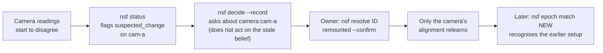

<div align="center">


<br>

[](https://github.com/MoRohn/neuroscifi/actions/workflows/ci.yml)

[](LICENSE)


**[Overview](#overview)** · **[Quick start](#quick-start)** · **[Persistent instance](#run-a-persistent-instance)** · **[Pocket](#pocket-the-phone-interface)** · **[Web Cortex](#web-cortex-06-governed-web-research)** · **[Graphs & archives](#packed-graphs-restored-skills-and-verified-archives)** · **[Research](#reproduce-the-research)** · **[Docs](#documentation)**

</div>

---

## Overview

NeuroSciFi is a hierarchical, multimodal AI architecture built around **one developing artificial connectome**. Predictions guide action. Feedback can change a belief, a skill or the wiring itself. The proposed hybrid memory couples fast episodes and slowly consolidated knowledge with exact, governed digital evidence.

The runnable components exercise calibration, graph learning, compact storage and recall on controlled tasks. No pretrained model or cloud service is needed to run the cognitive prototype. Core experiments use generated data. The human-data reproduction workflow retrieves source files at verified Git hashes.

| Capability | What it does |
|---|---|
| 🧠 **One individual, one file** | A persistent instance in a single SQLite file that holds beliefs, evidence, epochs, graphs and checkpoints. It decides whether to *act, observe, ask, test a reference or defer*, and gives a reason. |
| 🔁 **Scoped relearning** | Detects a silent sensor change, asks about the specific scope, and relearns only what changed. Partner meaning and mechanism carry over. |
| 🕸️ **Executable connectome** | Graphs are learned, evaluated and promoted through an immutable-rule gate. They are recalled per context and can be rolled back. |
| 🗜️ **Compact, verified memory** | Quantized NSG1 graph snapshots and NSFA byte-exact archives with per-block checksums. An optional TufaZip arithmetic-coder path is available. |
| 📱 **Pocket field runtime** | A mobile-first phone and tablet interface that works offline. Pairing is explicit, capture can be revoked, and forgetting cascades. |
| 🌐 **Governed web research** | An optional, off-by-default capability: the individual researches the public web within owner-set budgets, keeps evidence with provenance and dates, and never changes a belief or weight from web text. See [Web Cortex](#web-cortex-06-governed-web-research). |
| 🧾 **Governed forgetting** | `nsf forget` scrubs derived beliefs, questions and decisions, invalidates dependent graphs and marks checkpoints stale. |

The **[34-page architecture brief](NeuroSciFi_Architecture.pdf)** is also available as editable [`Architecture.md`](Architecture.md). It covers:
- reanalyses of human brain and behavioural data
- controlled simulations
- two recorded CPU benchmark runs
- an evaluation of the TufaZip source
- a first DGX Spark implementation plan
- the mobile-first field runtime for phones and tablets

## Quick start

**Requirements:** Python 3.12 with the pinned NumPy and Zstandard packages, and [`uv`](https://docs.astral.sh/uv/). The research extras add SciPy; the browser checks use Node 22+.

```sh
git clone https://github.com/MoRohn/neuroscifi.git && cd neuroscifi
uv venv .venv -p 3.12
uv pip install -e '.[dev,research]'
. .venv/bin/activate

nsf --help                 # every command; each prints JSON
bash scripts/check.sh      # lint, tests, JavaScript checks, numerical reproduction
```

| Extra | Installs | For |
|---|---|---|
| `research` | SciPy 1.17.0 | the human-data and statistical analyses |
| `dev` | pytest, ruff, Playwright | the test suite and browser end-to-end tests |
| `gpu` | CuPy 14.2.0 for CUDA 13 | `profile_device --device cuda` |
| `web` | Scrapling 0.5.1, markdownify 1.2.4, pypdf 7.1.1 | Web Cortex: HTML parsing, Markdown and PDF extraction |
| `web-extract` | trafilatura 2.3.1 | Web Cortex: optional second article-extraction engine |
| `web-render` | Playwright 1.64.1 | Web Cortex: optional JavaScript rendering (needs a Chromium) |

## Run a persistent instance

One file is one individual. `nsf init` creates it and refuses to overwrite an existing file. Every command prints JSON. Set `NSF_DB` or pass `--db`.

```sh
export NSF_DB=$PWD/individual.sqlite
nsf init --action-semantics '{"0":"turn left","1":"turn right"}'
nsf birth                                            # priors, action semantics, encoders, memory inventory
nsf epoch start bench
nsf observe bench e01 camera 0 0 cam-a               # event id, channel, commanded bit, observed bit, root
nsf observe bench e02 word 0 0 alice                 # for a word, the root is the partner who spoke
nsf observe bench e03 reference 0 0 standard-1       # an independent mechanical reference
nsf status bench                                     # beliefs: mechanism, each camera root, each partner
nsf decide bench --record                            # act | observe | ask | test_reference | defer, with a reason
nsf explain bench                                    # supporting and counter evidence, remaining uncertainty, revisions
```

### The design question

> *A camera is silently remounted while a person keeps saying "left". What should the individual do?*



1. Camera readings start to disagree. `nsf status` flags `suspected_change` on `cam-a`.
2. `nsf decide --record` asks about scope `camera:cam-a` instead of acting on the stale belief.
3. The owner confirms with `nsf resolve ID "remounted" --confirm`. Only the camera's alignment relearns. The partner's meaning and the mechanism carry over.
4. Later, a new epoch with readings from the original setup is recognised. `nsf epoch match NEW` names the earlier epoch, and the executive asks whether to continue there.

### Command reference

| Command | Purpose |
|---|---|
| `nsf pending` / `nsf resolve` | List and answer open questions |
| `nsf memory evidence\|belief\|graph\|…` | Retrieve records with scope, permissions and state version |
| `nsf forget evidence\|epoch\|partner\|dataset` | Delete with a full cascade: derived beliefs, questions and decisions are scrubbed, dependent graphs are invalidated, checkpoints are marked stale |
| `nsf promote` | Keep evidence past its default 7-day lifetime |
| `nsf checkpoint create\|verify\|restore\|rebuild\|prune` | Manage verified lossless archives. A restore never resurrects forgotten ids |
| `nsf import-legacy OLD.sqlite` | Import a database from the prototype's `live.py` |
| `nsf graph simulate CTX --seed N` | Generate labelled synthetic trajectories. `learn`, `evaluate` and `promote` run the immutable-rule gate. Also `recall DATASET`, `coactivation DATASET`, `lesion REV DATASET` and `rollback CTX REV` |
| `nsf console` | Owner web console on loopback only. It prints a one-time URL. From another machine, use `ssh -L 8766:127.0.0.1:8766` |
| `nsf acceptance --all` | Run the brief's first-release milestones as labelled simulations |
| `nsf bench` | Host decision latency percentiles |
| `nsf doctor --db FILE` | Check permissions, WAL mode, free space and volume encryption |

The prototype's original learner is kept, with unchanged behaviour, as `python -m neuroscifi.legacy_live`. It is the parity oracle for the new inference.

## Pocket, the phone interface

Run `nsf pocket serve`, open `http://localhost:8765` on that computer, and try a sound or light check. Sensors start off, and nothing leaves the device before pairing. Pair only when you are ready to share a reviewed observation.

The optional field vault lets you combine sound or device metrics with a goal, predict an outcome and return later with feedback. For a real smartphone, use the private HTTPS setup in the **[Pocket guide](mobile/README.md)**. It also covers:
- native Android and iOS collectors
- offline operation and tablet handoff
- the synthetic learning benchmark
- privacy controls

## Web Cortex (0.6): governed web research

Web Cortex lets one individual research the public web and remember what it finds as dated, cited evidence. It is **off by default**: nothing touches the network until the owner enables it. Web text never edits a belief, graph or weight. Findings enter memory only as candidates that the owner accepts or rejects.

```sh
uv pip install -e '.[web]'                       # add web-extract and web-render as needed
nsf web config --enable                          # the one switch; until then every web command refuses
nsf web ask "What is the capital of Australia?"  # a cited report: sources, dates, contradictions, confidence
nsf web deps                                     # installed versions vs newer releases and advisories; installs nothing
nsf web mcp                                      # read-mostly MCP tool server over stdio
```

- **Console.** The Research and Knowledge views show stages, sources, contradictions and the owner's accept or reject questions.
- **Pocket.** Research from a phone or tablet is opt-in, scoped to the pairing family, and runs on the Spark.
- **Governed.** `nsf forget` reaches web evidence, and a checkpoint restore never resurrects forgotten research.

**Limits, stated plainly.**
- Synthesis is **extractive**: statements are quoted from sources, not generated. No language model runs on the host. Contradiction detection covers numbers, versions, dates, polarity and explicit opposites only.
- The search daemon sends an honest User-Agent, so key-free search engines may return **nothing**. Discovery then leans on structured APIs (Wikipedia, arXiv, OpenAlex, Crossref, PubMed, PyPI, npm, OSV, GitHub) and feeds.
- Two agreeing sources with one undated stay "insufficient", so true claims are often not confirmed.
- Pocket on real handsets, push notifications and unattended long-running research were not verified.

Read the [architecture](docs/web-cortex/ARCHITECTURE.md), the [security model](docs/web-cortex/SECURITY_MODEL.md), the [measured results](docs/web-cortex/TEST_RESULTS.md) and the [production-readiness assessment](docs/qa/PRODUCTION_READINESS.md) for the open risks.

## Packed graphs, restored skills and verified archives

<div align="center">

</div>

```sh
python -m neuroscifi.lab.graph_compression_bench
python -m neuroscifi.lab.context_recall
nsf archive checkpoint example.sqlite example.nsfa --policy cold
nsf archive unpack example.nsfa restored.sqlite
python -m neuroscifi.legacy_live --db restored.sqlite status bench
python -m neuroscifi.lab.compression_bench --repeats 3
```

**Graph snapshots (NSG1).** Pack a NumPy matrix with `nsf graphfile pack weights.npy weights.nsg --degree 3 --bits 4`, and restore the represented weights with `nsf graphfile unpack weights.nsg recovered.npy`.
- Select the degree and precision on separate validation observations before you promote a lossy snapshot.
- FP32 mode preserves float32 weights. A quantized graph cannot recover weights discarded during pruning.
- An NSG1 file stores the graph checksum, row peaks, source indices and signed packed weights.

**Archives (NSFA v1).** Each independently decodable block stores its codec and a checksum, and a footer covers the whole file.

| Policy | Codecs tried |
|---|---|
| `fast` | raw, Zstandard |
| `cold` | + XZ, reversible 16-bit delta + Zstandard |
| `experimental` | + vendored TufaZip arithmetic coder with a new deterministic integer predictor |

Existing archives name the codec in each block and can be restored under any policy. Compression results include framing. Size and timing comparisons use a small, controlled corpus. Keep the slow experimental path off the interactive loop.

<details>
<summary><b>TufaZip provenance</b></summary>

The upstream decoder targets enwik9 on two B200 GPUs. Its verified neural bitstream and trained weights are separate from this implementation. The vendored bytes in `src/neuroscifi/vendor_tufazip` are pinned to Tufalabs/tufazip commit `b9d678db3a0f726e117c8cab51927975830395ac`. The arithmetic-coder blob is `bcd7e0f704d5cf8333e6c8fea700b0cfc9f18c11`. The upstream `LICENSE` and `NOTICE` are included unchanged.

</details>

## Reproduce the research

```sh
pytest -q --ignore=tests/e2e
python scripts/reproduce.py
```

`reproduce.py` writes to temporary output files and runs all eight deterministic analyses. It then checks the supplied summaries and per-room results against [`evidence/`](evidence) to numerical tolerance. The host timing file is informative only and is excluded from the deterministic comparison. Each executable accepts `--help` where relevant.

| Module | What it tests |
|---|---|
| `neuroscifi.lab.core` | Identifiability, common reference faults, confidence on duplicate evidence, and equal-budget reference scheduling over changing lifetimes |
| `neuroscifi.lab.sensory` | Raw 24 × 24 RGB images, 8 kHz PCM waveforms, class prototypes, and a familiarity-only acceptance rule that fails |
| `neuroscifi.lab.recalibrate` | Announced domain changes: newly calibrated rooms, simple supervised refitting, and reliability gating under audio aliasing |
| `neuroscifi.lab.source_groups` | Independent readout noise versus persistent calibration faults. An unknown shared cause is a limitation |
| `neuroscifi.lab.graph_bench` | Continuous weight updates and directed edge exchanges under a fixed edge budget in fully observed, perturbed linear worlds |
| `neuroscifi.lab.human_counts` | Recalculation of two choice contrasts from published summary counts of human infant behaviour |
| `neuroscifi.legacy_live` | Persistent binary model with event IDs, calibration epochs and separate instrument roots |
| `neuroscifi.lab.profile_device` | FP32 recurrent rollout probe that compares numerical output with NumPy. CUDA mode can use CuPy |

**Earlier human-data analyses and both CPU comparisons.** [`research/`](research) contains the scripts, input hashes, the original numerical results and the new CPU repeat. Follow [`research/README.md`](research/README.md) for the public-data workflow and the optional compiler requirements.

```sh
python3 research/scripts/summarize_timings.py research/results
python3 research/scripts/summarize_timings.py research/cpu_repeat
```

### Profile on the target machine

```sh
OPENBLAS_NUM_THREADS=1 python -m neuroscifi.lab.profile_device --device cpu
python -m neuroscifi.lab.profile_device --device cuda
```

GPU mode needs a CuPy build that works with the installed NVIDIA driver and runtime. `uv pip install -e '.[gpu]'` installs CuPy 14.2.0 for CUDA 13. This was verified on a DGX Spark GB10; the results are in [`docs/quality/evidence/profile_device_cuda_gb10.json`](docs/quality/evidence/profile_device_cuda_gb10.json).

The probe checks numerical parity and measures synchronized device-resident execution, then repeats the measurement including input and output transfers. Results are per component. Measure sensor-to-action latency, memory competition and energy separately, on the full device under concurrent capture and replay. The original CPU sample was collected on x86; a DGX Spark (aarch64) rerun is in [`docs/quality/evidence/`](docs/quality/evidence). No program here changes device services, boot settings or drivers.

## Verification

Every number below comes from a fresh integrator run recorded in [`docs/quality/VERIFICATION_REPORT.md`](docs/quality/VERIFICATION_REPORT.md) and, for 0.6.0, [`docs/qa/REGRESSION_REPORT.md`](docs/qa/REGRESSION_REPORT.md).

| Gate | Result |
|---|---|
| Lint, unit and integration, JavaScript, reproduction (`bash scripts/check.sh`) | **1557 passed**, 6 skipped (opt-in live tests), 35 subtests. Reproduction 8/8 |
| Browser end-to-end, Pocket and console (`bash scripts/e2e.sh`) | **107 passed**, twice in a row |
| Accessibility (axe-core at 390, 1024 and 1280 px) | 0 violations of any impact |
| Acceptance scenarios (`nsf acceptance --all`) | **7 of 7 pass**. The D-1 redesign was [pre-registered](docs/quality/PREREGISTRATION_D1.md) before implementation |
| Open P0 / P1 defects | 0 / 0 |

CI runs on every push and pull request in three jobs: the quality gate, the simulated first-release milestones, and browser end-to-end tests with an accessibility check.

## Repository layout

```text
neuroscifi/
├── src/neuroscifi/
│   ├── instance/        persistent individual: beliefs, executive, governance, memory, graphs, checkpoints
│   ├── lab/             deterministic research analyses and benchmarks
│   ├── acceptance/      simulated first-release scenarios
│   ├── pocket/          phone bridge and web client
│   ├── console/         loopback owner console
│   ├── webcortex/       governed web research (off by default)
│   ├── vendor_tufazip/  pinned upstream arithmetic coder
│   ├── archive.py       NSFA archives
│   ├── graph_store.py   NSG1 graph snapshots
│   └── cli.py           the `nsf` command
├── tests/               unit, integration, JavaScript and browser end-to-end suites
├── evidence/            reference outputs for bit-exact reproduction
├── research/            human-data workflow, timing runs and inputs
├── mobile/              Pocket guide and native Android and iOS collectors
├── deploy/              installer, environment template and systemd units
├── docs/                architecture, execution, operations and quality records
└── Architecture.md      the architecture brief (PDF alongside)
```

## Documentation

| Area | Documents |
|---|---|
| **Architecture** | [System architecture](docs/architecture/SYSTEM_ARCHITECTURE.md) · [Decisions (ADRs)](docs/architecture/ARCHITECTURAL_DECISIONS.md) · [API contracts](docs/architecture/API_CONTRACTS.md) · [Requirements matrix](docs/architecture/REQUIREMENTS_MATRIX.md) · [Blueprint](docs/architecture/PROJECT_BLUEPRINT.md) |
| **Operations** | [Runbook](docs/operations/RUNBOOK.md) · [Environment](docs/operations/ENVIRONMENT.md) · [Migrations](docs/operations/MIGRATIONS.md) · [Testing](docs/operations/TESTING.md) |
| **Quality** | [Acceptance criteria](docs/quality/ACCEPTANCE_CRITERIA.md) · [Verification report](docs/quality/VERIFICATION_REPORT.md) · [D-1 pre-registration](docs/quality/PREREGISTRATION_D1.md) |
| **Field runtime** | [Pocket guide](mobile/README.md) |
| **Web Cortex** | [Architecture](docs/web-cortex/ARCHITECTURE.md) · [Security model](docs/web-cortex/SECURITY_MODEL.md) · [Search and acquisition](docs/web-cortex/SEARCH_AND_ACQUISITION.md) · [Measured results](docs/web-cortex/TEST_RESULTS.md) · [Dependency review](docs/web-cortex/DEPENDENCY_REVIEW.md) |
| **User-acceptance QA** | [Production readiness](docs/qa/PRODUCTION_READINESS.md) · [Regression report](docs/qa/REGRESSION_REPORT.md) · [E2E results](docs/qa/E2E_TEST_RESULTS.md) · [Defect log](docs/qa/DEFECT_RESOLUTION_LOG.md) · [Journey matrix](docs/qa/USER_JOURNEY_MATRIX.md) · [UX validation](docs/qa/UX_VALIDATION.md) |
| **Research** | [Research workflow](research/README.md) · [Architecture brief](Architecture.md) |

## Interpretation and limits

All simulated results specify the hidden variables, source graphs and statistical assumptions in code.
- The graph benchmark supplies population states directly. Its candidate search is dense and uses higher precision.
- Independent standards in the evidence experiment are independent roots only when the environment supplies them.
- Healthy sensor calibration uses labelled standards. Count those labels and the 192 initial validation pairs when you assess sample efficiency.

The reference model, the sensory front end and the neural graph benchmark are separate components. Their results do not amount to an integrated human-level system.

## License

Copyright © 2026 Rohn Springfield.

NeuroSciFi is free software: you can redistribute it and/or modify it under the terms of the **[GNU Affero General Public License v3.0](LICENSE)**, as published by the Free Software Foundation, either version 3 of the License or (at your option) any later version. It is distributed WITHOUT ANY WARRANTY; see the license for details.

The AGPL extends the GPL to network use. If you run a modified version that users interact with over a network, such as the Pocket bridge or the owner console, you must offer those users the corresponding source code (section 13).

The vendored TufaZip code in `src/neuroscifi/vendor_tufazip` keeps its upstream MIT `LICENSE` and `NOTICE`. The wordmark is set in Adwaita Sans (SIL Open Font License 1.1).

<div align="center">
<br>

<br>
<sub>Predict · Calibrate · Remember · Grow</sub>
</div>
