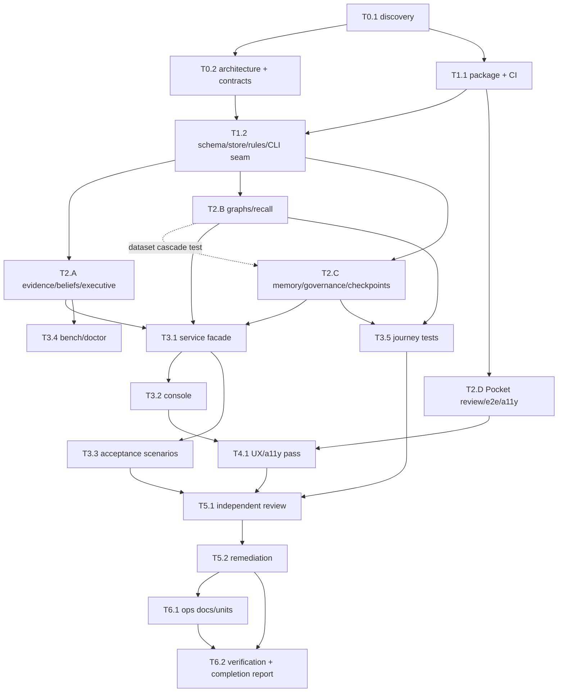

# Dependency graph

**Critical path:** T0.1 → T1.1 → T1.2 → T2.A (the highest-risk inference work) → T3.1 → T3.3 → T5.1 → T5.2 → T6.2.

**Parallel windows**
- Wave 2: T2.A, T2.B, T2.C and T2.D run concurrently with disjoint files. Only T2.C's dataset-cascade test depends on T2.B's `invalidate_dependents`, and that dependency is fixed by the contract in API_CONTRACTS §3.
- Wave 3: T3.2, T3.3, T3.4 and T3.5 run concurrently once the facade exists.
