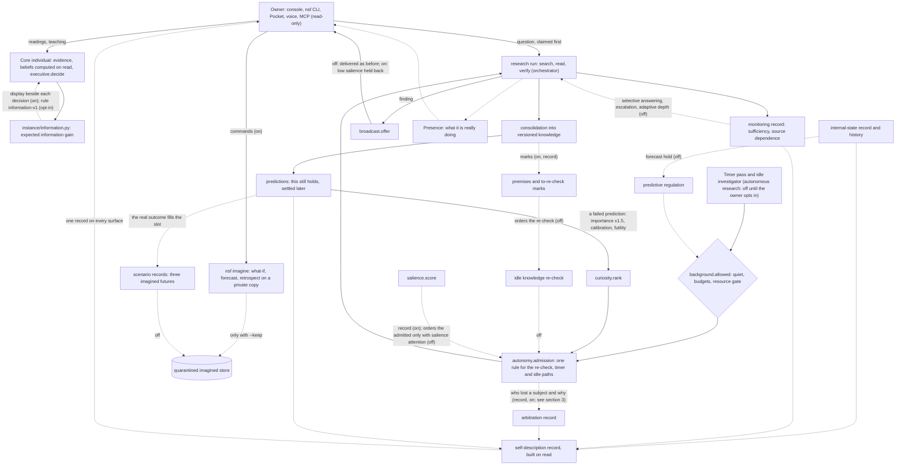

# Architecture after Project Cognitive Genesis (deliverable I)

Status: 2026-11-25, on the Wave 2 integration tree `828ca8e` (branch `genesis-wave2`); §8 added for Wave 3 and §9
for Wave 4 on 2026-11-26. Deliverable I of the
directive's §13: the subsystems and information flows as the code actually runs them after Waves 0, 1 and 2: what
produces which record, who reads it, which setting gates it, and whether it is **real** (a consumer changes behaviour
on it), **display-only** (recorded or shown, nothing acts on it) or **absent** at the shipped defaults. The core of
this document is lane L's link map (ADR-056); a sample of its file and line claims was checked against this tree (§6).
The overall system (packages, data, trust boundaries) is described in
[SYSTEM_ARCHITECTURE.md](../architecture/SYSTEM_ARCHITECTURE.md); this document covers only what Project Cognitive
Genesis added. Names describe functions; nothing here is a claim of consciousness or awareness.

## In plain words

- **The system is still one research loop with an owner in charge.** The owner asks; the individual researches,
  checks its sources, stores what was verified, and makes "this still holds" predictions it later re-checks. Project
  Cognitive Genesis added records about that loop, displays of it, a few owner commands, and switches for behaviour
  that is off.
- **At the shipped settings, most new links are display-only.** The ones that act are: one admission rule for
  everything done unasked, the owner's quiet switch, the voice follow-up across a restart, and the existing feedback
  from failed predictions into what curiosity looks at next. Autonomous research itself is off on a new individual
  until the owner opts in (`autonomous`, web, default off).
- **Imagined content is fenced off.** What the system imagines (what-ifs the owner keeps, scenario records,
  model-written reflection summaries) goes only into a quarantined store that the research loop never reads. A
  scenario's outcome reaches the loop only as a real prediction settling.
- **Wave 2 found the pieces hand over correctly but measured no gain from linking them** (knowledge correctness
  0.718 → 0.726 on held-out (paired +0.008, below the spread), `genesis_integration.json`;
  [BENCHMARK_RESULTS.md](BENCHMARK_RESULTS.md) §3). The Wave 2 measurement review found one link wrong: the
  arbitration record named conflicts that did not happen (§3), fixed by lane Y.

## 1. The flow, as one picture

Solid arrows act at the shipped defaults. Dotted arrows are display-only, record-only, or switched off at the shipped
defaults (the label says which). The background path (the timer's refreshes and curiosity, the idle investigator) runs
only once the owner has turned autonomous research on.

Not in the picture, by rule: no arrow leaves the imagined store towards curiosity, autonomy, the orchestrator or
consolidation (ADR-049, the ruling at review0b; checked by `tests/webcortex/test_imagined_quarantine.py` and by lane
L's end-to-end test, where deleting every imagined record leaves curiosity's ranking, the candidates and the
knowledge rows identical). Nothing reads the self-description to decide (ADR-056 row 4: it must not become a control
path).

## 2. The subsystems

| Subsystem | What it does | Main code | Added by |
|---|---|---|---|
| Core individual | evidence journal, beliefs computed on read, the executive's decisions and questions, graphs | `instance/` | existing; Wave 1 adds the information display and `information-v1` (opt-in) |
| Owner control | the quiet switch, the background registry, one admission rule, daily budgets, owner work first | `background.py`, `webcortex/autonomy.py`, `webcortex/scheduler.py` | Wave 0 (ADR-050); Wave 2 adds the arbitration record |
| Instinct-like regulation | internal-state record, predictive regulation (off), salience record, curiosity by learning progress (off) | `internal_state.py`, `resources/forecast.py`, `resources/policy.py`, `webcortex/salience.py`, `webcortex/curiosity.py` | Wave 1 lane I (ADR-051); Wave 2 adds salience attention (off) |
| Research and monitoring | search, read, verify, answer with quotes; a monitoring record per result | `webcortex/orchestrator.py`, `webcortex/monitoring.py` | existing; Wave 1 lane C (ADR-054) |
| Knowledge | consolidation, versions, contradictions asked of the owner, predictions, hypotheses, premises and marks, re-check (off), reflection (off), strategy selection (inactive) | `webcortex/consolidate.py`, `predictions.py`, `evolution.py`, `premises.py`, `recheck.py`, `reflection.py`, `strategies.py` | existing; Wave 1 lane K (ADR-055) |
| Imagination | sandbox copies, what-ifs, forecasts, the causal engine, scenario records (off) | `instance/imagine.py`, `instance/forecast.py`, `causal.py`, `webcortex/scenarios.py` | Wave 1 lane M (ADR-052) |
| Quarantine | provenance kinds; the imagined store; triggers; the allow-list scan | `provenance.py`, `instance/imagined.py` | Wave 0 lane P (ADR-049) |
| Workspace and self-description | selective broadcast (off), one self-description record, Presence from real activity, the voice follow-up | `broadcast.py`, `self_description.py`, `presence/`, `voice/hub.py`, `mcp.py` | Wave 1 lane W (ADR-053); Wave 2 adds `doing.cycle` |
| Failure guards | a failing Wave 1 mechanism no longer takes down the owner's question, a status page, the timer, the worker or a voice session | ten files ([REGRESSION_VERIFICATION.md](REGRESSION_VERIFICATION.md) §4.2) | Wave 2 lane U |

## 3. The records: who writes, who reads, what gates them

"At the defaults" is the state on a new individual with the shipped settings (read from `InstanceConfig`, `WebConfig`
and voice `DEFAULTS` on this tree; see [IMPLEMENTED_ENHANCEMENTS.md](IMPLEMENTED_ENHANCEMENTS.md)).

| Record (where stored) | Written by | Read by | Setting | At the defaults |
|---|---|---|---|---|
| internal-state history (`<db>.resources/internal-state.jsonl`, 720 samples) | the worker every 30 s (`internal_state.record`) | `nsf internal-state`, the self-description, the background gate when predictive regulation is on | `internal_state_history` (on), `predictive_regulation` (off) | **display-only** |
| salience record (`$.autonomy.salience` in the decision event) | `salience.score` for every candidate | the decision log; broadcast (when `on`); salience attention (when on) | `salience_record` (on), `broadcast` (off), `salience_attention` (off) | **display-only** |
| admission decision (`$.autonomy`) | `autonomy.admission` | the cooldown and lineage; the self-description's `doing.cycle` | `tick_admission` (`unified`), `quiet`, budgets | **real** once autonomous research is on |
| arbitration record (`$.arbitration` on the winner's task) | `scheduler._arbitrated` | the self-description's `doing.cycle`; nothing decides on it | `arbitration_record` (on) | **display-only** (a record), written for a real conflict only: the subject in the timer's curiosity pool as the kind curiosity launches, with budget left (lane Y fixed the first build, which recorded a "curiosity lost" for subjects curiosity never wanted and with no budget left; measurement review H1); dormant at the defaults (the re-check is off) |
| monitoring record (`report["monitoring"]`) | `monitoring.assess` in `orchestrator._monitor` | the report; the self-description; selective answering, escalation, adaptive depth when on | `answer_monitoring` (on); the other three off | **display-only** |
| knowledge, versions, contradictions (`web_knowledge`, …) | `consolidate.run` | answers, curiosity, the re-check, predictions | existing | **real** |
| predictions and their settlement (`web_predictions`) | `orchestrator._predict`; `predictions.check` | curiosity (×1.5 importance after a failure), the calibration reading in `autonomy.candidates`, the futility rule, marks, error analysis | `calibrated_forecasts` (on) | **real** (refreshes run only with autonomous research on) |
| premises and marks (`web_premises`, `web_rechecks`) | `premises.after_consolidation`, `premises.failed_prediction` | the idle re-check's order (when on); `nsf knowledge rechecks`; the self-description | `premise_recheck` (on), `idle_recheck` (off) | **display-only** |
| hypothesis details (`web_hypothesis_details`) | `evolution` | displays | `hypothesis_fields` (on) | **display-only** |
| reflections (`web_reflections`) | `reflection.scheduled` | `nsf knowledge reflections` | `reflection` (off) | **absent** |
| improvement ledger (`improvement_ledger`, append-only) | `strategies` gate, the owner's revert | the strategy gate | `strategy_selection` (`"gate"`, inactive) | **absent** in effect (no promotion has passed) |
| scenario records (`imagined`, kind simulation) | `scenarios.tick`; `scenarios.settle` fills the outcome from the real settlement | `nsf imagine scenarios` only | `imagine_scenarios` (off) | **absent** |
| kept imagination answers (`imagined`) | `nsf imagine … --keep` | `nsf imagined list / show` | the imagine commands (on) | **display-only** (only when the owner keeps one) |
| broadcast decisions (`$.broadcast`) | `broadcast.offer` | the owner's channels | `broadcast` (`off`: delivers as before) | **real** as before; the new holding back is **absent** |
| self-description | built on read by `self_description.build` | console `GET /api/self`, `nsf self`, Pocket and voice `self_status`, MCP `self_status` (scope `agent`) | none | **display-only** |
| voice follow-up (`voice_sessions.context`) | `voice/hub.py` | the next voice session after a restart | voice `resume_follow` (on) | **real**. The answer is delivered only after a delivery claim succeeded and the task was read again; a claim that cannot be made is asked again, the person told once (lane X fixed security review M1, where a failed claim delivered anyway, also after a forget; the reconciliation fixed review2b N1, N2) |
| executive decision with information display (`decisions`) | `executive.decide` | `nsf decide`, `nsf explain` | `decision_information` (on), `executive_rule` (`rules-v1`) | **display-only**; the decision itself is unchanged |

## 4. The eight integration requirements of directive §8, link by link

From ADR-056's link map, at the shipped defaults and with everything on; lines re-located on this tree (§6).

| # | Requirement | At the defaults | Everything on | What carries it |
|---|---|---|---|---|
| 1 | curiosity informs knowledge discovery | **real** once the owner opts in | real | `curiosity.rank` (`webcortex/curiosity.py:255`) → `autonomy.candidates` (`autonomy.py:509`) → `autonomy.admission` (`:701`) → the timer's launch or the idle investigator's `orchestrator.submit` (`autonomy.py:871`) → consolidation |
| 2 | salience informs attention | **display-only** | real: broadcast `on` holds back low-salience findings; salience attention orders the admitted (not exercised by the benchmark's worlds: the timer's curiosity pool never held more than one subject; where the idle path had several candidates salience never changed the first) | `salience.score` (`salience.py:71`, attached at `autonomy.py:631`); `salience.attention` / `order` (`autonomy.py:782-783`) |
| 3a | imagination supports planning | **display-only** | real in the core (`information-v1` chooses by expected gain, `instance/executive.py:176`) | no web planning reads a scenario, by rule |
| 3b | imagination supports learning | **absent** (scenario records off) | **display-only**: a scenario's error reaches no learner; assessed and not built (ADR-056 Decision 4) | `scenarios.tick` / `settle` / `errors` (`webcortex/scenarios.py:215`, `:170`, `:188`) |
| 4 | the workspace coordinates access | **display-only** | real for delivery to the owner | `broadcast.offer` (`broadcast.py:113`); `self_description.build` (`self_description.py:661`); `presence.aggregator.derive` (`presence/aggregator.py:373`) |
| 5 | metacognition monitors reasoning quality | **display-only** | real inside a task (escalation, selective answering, adaptive depth); low support → later re-check not built | `monitoring.assess` (`monitoring.py:313`) in `orchestrator._monitor` (`orchestrator.py:2723`) |
| 6 | memory supports continuity | **real** (the voice follow-up; every step reads stored knowledge); marks display-only | real (marks order the re-check) | `premises.after_consolidation` (`premises.py:207`, called at `consolidate.py:1539`); re-check ranking (`recheck.py:92`); voice (`voice/hub.py:310-336`) |
| 7 | verified outcomes drive improvements | **real** (futility; the calibration reading orders candidates, `autonomy.py:532`; ×1.5 importance after a failed prediction, `curiosity.py:292`); marks display-only; strategy selection inactive | real; learning progress | `predictions.check` (`predictions.py:108`): marks (`:127`), error analysis (`:130`), calibration (`:142`); `strategies.rank` (`strategies.py:106`) behind its gate |
| 8 | executive control arbitrates conflicts and permissions | **real** decision; the record **on** (a real conflict only, since lane Y's fix) | real, with the record | `background.allowed` (`background.py:208`); `autonomy.admission`; `scheduler._over_cap` (`:401`); `scheduler.claim_next` (`:646`, owner first); `scheduler._arbitrated` (`:422`) |

Competing objectives (directive §8 "prevent any subsystem from creating uncontrolled competing objectives"): every
background activity passes `background.allowed`; the re-check, timer and idle paths all ask `autonomy.admission`;
with every lane L setting on, the caps, budgets and policy are unchanged and a tick launches as many tasks; quiet and
a spent budget stop everything new (`tests/webcortex/test_integration_arbitration.py`, lane L's report §5). No
mechanism learns or rewards its own weights: salience's weights are the fixed ones of ADR-051.

## 5. What is real, display-only or absent, at a glance

| Real at the shipped defaults | Display-only or record-only | Absent (off, inactive or not built) |
|---|---|---|
| one admission rule; quiet; owner first; budgets; the timer's one-task-per-subject order | internal-state record; salience record; arbitration record; monitoring record; hypothesis fields; premise marks | predictive regulation; curiosity learning progress; salience attention; `information-v1` (opt-in) |
| failed predictions raising a subject's importance (×1.5), futility, the calibration reading (with autonomous research on) | information gain beside decisions; the self-description; Presence's planning / predicting / simulating states; `doing.cycle` | scenario records; selective answering; verification escalation; adaptive depth; broadcast holding back |
| the voice follow-up across a restart | the imagination commands (answers shown to the owner; kept only with `--keep`) | idle re-check; reflection; hypothesis abandon; strategy selection (gate fails closed); `pocket_recent` |
| the 14 failure guards (act only when something fails) | | a scenario's error feeding a learner (front-door adjustment: built in Wave 3, §8); low support → later re-check; learned policies; levels 4 and 5 |

## 6. Verification of lane L's file:line claims

ADR-056 cites lines on lane L's own branch. On the integration branch lanes U and F were applied first; lane U's
guards changed `autonomy.py`, `curiosity.py`, `executive.py`, `scheduler.py`, `orchestrator.py`, `consolidate.py`
and `voice/hub.py`, and lanes U and F each added entries to `background.py`, so some lines moved. Checked on
`828ca8e` with `sed -n` and `grep -n`:

| ADR-056 says | On `828ca8e` | Match |
|---|---|---|
| `salience.py:71` `score` | `def score` at 71 | exact |
| `broadcast.py:113` `offer` | `def offer` at 113 | exact |
| `scenarios.py:215`, `:170`, `:188` `tick`, `settle`, `errors` | at 215, 170, 188 | exact |
| `self_description.py:661` `build` | at 661 | exact |
| `presence/aggregator.py:373` `derive` | at 373 | exact |
| `monitoring.py:313` `assess` | at 313 | exact |
| `premises.py:207` `after_consolidation` | at 207 | exact |
| `predictions.py:108` `check`; `:127`, `:130`, `:142` | at 108; `premises.failed_prediction` 127, error analysis 130, `record_calibration` 142 | exact |
| `strategies.py:106` `rank` | at 106 | exact |
| `recheck.py:92` the marked item ranked higher | the staleness call with the mark at 92 | exact |
| `orchestrator.py:1630` adaptive depth | at 1630 | exact |
| `orchestrator.py:2724` `_monitor` | `def _monitor` at 2723 (2724 is its docstring) | exact |
| `curiosity.py:252` `rank` | `def rank` at 255 | moved +3 |
| `curiosity.py:260`, `:283` the failed-prediction query and the ×1.5 | at 263 and 292 | moved +3, +9 |
| `autonomy.py:622` salience attached | `salience.score` call at 631 | moved +9 |
| `autonomy.py:688` `admission` | `def admission` at 701 | moved +13 |
| `autonomy.py:769` salience order | `salience.attention` / `order` at 782-783 | moved +13 |
| `autonomy.py:529` `evolution.recalibrations` | at 532 | moved +3 |
| `autonomy.py:852` `orchestrator.submit` | at 871 | moved +19 |
| `autonomy.py:442` `_recent` | `def _recent` at 445 | moved +3 |
| `instance/executive.py:173-175` `information-v1` | `if rule == "information-v1"` at 176 | moved +3 |
| `consolidate.py:1534` the premises call | at 1539 | moved +5 |
| `background.py:200` `allowed` | `def allowed` at 208 | moved +8 |
| `scheduler.py:398`, `:419`, `:626` `_over_cap`, `_arbitrated`, `claim_next` | at 401, 422, 646 | moved +3, +3, +20 |
| `voice/hub.py:307-328` the follow-up at a new session | `start_session` at 307, the `resume_follow` read at 310, `_resume_follow` called at 329 | moved about +3 |

Every named function and call exists on this tree. 12 of the 25 rows point at the named code exactly; 13 moved, by 3
to 20 lines. The line numbers in §4 are this tree's.

## 7. Limits of this description

- The flows are as the code reads; how often each runs in a real installation is **unverified** (no worker was run
  for days; the host's background gate was read as allowed in the integrated benchmark).
- Lane L found that a scenario settles one timer pass (15 minutes) after its prediction, that a superseded (rather
  than contradicted) item marks nothing on what rests on it, and that the ×1.5 importance is keyed by the failed
  item's id (ADR-056 row 7; lane L's report §2).
- Lane X (Wave 2 follow-ups) may move lines in `scheduler.py`, `autonomy.py`, `reflection.py`, `strategies.py` and
  `voice/hub.py` after this was written; the function names stay the reference.

## 8. After Wave 3 (2026-11-26; [WAVE3.md](WAVE3.md))

Read from the merged tree `f0a1f09`, the reconciliation branch and the fix lanes (`gen3-fix`, `gen3-fix2`,
`gen3-fix3`); ADR-058 to ADR-063.

**What counts as an independent source.** Consolidation counts the independent groups of a cluster's claims with
`claims.independence_groups`: claims join one group when they share a host, a near-identical sentence, an attribution
line ("first appeared on …") or a canonical URL (`claims.stamp_origins` writes those origins into each claim's flags,
so stored clusters keep them), transitively. That is the rule at the shipped defaults, as at step 0
(`origin_grouping` "transitive"; the code of `3ce4ae3`, unchanged). Its known defect: one page naming two honest
outlets as its origins joins them into one source (review3b N1, open). With `origin_grouping` "one_way" (off; ADR-063)
such a page attaches to one origin only (`claims._one_way_groups`, the edge chosen by content), on claims stamped
while it is set (`flags["origin_grouping"]`); it is checked on staged pages only. With
`attribution_independence` on (it ships off since the fix lane; the owner may turn it on), `claims.attribution_keys` also reads an outlet the sentence
credits ("According to X, …", "…, X says.", "… (X).", "… via X.", "…, the X desk reports") as that claim's origin;
it reads only those forms, and a sentence crediting two outlets joins them (security review H1). The rule cannot see a
copy whose wording credits its origin any other way, nor one that credits nothing: wording is not provenance.

**The individual's own text.** With `echo_recognition` on (it ships off since the fix lane; the owner may turn it on), consolidation removes from the
supporting side of a cluster every claim that repeats a value only the individual's own model-written answers (stored
with its tasks, `web_tasks.result`) had stated before any source it read did, or their wording, or that credits an
assistant, a chatbot or an AI model (`consolidate._Echoes`, `_without_echoes`); a disagreement such a page raises is
still asked. It never reads the imagined store (its quarantine forbids it), so own values that live only there are not
seen. At the shipped defaults nothing removes echoes.

**Supersession** (`supersession`, `"ask"` by default). With `"independent"`, in `_contested_against` the rule
(`_rule_replacement`) may replace a held item when a newer value by its stated time is stated by at least
`supersession_min_sources` independent groups, never contradicted by an owner's answer and never the individual's own
text; the replacement is marked `decided_by: "rule"`, listed by `nsf web replacements` and undone by `nsf web revert
ID`. Off, a contradicting refresh records a contradiction and asks the owner, as since ADR-026.

**The shadow record.** With `predictive_regulation: "shadow"`, `resources.policy.background_gate` decides exactly as
with the setting off and then, on decision paths only (`record=True`; the status displays pass `record=False`),
`resources.shadow.observe` appends what the forecast would have said for the newest history sample to
`<db>.resources/forecast-shadow.jsonl` (at most once per sample per process). The worker's sampler
(`internal_state.record`) settles the verdicts against the history every 300 s into `forecast-shadow-days.json`;
`nsf internal-state --shadow-report` reads both. Display-only: nothing acts on it. Its "hits" include holds the real
gate already made; since the fix lane `settled.added` counts only what the forecast adds where the gate
allowed, and `guide` states, written before any host data, what would support turning it on.

**The front door.** `causal.answer` tries the back-door formula first; when it is declined because a hidden common
cause acts on the cause, and `front_door` is on (`FRONT_DOOR = True`; `nsf imagine scm --no-front-door`), it checks the
front-door criterion by d-separation (`_frontdoor`) and answers with the mediators named (`identified_by:
"front_door"`). The question must say where its moments come from (`moments: "population"`, or `samples: n`, which
gives an interval and a decline below the usefulness bound, `_regime`); an unstated origin is declined. Labelled
imagined, never evidence; nothing stored; the command opens no individual.

**Budget.** `autonomy.idle` refuses at the day's autonomous task count (`_tasks_spent`), as the timer does
(`scheduler._over_cap`); the re-check's pool can be ordered by `recheck_order` (default `"staleness"`, lane K's).

**The settings Wave 3 added, at the shipped defaults:**

| Setting | Default | Real / display-only / absent |
|---|---|---|
| `attribution_independence` (web) | off (fix lane) | absent |
| `echo_recognition` (web) | off (fix lane) | absent |
| `supersession` (web), `supersession_min_sources` | `"ask"`, 2 | absent (contradictions asked) |
| `origin_grouping` (web, third fix lane) | `"transitive"` | absent (the grouping of `3ce4ae3`; N1 open) |
| `recheck_order` (web) | `"staleness"` | real only with `idle_recheck` on (off) |
| `predictive_regulation` (instance) third value `"shadow"` | `false` | absent; display-only when set |
| front door (`nsf imagine scm`) | on | real for the owner's command (an answer shown, nothing stored) |
| `nsf readiness`, `uncertain.outcomes_readiness` | always | display-only (read-only, owner scope) |
| the three reconciliation guards (claims, echoes, the rule) | always | act only when a mechanism fails |

## 9. After Wave 4 (2026-11-26; [WAVE4.md](WAVE4.md))

Read from `3032cf6` (`genesis-wave4` after its fix lane); ADR-064 to ADR-067. No schema change (19); no new
background activity, daemon, listener or dependency.

**What counts as an independent source, at the shipped defaults: unchanged.** `claims.independence_groups` groups
as in §8 (`origin_grouping` "transitive"). Wave 4 added two rules on top of it, both off.

**Derivation** (`source_derivation`, off; ADR-066; code in `webcortex/claims.py`). With it on,
`claims.stamp_origins(..., derivation=True)` stores on each claim `flags["derivation"]["cites"]`: the normalised
names (`"name:<site label>"`, at most 16, the first 5,000 words read) of the other pages of the task that its page
names in capitalised words or links to (`derivation_cites`), never a flagged or claimless page, never the subject's own
name or a calendar word, never a page stated as published later. `independence_groups` then takes today's groups and
only joins them, one edge per group chosen from content (`_derivation_edges`); claims are loaded with the settings in
force (`state.claim_from_row`), so stored marks are inert when it is off. It runs inside consolidation's write
transaction in memory over one task's claims and reads no row. Real when on; absent at the defaults.

**What the individual itself said** (`own_text_provenance`, off; ADR-067; new module `webcortex/emitted.py`). With it
on, the orchestrator's final write of an owner's model-written answer (`emitted.owner_task`: console, CLI, voice,
`refresh-owner:`) records, for each asserting part of a sentence (`emitted.asserted`), the (subject name, value) pairs
it states (`names`, `value_key`) with their time and whether a claim read by then states them (`prepare`, one bounded
pass before the write transaction; `record` inside it). Stored as salted digests in `web_strategies` rows
(`emitted:<digest>`, `emitted-task:<digest>`; primary-key reads only; at most 200,000 rows; an emission counts for 30
days). Consolidation's `emitted.Echoes` (built before the write transaction, at most 512 point lookups) marks a page's
claim as an echo when the earliest emission of one of its pairs was unsourced and made before the page was read; an
echo leaves the supporting side, supersession never counts it, and a held item it disagrees with is asked about as a
contradiction (`consolidate._echo_disagreement`) and neither superseded nor weakened. With both rules on,
`emitted.derivation_hook` is passed as `stamp_origins(echo=...)` at the orchestrator's two call sites (evaluate,
adaptive depth) and in the harnesses, so a marked page is in no group. Forget and restore: `_forget_research_core`
calls `emitted.forget_task`; a forgotten knowledge item calls `forget_knowledge` (live and on replay); `nsf web config
--forget-own-text` calls `forget_all`. Pocket, MCP and the self-description never read these rows. Real when on;
absent at the defaults.

**The caution** (always, display only; ADR-065; new module `webcortex/caution.py`). Computed when a view is drawn
(`for_report`, `for_knowledge`, `for_pending`, `for_contested`; `facts` over the stored supporting claims with today's
`independence_groups`; `_Own` reads `consolidate._Echoes` for the owner's views only, 0.5 s per view, at most 50
statements in the open-questions view). Imported only by the views: `console/server.py`, `webcortex/cli.py`,
`pocket/server.py`, `voice/hub.py`, `voice/bridge.py` (a test scans `src`); MCP does not import it. It shows "Only one
source says this." for a single page; with `caution_detail` (off) also the copy trigger and the own-answer flag.
Display-only.

**The day's allowance** (`allowance_division`, `"race"`; ADR-064). With `"reserve"` or `"yield"`,
`scheduler._division` computes places held for reaching (`round(tasks × reach_share)`, released while the admission
rule admits no reaching candidate) and `scheduler._over_cap(..., held=)` keeps the timer's pass out of them;
`autonomy.idle` takes reaching candidates into any room and records the division in its decision event. `"race"` reads
nothing: absent at the defaults. **The tie-breaks** (always): `autonomy._lineage` visits the owner's records, then
tasks in creation order; `curiosity.search_terms` and `rank` take the claim stored last (`rowid`). Real.

**Settings and budgets** (always). `config.CHECKED_ON_LOAD` holds every `WebConfig` field; a damaged value reads as
`config.CAUTIOUS` or its default, and the `FAILS_CLOSED` network limits turn web access off
(`state.require_enabled` names `nsf web config --set NAME=VALUE`); `InstanceConfig` checks `ask_budget_per_epoch` and
the settings fixed at `nsf init`, whose damage pauses writes (`write_allowed`, `fixed_damage`) until `nsf config
--repair-fixed NAME=VALUE` (`store.repair_fixed`); `voice/config.py` checks every stored value. `orchestrator.requeue`
checks the day's autonomous count inside its transaction; `governance.prepare_replay_marks` scans before a restore's
transaction. Real.

**Benchmark code** (`acceptance/cognition/sources.py`, new): the source-independence harness: the worlds
(`sources_splits_dev.py`, `sources_splits_heldout.py`; `sources_withheld.py` loaded only by `sources.final()`), the
metrics, the references, the verdict rules (`verdict_derivation`, `own_verdict`), the guard (pinned digests, a ledger
line before loading); commands `scripts/bench_sources.py run|final`. Also `cycles_reach_splits.py` and the `division`
configurations of `cycles.py` (`scripts/bench_learning_cycles.py division`, `division-cost`); `scripts/bench_caution.py`,
`assess_derivation_evidence.py`, `compare_source_derivation.py`, `cost_source_derivation.py`,
`families_with_source_derivation.py`, `report_source_derivation.py`, `summarise_wave4_e.py`, `summarise_wave4_fix.py`.

**New owner commands:** `nsf config --repair-fixed NAME=VALUE`; `nsf web config --forget-own-text`.

**The settings Wave 4 added, at the shipped defaults:**

| Setting | Default | Real / display-only / absent |
|---|---|---|
| `source_derivation` (web) | off (not supported; not recommended) | absent |
| `own_text_provenance` (web) | off | absent (nothing recorded or read) |
| `allowance_division` (web), `reach_share` | `"race"`, 0.25 | absent (reads nothing) |
| `caution_detail` (web) | off | absent; display-only when set |
| the caution ("Only one source says this.") | always | display-only |
| settings checked on load; fixed settings and network limits fail closed | always | real (acts only on a damaged value) |
| `requeue` within the day's count; the restore's scan; the tie-breaks | always | real |
