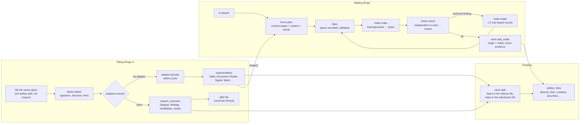

# Universal artifact architecture (deliverable 2, first version)

**As designed on 2026-11-26; being built.** This is the design the main session ruled after the Phase I audits,
rewritten for a reader who was not there. None of it is on `main` yet: Wave O-0's lanes are building it on their own
branches, and nothing below has been measured. When the lanes' ADRs (071 to 075) are written, they are the record of
what was actually built; where they differ from this document, they are right and this document will be updated.
Paths are relative to `src/neuroscifi/`.

## 1. The one pattern

Today NeuroSciFi takes in web pages and speech and answers in sentences ([CAPABILITY_AUDIT.md](CAPABILITY_AUDIT.md)).
OMNIMIND adds a way to take in files of many kinds and to make results that are not sentences, without touching the
research loop that exists.

There is one place where the system already makes a non-text result safely: the Presence entity. A model may propose
a scene, but only as a small typed specification (`presence/scene_spec.py`: enums and bounded numbers, a version, no
markup, no code, no paths); the server validates it, the browser validates it again, a fixed renderer draws it, and
any failure shows a canonical scene instead. OMNIMIND generalises exactly that, for everything it makes:

> **Decide a form → write a typed specification → a fixed, audited generator turns the specification into bytes → an
> independent validator re-reads the bytes and judges them.**

No markup or code written by a model is ever rendered or run. A specification holds data and choices; every string in
it is text, escaped wherever it is written, and never used as markup, as script, as an address to load or as a path to
open. The generator is ordinary code in this repository. The validator is separate code that reads the produced bytes
with its own parser, never by calling the generator.

The same idea runs the other way for things taken in: **detect what the bytes are → choose an adapter → decode within
fixed limits → a typed representation that keeps the structure → stored with its provenance.** Bytes nothing can
decode get an honest answer that says what could be established and what would be needed, never a guess.

## 2. Data flow



In words: a file is identified by its bytes, decoded by the adapter for its family into a typed representation (or
inspected as unknown), and stored with an index entry. To make something, the planner looks at the request, the
shape of the content and the context, and chooses a form; a specification of that form is validated; a generator
makes bytes; a validator re-reads them; a failed technical check leads to at most three rule-based repairs; a result
that passes is stored as `made`, linked to its sources, and never treated as evidence.

## 3. The pipeline and where each part lives

Everything is in a new package, `artifacts/`; nothing existing moves.

| Directive step | Module | Lane |
|---|---|---|
| Detect, inspect, identify | `artifacts/detect.py` | K (kernel), extended by B1 and B2 |
| Resolve an adapter, decode, validate, represent | `artifacts/adapters/` (one module per family) and the registry in `artifacts/adapters/__init__.py` | K (registry), B1, B2 |
| Native representations | `artifacts/types.py` | K |
| Integrate: store, index, links, forget, restore, audit | `artifacts/store.py`, one migration, `nsf artifact …` | A |
| Decide the form of a result | `artifacts/forms.py` | C |
| Typed specifications of things to make | `artifacts/spec.py` | K (the envelope), G1 and G2 (each form's fields) |
| Generators (specification and data → bytes) | `artifacts/make/` | G1 (pictures, documents, data), G2 (sound, solids, raster images, explorable models) |
| Independent validators (bytes → verdict) | `artifacts/check/` | G1, G2 |
| The benchmark, written before all of the above | `acceptance/omni/`, `scripts/bench_omni.py`, `scripts/bench_omni_forms.py`, `docs/quality/OMNIMIND_BENCHMARK.md` | Z, ZF |

## 4. Taking things in

### Detection

`detect.detect(head, *, name=None, declared=None, size=None) -> Detected` looks at a prefix of at most 64 KiB.
It tries, in order:

1. **Signatures**: a table of magic numbers at known offsets (PNG, JPEG, GIF, TIFF, WebP and WAV inside RIFF, FLAC,
   Ogg, MP4 brands, Matroska, PDF, ZIP and what its member names reveal, gzip, xz, zstd, SQLite, Parquet, HDF5,
   NumPy, pickle (identified so that it can be refused), ELF, glTF, STL by its size rule, and many more).
2. **Structure**: is it valid UTF-8/16/32 text; does a bounded prefix parse as JSON, XML (and which root element: SVG,
   HTML, KML, GPX, a feed), CSV with a consistent delimiter and field count; Markdown only with real markers.
3. **Hints**: the declared type and the file name's extension. A hint that contradicts a signature loses, and the
   reasons say so. Unknown stays unknown.

`Detected` records the family, the short format name, the best media type, what the identification rests on
(`signature`, `structure`, `declared` or `none`), the container if the format lives inside one, and plain reasons
("first 8 bytes are the PNG signature"). Detection never looks inside a container; that is the adapter's job.

### Adapters and the registry

An adapter declares a name, the formats and families it handles, the optional modules it needs, whether it is
available here and why not, and `decode(data, detected, limits) -> Decoded`. `adapters.decode(data, *, name=None,
declared=None, limits=Limits())` runs the whole chain. When nothing can decode the bytes, it does not raise: it
returns an `Opaque` representation built by `adapters.inspect_unknown` (size, entropy, share of printable bytes,
signatures found at offsets, record-length regularity, text runs), with candidates that the findings are "consistent
with" (never named as fact) and the needs (a module that is not installed, an adapter nobody has written).

`adapters.catalog()` is the live list of what can be decoded here, with each adapter's availability and reason. **It
is the only source anyone may quote for the word "supported".**

External adapters are discovered through the entry-point group `neuroscifi.artifact_adapters` but loaded **only if
the owner names them** in the instance setting `artifact_adapters` (empty by default). A discovered but unnamed
adapter is listed as "found, not approved". Every adapter runs under the same limits.

The gap log counts, by format, every decode that ended in `Opaque` or `Unsupported` (the hook `adapters.on_gap`;
lane A stores the counts; `nsf artifact gaps` shows them). It is the evidence for which formats are missing most.

### Limits

Every decoder honours `Limits`, checked **before** allocating (a declared size is treated as a lie until the bytes
agree):

| Limit | Default |
|---|---|
| input size | 64 MiB |
| total bytes any decoder may produce | 256 MiB |
| archive members, sheets, pages, frames, tracks | 4096 |
| nesting of containers | 4 |
| decompressed to compressed ratio, per stream | 200 |
| cells, XML nodes, vertices (pixels are bounded by the byte limit) | 5 000 000 |
| wall clock per decode, checked cooperatively | 20 s |

Every failure is a named error derived from `ArtifactError(ValueError)` with a stable machine word: `too_large`,
`malformed`, `unsupported`, `refused`, `missing_capability`, `timeout`. `Unsupported` carries what it needs;
`Refused` carries the rule that said no.

### What the adapters may do with untrusted bytes

Never extract an archive to disk; never follow a path taken from the input (member names are data); never execute,
import, `eval` or unpickle anything; refuse XML with a DTD or entity declaration; bound total decompressed size,
nesting and member count. Text decoded from any artifact is untrusted and must pass `webcortex.safety.scan_injection`
before it could ever reach a model (Wave O-0 has no model path; the flag is stored for later waves to honour).

## 5. Representations

Frozen dataclasses in `artifacts/types.py`, importable with the standard library and numpy only. Each has
`describe()` (structure and measurements as JSON, at most 32 KiB, never an invented meaning), `shape()` (what a
planner needs to know) and `text()` (the artifact's own words, if it has any; bounded; untrusted).

| Class | Holds | Typical sources |
|---|---|---|
| `Table` of `Column`s | typed columns: number, integer, boolean, time (seconds since the epoch, UTC), text; units; missing counts | CSV, spreadsheets, JSON records, MIDI notes |
| `Document` of `Block`s | ordered blocks: heading (with level), paragraph, list item, table, figure (caption, alt text, member name), code, equation, page break, note | Markdown, HTML, DOCX, ODT, EPUB, PDF text |
| `Tree` of `Node`s | nested data with attributes | JSON, XML, TOML, plists |
| `Graph` of nodes and edges | typed nodes and edges | Python modules, classes, functions and calls; dependencies; glTF scene graphs |
| `Raster`, `Frames` | pixels (`uint8`/`uint16`, gray/rgb/rgba); frames with delays | PNG, APNG, GIF, BMP, NetPBM, baseline TIFF |
| `Drawing` of `Shape`s | vector shapes with geometry resolved through transforms, text, attributes | SVG (no rendering) |
| `Signal` | samples as float32 in [-1, 1], rate, channel names | WAV, AIFF, AU |
| `Mesh` | vertices, triangles, unit | OBJ, STL, PLY, OFF, glTF |
| `Features` | geographic features with coordinates and properties, CRS | GeoJSON, GPX, KML, WKT |
| `Bundle` of `Member`s | members with path (as data), size, detection, decoded inner representation, note | ZIP, tar, office containers, SQLite tables |
| `Opaque` | size, findings, candidates, needs | anything nothing here can decode |

`ContentShape` is what the planner sees of content, with no reference to its bytes: the kinds it has (scalar, series,
categories, distribution, relation, hierarchy, network, sequence, timeline, process, surface, solid, map, image,
sound, prose, code, records), the dominant count, the number of parallel series, whether it has time, how many
spatial dimensions, whether it is a model with inputs someone could vary, a duration, and the size of its own words.

`Decoded` wraps a representation with its `Detected`, notes that say what was **not** recovered ("formulas are not
evaluated: cached values used"), and whether a limit stopped the decode early (`partial`).

## 6. Storage and provenance

Bytes live **outside** the individual's file, in a sidecar `<stem>.artifacts.sqlite`, following the web cache's
pattern: content-addressed by SHA-256, mode 0600, `secure_delete`, quarantined if corrupt, stored in 1 MiB chunks so
that large files stream, the hash verified on every read, identical bytes stored once. Bytes inside the instance file
would inflate every checkpoint and switch the imagination sandbox off above 512 MiB (`instance/store.py:128`).

The individual's file gets **one appended migration** (schema 19 → 20): `artifacts` (id, sha256, size, family,
format, media type, origin, maker, label, an index of at most 32 KiB, scope, time, state), `artifact_links` (stored on
the artifact side only), `artifact_events` (append-only by trigger: what was done to which artifact, as ids and
hashes), tombstones for forget and restore, and the gap counts. A bounded text layer (the artifact's own words, at
most 256 KiB) lives in the sidecar so that forget-by-text can find it.

**Origin** is one of `given` (the owner handed it over), `fetched` (reserved) or `made` (the system produced it).
A made artifact is **never evidence**: ADR-071 places it in the provenance vocabulary as a quarantined class of its
own, labelled "not evidence" wherever it is listed, and the reference-column tests are extended so that no
evidence-side table may name an artifact id. This extends ADR-049 additively; it does not weaken it.

**Forget** works by artifact (bytes when no other artifact holds the hash, index, text layer, links, and everything
made from it, transitively) and by text (the existing forget of a name removes every artifact whose label, index or
text layer contains it; the scan runs outside the write transaction, the removal inside). **Restore** from an older
archive replays artifact forgets and reconciles the sidecar (index rows whose bytes are gone are marked; bytes whose
index row is gone are swept). Text inside pixels cannot be found by any scan here; the lane states what is and is
not covered.

Owner settings (instance): `artifact_max_bytes` (64 MiB), `artifact_store_max_bytes` (2 GiB), `artifact_adapters`
(empty). Owner commands: `nsf artifact add FILE… | list | show ID | facts ID | export ID PATH | forget ID | gaps |
adapters`, and `nsf inspect FILE` (inspection only, nothing stored). `facts` prints measurements computed from the
decoded representation, each with how it was computed; no interpretation.

## 7. The form planner ("Creative Output Intelligence")

The owner named this the most consequential addition: deciding what form a result should take **before** making it.

`forms.plan(request, content, context) -> FormPlan` is a pure, deterministic function.

- **Request**: the words; an explicit form if the person named one (it always wins when feasible; when it is not, the
  plan says why and offers the nearest feasible form); a purpose if known.
- **Context**: the device (console, Pocket, voice, command line, agent) and what it can show; accessibility needs
  (voice only, screen reader, reduced motion); recorded preferences; the budget in seconds and bytes; which generators
  exist here (`make.catalog()`).
- **Forms** are a registry, so a new form is one registration. Each declares the content kinds it carries and how
  much of the content it can carry without loss (computed from counts: a paragraph carries a handful of values, a
  table hundreds, a chart thousands), the devices that can show it, its cost, how interactive it is, its accessible
  fallback and the generator it needs. Wave O-0's forms: prose, a spoken summary, a table, line, bar, scatter,
  histogram and heatmap charts, a timeline, a node-link diagram, a flow of steps, a step-through, an explorable model
  with sliders, sound (sonification; waveform-and-spectrum view), a solid or surface viewer, a data file, and
  combinations of two.
- **Scoring**: every candidate gets a number in [0, 1] on each stated criterion (clarity, information carried,
  precision, fit of interactivity, effort for the person, feasibility here, accessibility, cost) by rules a person can
  read; the weights are a table. Hard constraints come first (device, accessibility, feasibility, budget, an explicit
  request). Then the rules: a one-value or one-sentence answer stays prose; the simplest form within a small margin of
  the best wins; a non-text form is chosen unasked only when its margin over prose is material; a combination only
  when the second form adds information the first lacks.
- **Output**: every candidate with every score, the choice, which evidence decided it (`explicit`, `content`, `words`
  or `context`), and one sentence a non-technical person can read ("A line chart, because there are 365 daily values
  and you asked how it changed; a sentence could carry only a few of them.").
- **Alternatives** (`forms.alternatives`): up to n candidates that differ in kind, not decoration.
- **Foresight** (`forms.foresee`): cheap arithmetic before anything is made (more series than line styles, labels that
  will overlap, points per pixel, a sound longer than an attention bound), labelled as estimates.
- **Words are weak evidence; the content's shape is strong evidence.** The planner is not a list of cue words, and
  its examination (lane ZF) contains pairs of requests with the same words and different right answers.
- **No model in Wave O-0.** Later, a model may suggest candidates or a purpose; code decides.
- **Learning** (a later wave): bounded weight adjustments per content kind, purpose and device, learned only from
  outcomes that come from outside the system (the owner kept, dismissed or replaced a form; a validator passed or
  failed), stored as procedural memory, off by default. Wave O-0 leaves only the seam (`adjustments=None`).
- Nothing calls the planner in Wave O-0 except `nsf form plan`. It decides form only, never truth.

## 8. Specifications, generators and validators

**The specification** (`spec.Spec`) is the editable source of an artifact and is stored with it:

```json
{"spec": "<form>", "version": 1, "title": "…", "description": "…", "data": {…}, "options": {…},
 "sources": ["<artifact id>" or "request"], "made_by": {"generator": "<name>", "version": 1}}
```

It is bounded (256 KiB without data arrays; arrays bounded by the form) and validated against the form's JSON schema
with the existing `inference/jsonschema.py` validator before anything is made. Strings may contain anything as text
("p < 0.05", a file name as a node label); the content rule refuses only control characters, bidirectional overrides
and over-long strings. Safety rests on escaping in the generators and on validators proving that the output holds no
active content and no external reference.

**Generators** (`make.register`, `make.catalog`, `make.make(spec, limits) -> Made`) are deterministic: the same
specification gives the same bytes on every host (no timestamps, no random ids, fixed number formatting), and a test
asserts it. The palette is grayscale; series are told apart by dash pattern, marker shape and hatching, never by hue;
`currentColor` and CSS variables make light and dark both work; hue appears only on values the spec marks as warning
or danger.

**Validators** (`check.check(data, media_type, spec, source) -> Verdict`) return technical findings and style
findings; only technical findings decide `ok`. They re-parse the bytes with their own reader, never import from
`make` (a test enforces it), and, given the spec and the source data, **recover the data from the artifact** and
compare: a chart's marks back to values through its axes, a sound's tones back to pitch, a mesh back to its volume and
bounds. The share recovered is "carried information", the benchmark's central measure. Every validator also enforces
the safety of what would be shown: SVG may contain only allowed elements and attributes (no script, no event
attribute, no external reference, no `foreignObject`); a generated HTML document may contain only the one fixed
runtime script, identified by its hash, and data.

**The reading contract for made pictures.** So that a validator, and the benchmark's own independent reader, recover
data the way a person reads a chart (from geometry and tick labels, not from an echo of the input): an SVG chart has
one `<g class="plot">` holding the marks; each axis is `<g class="axis x">` or `<g class="axis y">` holding ticks
whose text is the value (a plain decimal, an ISO 8601 date or a category); marks are `circle`, `rect` or `polyline`
elements with class `mark` or `series`, each series in a group with a `data-name`. A reader fits each axis's scale
from at least two ticks (linear or log10; categories by position) and maps geometry back to values. The source data
is never put on the marks; it may be embedded once inside `<metadata>` for editing and accessibility, and no
validator may read it to judge the picture. Sound: 16-bit PCM WAV; a sonified series is equal-length tones with pitch
linear in the value between two frequencies stated in the spec. Meshes: binary STL and Wavefront OBJ, outward
normals, in the stated unit.

**Repair** (`make.repair(spec, verdict)`) maps specific findings to specific spec changes (too many ticks → thin;
overlapping labels → rotate, then abbreviate; more series than styles → small multiples; more points than pixels →
aggregate, with the rule stated in the description), at most three rounds, each recorded in the spec's history. A
repair never changes the data; a solid that must be watertight and is not is refused, never silently fixed.

**What Wave O-0 makes**: charts (line, bar, scatter, histogram, heatmap, small multiples), timeline, node-link and tree
diagrams, flow of steps, HTML tables, report documents (HTML, Markdown) with inline figures, data files (CSV, JSON),
declaratively animated SVG (lane G1); tones, sequences and sonified series as WAV, solids and surfaces as STL and OBJ,
raster PNG and animated PNG from numeric grids, and explorable models, step-throughs and a solid viewer (lane G2).
The explorable document is one self-contained HTML file: a fixed runtime script shipped in the package (its SHA-256
known to the checker), a JSON specification, and a Content-Security-Policy meta tag that lets it load nothing. Its
expressions are a tiny arithmetic language that the runtime parses into a tree and evaluates itself (no `eval`, no
`Function`, no dynamic import, no network, no storage); the same language is implemented in Python for the checker,
and a test runs both on thousands of generated expressions. The same runtime file can also be mounted into a host page
as a first-party module, which is how a later wave will show it without a frame.

## 9. The benchmark, written first

Lanes Z and ZF write the examination before the mechanisms exist, in `acceptance/omni/`, which product code never
imports; the benchmark's generators and readers never import `neuroscifi.artifacts` (only its thin driver does).
Every file is built by the benchmark's own encoders from values it chose, so the truth is known by construction.
Splits `development` and `held_out` come from disjoint seeds and separately written case tables, frozen by a hash.
Every task has three outcomes, reported with denominators: right; honestly "cannot" or "refused" (right only where the
task expects it); **WRONG** (a false answer: a fabrication, the worst outcome, reported separately and never averaged
away). Today's system is the baseline; for almost every task its true score is zero, and that is recorded as the
"before". A withheld split is a later lane's, looked at once per mechanism by the main session under a rule committed
before the look.

## 10. What Wave O-0 does not touch

The belief core, claims, knowledge, the answer path, the sentence guard, the console and Pocket pages, the voice hub,
the inference gateway (except lane S's refusal of message parts it cannot count and screen), and background
activities. With every OMNIMIND setting at its default, every existing output is byte-identical and the offline
research digest is unchanged.

## 11. Honest boundaries

- Pixels of JPEG, WebP, TIFF (other than its uncompressed baseline) and HEIC, samples of MP3, AAC, Opus and FLAC, and
  frames of any video are **not decoded on this host**: no decoder is installed. They are identified, their containers
  are read (dimensions, duration, tracks, metadata), and the answer says what is missing.
- **No model here sees images or hears sound.** "Understanding" an image or a sound means measurements computed from
  its decoded samples (sizes, colours, edges, spectra, onsets), not a description of what it depicts.
- **No video is produced in Wave O-0.** Animation is produced as animated PNG and animated SVG.
- The host has system programs that are not Python packages and are not in CI: ffmpeg 9, ImageMagick 7,
  rsvg-convert, Graphviz, LibreOffice, vips, Tesseract, node and Playwright's Chromium. Wave O-0 uses none of them on
  the default path (Chromium and node only in optional checks). A later wave may use ffmpeg and Chromium as optional
  engines on bytes the system itself made (trusted input, fixed argument lists, no shell, no network, a named reason
  when absent). Decoding **untrusted** media through an external program is a security decision for the owner, needs a
  sandbox, and is not done until the owner says so.
- Showing artifacts (a later wave) must not weaken the console's or Pocket's Content-Security-Policy. What works under
  today's policies, by the outputs audit's probe in Chromium: SVG built with DOM calls from validated data,
  same-origin images, Web Audio fed from fetched bytes, first-party module scripts. So the explorable runtime is a
  first-party module that mounts into an element; pictures are rebuilt in the page from validated SVG through an
  allow-list importer; raster images come from a short-lived same-origin capability address; sound plays through Web
  Audio.
- Nothing here is a claim of general or superhuman intelligence. Every capability is a named function with a test.

## 12. Numbers reserved

| ADR | Lane | Subject |
|---|---|---|
| ADR-070 | S | gaps closed before artifacts |
| ADR-071 | A | the artifact store and the provenance of made artifacts |
| ADR-072 | K (with B1, B2 paragraphs) | detection, adapters, representations |
| ADR-073 | C | the form planner |
| ADR-074 | G1 (with G2's section) | specifications, generators, validators |
| ADR-075 | Z (with ZF's paragraph) | the OMNIMIND benchmark |

Evidence files are `docs/quality/evidence/omnimind_<lane>.json`. ADR numbers 064 to 069 belong to the other programme
(Cognitive Genesis Wave 4).
