# The artifact architecture, as built (deliverable 2)

Status: 2026-11-27, written by documentation lane 2 on `omnimind` at `09bfff6` with fix lane F4 (`1aa7eb6`) merged (schema 21), from the code and the
decision records ADR-070 to ADR-079 in [../architecture/ARCHITECTURAL_DECISIONS.md](../architecture/ARCHITECTURAL_DECISIONS.md).
It replaces the first version of 2026-11-26, which described the design before anything was built. Nothing here is
merged into `main`. Fix lane F5 (`bf3dac6`) is merged too.

## The first screen

- **One pattern, generalised from the Presence entity**: nothing the system makes is model-written markup or code. A
  made thing is a typed, bounded, versioned **specification** turned into bytes by a fixed **generator**, and read back
  by an independent **check** that never imports the generator.
- **Everything is reached by an owner's explicit command** (or the owner's console view). Nothing runs unasked, so the
  quiet switch has nothing to hold. No artifact is reachable from a family or agent scope.
- **Deliberately not connected**: the answer path (every answer in conversation is still sentences), Pocket, voice,
  the MCP tools for agents, and any model (no model is called anywhere in the artifact package).
- **Nothing made is evidence**: made artifacts carry provenance `MADE`, are labelled "made by the system, not evidence"
  wherever they are listed, and schema 20's triggers refuse an artifact id in 15 evidence-side tables.

## Modules

Package `src/neuroscifi/artifacts/` (91 modules; the default import path needs only numpy):

| part | modules | what it does |
|---|---|---|
| kernel | `types.py`, `spec.py`, `unknown.py` | the representations (`Table`, `Signal`, `Raster`, `Frames`, `Drawing`, `Mesh`, `Features`, `Tree`, `Graph`, `Document`, `Bundle`, `Opaque`), the named errors (`Unsupported`, `HeaderOnly`, `Malformed`, `Refused`), `Limits`, the spec envelope (`spec`, `version`, `title`, `description`, `data`, `options`, `sources`, `made_by`), the capability-discovery answer |
| detection | `detect.py`, `detect_b2.py` | signatures first, then structure, then hints; disguises and nested compression; never trusts a name or a declared type alone |
| readers | `adapters/` (a registry: `adapters.decode`, `adapters.catalog`; 66 readers in `adapters/*.py`, `_b1.py`, `_b2.py`), `shapes_b1.py`, `repr_b2.py`, `measure_*.py` | decode within `Limits`; or say what was established (`HeaderOnly`, `Opaque`, `Unsupported`); measurements (image, audio, mesh, geo) |
| safety helpers | `safe.py`, `safe_b1.py`, `safe_b2.py` | bounded zip/tar/stream readers, XML without DTD or entities, bounded counts; allocation charged before it is made |
| the guard | `guarded.py` | every owner-started decode runs first in a child process (`RLIMIT_AS` = 256 MiB + 2 x the input + 2 x `max_decoded_bytes`, CPU = `max_seconds` + 5 s, no file writes, no core, a clean environment); its verdict is JSON, never pickled; then the parent decodes the same bytes |
| outcomes | `outcome.py` | one table (`of_error`, `of_decoded`, `of_member`) that maps a decode's result to answered / cannot / refused and to the exit code (0 / 1 / 2) |
| store | `store.py` | the index in the individual's file, the bytes in a sidecar; forget, restore, owner scope (below) |
| makers | `make/` (generators: charts, timeline, graphs, flow, tables, documents, data files, animation, raster PNG/APNG, sound, solids, explorable; `repair.py`; `svg_base.py` holds the palette) | spec to bytes, deterministic |
| checks | `check/` (SVG reading and safety, layout, documents, data files, PNG, WAV, meshes, explorable) | bytes to a verdict, never importing `make/`; `expr.py` is shared with the explorable maker |
| planner | `forms.py`, `forms_cli.py` | `forms.plan`, `forms.alternatives`, `forms.foresee`; frozen at `4388f4d` |
| pipeline | `produce.py`, `produce_builders.py` | from files and a request to a made, checked, stored result with its "why" |
| relating | `relate.py`, `relate_read.py`, `relate_cli.py` | what one artifact measures against what another states or shows; units from a document to a table |
| learning | `learn.py` | the per-key majority of outcomes (off by default) |
| commands | `inspect_cli.py`, `cli.py`, `forms_cli.py` | `nsf inspect`, `nsf artifact ...`, `nsf form ...` |
| page runtime | `web/explorable.mjs`, `web/explorable.css` | mounts an explorable model's spec in a page (a bounded expression language; no code) |

Outside the package: `console/artifacts.py` and `console/web/artifacts.mjs` (the "Made and kept" view, ADR-079),
`presence/aggregator.py` (an in-flight entry for the artifact subsystem), `instance/schema.py` (migrations 20 and 21),
`instance/governance.py` and `instance/checkpoints.py` (forget and restore reach the store), `instance/store.py` and
`instance/cli.py` (six settings).

## Data flow

```mermaid
flowchart LR
  subgraph owner["The owner (explicit commands or the console view)"]
    F["a file, or a kept artifact"]
    R["a request in words"]
  end
  F --> D["detect: signature first"]
  D --> G["guard: decode in a limited child process"]
  G --> A["adapters.decode under Limits"]
  A --> O{"outcome table"}
  O -- "answered / partial" --> S[("store: index in the individual's file, bytes in the sidecar")]
  O -- "refused / cannot" --> X["named refusal or capability-discovery answer"]
  S --> P["produce: interpret"]
  R --> P
  P --> PL["planner: forms.plan (+ learn.plan when form_learning is on)"]
  PL --> B["spec builders"]
  B --> M["make: fixed generator"]
  M --> C["check: independent reader of the bytes"]
  C -- "fails" --> RP["bounded repair (3 rounds)"]
  RP --> C
  C -- "passes" --> K[("stored as MADE, not evidence, with derived_from links and its production record")]
  P -. "two or more sources" .-> RL["relate.compare: How the sources relate"]
  RL --> B
  K --> V["console: Made and kept"]
  K --> CLI["nsf artifact show / export / remake"]
  AP["the answer path, Pocket, voice, agents, any model"] -. "not connected" .- K
```

## Taking things in

- **Detection** decides by content: magic numbers and structure first, names and declared types only as hints. A
  polyglot (a PDF that is also a ZIP) is refused. An unknown format gets the capability-discovery answer (what was
  identified, which reader is missing), never a guess.
- **Readers** are a registry. Built-in readers are listed by `nsf artifact adapters`, the only statement of what can be
  read; external readers load only by an owner's approval naming entry point, distribution and version (`nsf config
  --artifact-adapters NAME`, recorded as `NAME=DIST==VERSION`; a bare name stored earlier loads nothing). The catalog of
  readers, which formats are decoded and which only identified: [CAPABILITY_AUDIT.md](CAPABILITY_AUDIT.md).
- **Limits** (`types.Limits`): input 64 MiB (`artifact_max_bytes`), 256 MiB decoded in all, 4,096 members, depth 4,
  ratio 200 per stream, 5,000,000 elements, 20 s per decode (checked cooperatively; the guard kills at 25 s). Each
  reader charges what it will materialise before it allocates it; text formats are charged their measured cost per
  structural mark before parsing (an honest INI over about 131,000 lines is refused with a reason).
- **The guard** (`guarded.py`, fix lane F1): always on for owner-started decodes. A child that cannot start means the
  file is kept and not read (fail closed). Cost, as measured by fix lane F4 (`docs/quality/evidence/omnimind_f4.json`):
  the child starts in about 0.09 s; `add` decodes once, in the child, which returns a bounded JSON summary the parent
  validates (`guarded.summarize`); `make`, `facts`, `relate` and the console's view decode twice (child, then parent)
  plus about 0.1 s. `add` before and after that change: a 5,000-file zip 5.81 to 2.97 s (2.53 s of the in-process
  decode is the injection screen run on each of the 4,096 members), a crafted 135 KiB PNG 13.19 to 6.86 s, a 30 MP PNG
  1.31 to 1.02 s. An approved external reader that loads in the parent but not in the child is refused
  (`external_unguarded`) and the file kept unread. A success verdict is reused per content hash, name, limits and
  approved readers (at most 256; refusals never reused).
- **Injection**: text decoded from a file passes `webcortex.safety.scan_injection`. `adapters.decode` refuses a flagged
  file (`Limits.refuse_flagged`, default on); the store keeps it marked flagged and never offers its words to a model.

## The store and its two schema steps

- **Bytes** live in a sidecar `<individual>.artifacts.sqlite` next to the individual's file: content-addressed by
  SHA-256, chunked, mode 0600, WAL, `secure_delete`; it also holds each artifact's text layer and a made artifact's
  specification. It is never part of a checkpoint. Caps: 64 MiB per file, 2 GiB in all (`artifact_store_max_bytes`).
- **Schema 20** (lane A): `artifacts`, `artifact_links`, `artifact_events` (append-only), `artifact_forgotten`
  (payload-free tombstones), `artifact_gaps`; triggers refuse an artifact id in 15 evidence-side tables.
- **Schema 21** (lane L): `form_outcomes` (the owner's reactions and check verdicts per made artifact; a row only for a
  held made artifact; never rewritten; at most 100,000 rows).
- Both steps are forward-only: an upgraded file cannot be opened by an older build, and a restore made by this build
  yields schema 21. The way back is the owner's own copy taken before the upgrade
  ([RUNBOOK.md](RUNBOOK.md), `docs/operations/MIGRATIONS.md` §2).
- **Forget** of an artifact removes it and everything made from or contained in it, its bytes when no row names them,
  its outcomes, and makes later checkpoints stale (rewritten in place). **Forget of a root** (a partner or a camera)
  scans every kept artifact's label, index, text, specification and bytes, inside compressed and base64 layers; what
  the scan cannot read is stated in `store.py`. The scan has its own budget (fix lane F4: 1 GiB decompressed per
  artifact, 128 MiB per stream, depth 16, 65,536 streams per layer), so the security reviewer's honest 47 MiB dataset
  zip and notebook are now checked to the end. A file it still cannot finish is no longer removed (as it was at
  `09bfff6`, security review M-new-1): it is **held**, recorded as a `deletion_log` row (`artifact_hold`; not
  `artifacts.state`, whose CHECK would need a migration): its bytes stay, but it is never decoded, exported, made from,
  related or offered to a model; `list`, `show` and the console say "held: it could not be checked for what you asked
  to forget"; the forget's result lists it by id and label (`artifacts_held`) with the next step; `nsf artifact
  release ID` (a log row) or `nsf artifact forget ID` ends the hold; restore and rewrite replay holds and releases
  (`tests/artifacts/test_f4_forget_hold.py`).
- **Restore** replays every forget made since the archive was taken onto the restored copy, and gives the restored file
  its own sidecar.

## Provenance of made things

`provenance.MADE` (ADR-071, after ADR-049): a made artifact has origin `made`, a maker (`generator@version`), its
spec as the editable source, `derived_from` links to every source, the check's verdict and a production record
(`neuroscifi.production/1`, at most 14 KiB, labelled "made by the system, not evidence"). A plan is labelled "made by
the system, not evidence". The relater's links (`consistent_with`, `contradicts`) are "the system's claim from
measuring both artifacts; not evidence". A production's foresight goes to the imagined store as a SIMULATION record
only when `imagine_scenarios` is on (off by default).

## Making: specifications, generators, checks

- 30 makers (`nsf artifact forms`); every SVG follows the palette rule (grays; hue only on warned values) and scales to
  its container (328 px inside a 360 px phone).
- 12 checked media types. A check reads the bytes the way the benchmark's reading contract says a person reads them
  (axes, ticks, marks; nodes and edges; pitch and onsets; vertices and volume; pixels). Since fix lane F4 the SVG
  check also reports `visible_to_a_person` (`check/visible.py`): a mark, series, axis or tick hidden by display,
  visibility, opacity or a style rule, a zero-area clip, zero font size or radius, background-coloured paint, a
  position off the canvas, a later opaque shape over it, a zero-size root, or a hiding rule it cannot read, is a
  technical finding (`tests/artifacts/test_f4_visible.py`).
- `produce.py` (ADR-076): Interpret, Conceptualize, Explore, Choose, Plan, Generate, Render, Evaluate, Repair,
  Converge, Finalize; the context's seconds (default 60) and bytes (default 16 MiB) are enforced between steps; any
  stop or failed check leaves nothing stored. Large sources are made from a stated reduction (an image over 4 MP
  downsampled; a mesh over 20,000 vertices decimated; a line series over 4,000 points kept as each window's extremes;
  a scatter over 5,000 points thinned; at most 24 children per tree node); `--partial` uses a file a limit stopped
  part-way; since fix lane F5 the make summary and the "why" say a partial read or a reduction first, in the made
  thing's own words (never "100% of the source values" for a part), the row counts agree, the solid viewer names its
  reduction, and an archive too large to draw member by member is drawn as its folders with file counts. `make` and
  `remake` exit through `outcome.of_production` (2 refused, 1 cannot, 0 answered). When the planned form has no builder here, up to two further admitted forms that have
  one are tried and the record says so.

## The console view

"Made and kept" (lane U, ADR-079; `console_artifacts`, **on** by default; upload `console_artifact_upload`, off): a
list (20 a page), a detail with the made thing shown, its "why", its relations and the check, feedback buttons
(recorded only when `form_learning` is on), forget with a confirmation, and Make as a single owner job polled by the
page. The console's content security policy and every security header are unchanged to the character; made SVG is
rebuilt through an 18-element allow-list importer, explorable models through the first-party runtime, PNG through a
256-bit, 120-second, session-bound address; no `innerHTML`. The Presence entity stays on the view's stage. At
`09bfff6` every detail view ran a guarded decode with no cache or bound (security L-new-1); since fix lane F4 the
guard's success verdict is reused per content hash, one detail decode runs at a time (a second waits up to 60 s, then
gets a plain "busy" answer), and a held artifact is shown without any decode.

## Deliberately not connected

| what | why |
|---|---|
| the answer path (`webcortex` reports, the model's guarded sentences) | not built: the design's `output_forms` setting (off / offer / auto) was left for a later wave and no lane took it up; connecting it is the owner's decision, and the planner's held-out verdict (it does not beat the references) would need a new examination first |
| Pocket | its policy differs (`media-src 'self' blob:`); it would need family-scoped routes, a family's own artifacts, signed replies and the phone's byte limits |
| voice | no spoken description of a made thing exists |
| agents (MCP), family scopes | every store reader refuses a viewer other than the owner |
| any model | no model here sees or hears; nothing decoded from an artifact is offered to a model (no product code calls `store.text_for_model`, the gate that refuses a flagged artifact's text) |
| memory and knowledge | nothing decoded enters the individual's knowledge, claims or beliefs |
| durable jobs | a production runs inside the command and either finishes or leaves nothing |
